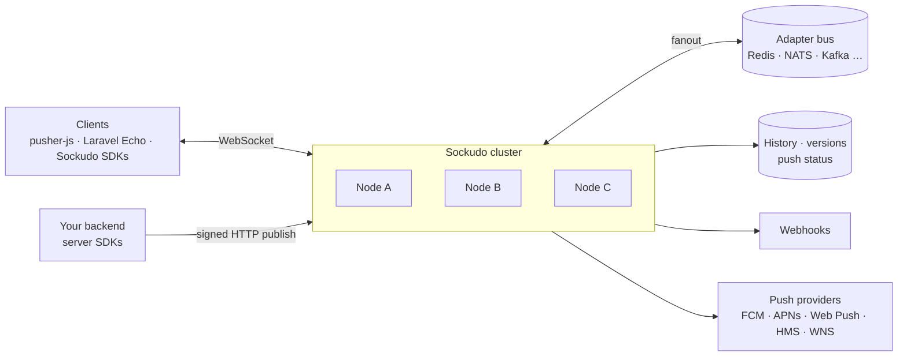

<p align="center">
  <a href="https://sockudo.io">
    
  </a>
</p>

<p align="center">
  A self-hosted, high-performance WebSocket server written in Rust.<br>
  Pusher-compatible at the edge, with recovery, history, mutable messages, push and AI Transport
  when you need them.
</p>

<p align="center">
  <a href="https://github.com/sockudo/sockudo/actions/workflows/ci.yml"></a>
  <a href="https://github.com/sockudo/sockudo/releases/latest"></a>
  <a href="https://crates.io/crates/sockudo"></a>
  <a href="LICENSE"></a>
  <a href="https://github.com/sockudo/sockudo/stargazers"></a>
  <a href="https://discord.gg/ySfNxfh2gZ"></a>
</p>

<p align="center">
  <a href="https://github.com/sockudo/sockudo/releases"></a>
  <a href="https://crates.io/crates/sockudo"></a>
  <a href="https://www.npmjs.com/package/@sockudo/client"></a>
  <a href="https://pypi.org/project/sockudo-python/"></a>
</p>

<p align="center">
  <a href="https://sockudo.io"><b>Website</b></a> ·
  <a href="https://sockudo.io/docs"><b>Documentation</b></a> ·
  <a href="https://sockudo.io/docs/getting-started/installation"><b>Install</b></a> ·
  <a href="https://sockudo.io/docs/getting-started/migration"><b>Migrate from Pusher</b></a> ·
  <a href="https://discord.gg/ySfNxfh2gZ"><b>Discord</b></a>
</p>

<p align="center">
  <sub>
    <a href="#quick-start">Quick start</a> ·
    <a href="#install">Install</a> ·
    <a href="#protocols">Protocols</a> ·
    <a href="#sdks">SDKs</a> ·
    <a href="#ai-transport">AI Transport</a> ·
    <a href="#mcp-for-ai-agents">MCP</a> ·
    <a href="#configuration">Configuration</a> ·
    <a href="#development">Development</a>
  </sub>
</p>

---

## Why Sockudo

- **Keep the clients you already ship.** Protocol V1 is a strict Pusher compatibility target: point
  `pusher-js` or Laravel Echo at Sockudo, keep your channel auth and signed HTTP publishing, and ship.
- **Grow into durable realtime.** Protocol V2 adds serials and message IDs, recovery and rewind,
  durable history, mutable messages, annotations, tag filtering and delta compression, gated so V1
  clients never see them.
- **Scale on infrastructure you run.** Fan out across nodes through Redis, Redis Cluster, NATS, Kafka,
  RabbitMQ, Pulsar, Google Pub/Sub, Apache Iggy or OMQ, with app records in MySQL, PostgreSQL,
  DynamoDB, ScyllaDB or SurrealDB.
- **Operate it like infrastructure.** Prometheus metrics, webhooks, rate limits, readiness probes,
  graceful drains, a Helm chart and an operator dashboard.
- **Build durable AI streams.** Optional AI Transport streams LLM tokens on the same versioned
  messages, history, recovery, presence and push primitives, so a reload or dropped connection
  resumes mid-answer.
- **Official SDKs.** 6 realtime clients and 10 server SDKs, plus the AI Transport SDK, all in this
  monorepo.

## How it works



Your backend publishes once over the signed HTTP API. The adapter fans the event out to every node,
and each node delivers it to its own subscribers. Protocol V2 clients that drop out resume from the
hot replay buffer or durable history. Sockudo fails closed when continuity cannot be proven.

## Quick start

Run a server with a demo app:

```bash
docker run --rm -p 6001:6001 -p 9601:9601 \
  -e HOST=0.0.0.0 \
  -e METRICS_ENABLED=true \
  -e SOCKUDO_DEFAULT_APP_ID=app-id \
  -e SOCKUDO_DEFAULT_APP_KEY=app-key \
  -e SOCKUDO_DEFAULT_APP_SECRET=app-secret \
  ghcr.io/sockudo/sockudo:latest
```

Subscribe from a client:

```ts
import Sockudo from "@sockudo/client";

const client = new Sockudo("app-key", {
  wsHost: "127.0.0.1",
  wsPort: 6001,
  forceTLS: false,
  enabledTransports: ["ws"],
  protocolVersion: 2,
});

client.subscribe("orders").bind("order.created", (order) => {
  console.log("received", order);
});
```

Publish from your backend:

```ts
import Sockudo from "sockudo";

const sockudo = new Sockudo({
  appId: "app-id",
  key: "app-key",
  secret: "app-secret",
  host: "127.0.0.1",
  port: 6001,
  useTLS: false,
});

await sockudo.trigger("orders", "order.created", { id: "ord_123" }, {
  idempotency_key: "order-created-ord_123",
});
```

Already on Pusher? Keep `pusher-js` and change the host:

```ts
const pusher = new Pusher("app-key", { cluster: "local", wsHost: "realtime.example.com", forceTLS: true });
```

Next: the [first connection guide](https://sockudo.io/docs/getting-started/first-connection) and
[authentication](https://sockudo.io/docs/getting-started/authentication) for private and presence
channels.

## Install

**Linux binary.** x86_64 or ARM64, GNU libc or musl, SHA-256 verified, installed to `~/.local/bin`:

```bash
curl --proto '=https' --tlsv1.2 -sSfL https://sockudo.io/install.sh | sh
```

**Docker.** See the [quick start](#quick-start) for a demo app:

```bash
docker run -p 6001:6001 ghcr.io/sockudo/sockudo:latest
```

**Cargo.** Add `--features "redis,postgres,push"` for production backends:

```bash
cargo install sockudo --locked
```

**Helm.** The chart is published at the release version:

```bash
helm install sockudo oci://ghcr.io/sockudo/charts/sockudo --version 5.2.0
```

**From source.** Use `--release --features full` for every integration:

```bash
cargo run -p sockudo
```

### Docker Compose (full local stack)

```bash
git clone https://github.com/sockudo/sockudo.git
cd sockudo
make up
```

| Service | URL |
| --- | --- |
| Sockudo server | `http://localhost:6001` |
| Prometheus metrics | `http://localhost:9601/metrics` |
| Dashboard UI | `http://localhost:5174` |
| Dashboard API | `http://localhost:3460` |

Compose registers its own default app: `demo-app` / `demo-key` / `demo-secret`.

### Kubernetes

A production-shaped install with Redis, ingress, autoscaling and monitoring:

```bash
helm install sockudo oci://ghcr.io/sockudo/charts/sockudo --version 5.2.0 \
  --set config.adapterDriver=redis \
  --set redis.host=redis-master \
  --set redis.existingSecret=my-redis-secret \
  --set defaultApp.existingSecret=my-default-app-secret \
  --set autoscaling.enabled=true \
  --set pdb.enabled=true \
  --set ingress.enabled=true \
  --set serviceMonitor.enabled=true
```

When `defaultApp.existingSecret` is set, the Secret must contain `default-app-secret` and can also
include `default-app-id` and `default-app-key`. To develop the chart itself, install from a checkout
with `helm install sockudo ./charts/sockudo`.

See the [deployment guide](https://sockudo.io/docs/deployment),
[Kubernetes and Helm](https://sockudo.io/docs/deployment/kubernetes) and
[capacity planning](https://sockudo.io/docs/deployment/capacity-planning).

## Protocols

Each connection chooses its protocol. Run V1 and V2 clients side by side on the same server.

| Capability | Protocol V1 | Protocol V2 |
| --- | --- | --- |
| Event prefixes | `pusher:` / `pusher_internal:` | `sockudo:` / `sockudo_internal:` |
| Pusher compatibility | Strict compatibility target | Sockudo-native |
| `serial` and `message_id` | Stripped from delivery | Native on relevant frames |
| Recovery and rewind | Not available | Hot replay plus durable history |
| Mutable messages | Not available | `sockudo:message.*` |
| Annotations | Not available | Native |
| Tag filtering and deltas | Not available | Native |
| AI Transport | Not available | Optional feature and runtime config |

Use Protocol V1 for drop-in Pusher behavior. Use Protocol V2 when clients and server SDKs can rely on
Sockudo-native recovery, history, mutation, annotation, filtering and AI Transport semantics.
Protocol defaults vary by SDK; check each SDK page before assuming V2 is enabled. Read more in
[Protocol V2](https://sockudo.io/docs/clients/protocol-v2) and the
[compatibility reference](https://sockudo.io/docs/reference/compatibility).

## SDKs

### Realtime clients

| Runtime | Package | Docs | Downloads |
| --- | --- | --- | --- |
| JavaScript / TypeScript | `@sockudo/client` | [Guide](https://sockudo.io/docs/clients/javascript) | [](https://www.npmjs.com/package/@sockudo/client) |
| Swift / Apple platforms | `SockudoSwift` via SwiftPM (`https://github.com/sockudo/sockudo-swift`) | [Guide](https://sockudo.io/docs/clients/swift) | — |
| Kotlin / JVM / Android | `io.sockudo:sockudo-kotlin` | [Guide](https://sockudo.io/docs/clients/kotlin) | — |
| Flutter | `sockudo_flutter` | [Guide](https://sockudo.io/docs/clients/flutter) | [](https://pub.dev/packages/sockudo_flutter) |
| .NET | `Sockudo.Client` | [Guide](https://sockudo.io/docs/clients/dotnet) | [](https://www.nuget.org/packages/Sockudo.Client) |
| Python | `sockudo-python` | [Guide](https://sockudo.io/docs/clients/python) | [](https://pypi.org/project/sockudo-python/) |
| AI Transport (TypeScript) | `@sockudo/ai-transport` | [Overview](https://sockudo.io/docs/server/ai-transport-overview) | [](https://www.npmjs.com/package/@sockudo/ai-transport) |

### Server SDKs

Server SDKs publish events, sign private and presence channel auth, authenticate users, validate
webhooks, query channel state, and expose Sockudo-native APIs such as idempotent publishing,
history, mutable messages, annotations and push where implemented.

| Language | Package | Docs | Downloads |
| --- | --- | --- | --- |
| Node.js | `sockudo` | [Guide](https://sockudo.io/docs/server-sdks/node) | [](https://www.npmjs.com/package/sockudo) |
| Python | `sockudo-http-python` | [Guide](https://sockudo.io/docs/server-sdks/python) | [](https://pypi.org/project/sockudo-http-python/) |
| PHP | `sockudo/sockudo-php-server` | [Guide](https://sockudo.io/docs/server-sdks/php) | [](https://packagist.org/packages/sockudo/sockudo-php-server) |
| Laravel | `sockudo/laravel` | [Guide](https://sockudo.io/docs/server-sdks/laravel) | [](https://packagist.org/packages/sockudo/laravel) |
| Ruby | `sockudo` | [Guide](https://sockudo.io/docs/server-sdks/ruby) | [](https://rubygems.org/gems/sockudo) |
| Go | `github.com/sockudo/sockudo/server-sdks/sockudo-http-go/v2` | [Guide](https://sockudo.io/docs/server-sdks/go) | — |
| Rust | `sockudo-http` | [Guide](https://sockudo.io/docs/server-sdks/rust) | [](https://crates.io/crates/sockudo-http) |
| Java | `io.sockudo:sockudo-http-java` | [Guide](https://sockudo.io/docs/server-sdks/java) | — |
| .NET | `SockudoServer` | [Guide](https://sockudo.io/docs/server-sdks/dotnet) | [](https://www.nuget.org/packages/SockudoServer) |
| Swift | `Sockudo` via SwiftPM (`https://github.com/sockudo/sockudo-http-swift`) | [Guide](https://sockudo.io/docs/server-sdks/swift) | — |

Python example:

```python
from sockudo_http import Config, Sockudo

sockudo = Sockudo(
    Config(
        app_id="app-id",
        key="app-key",
        secret="app-secret",
        host="127.0.0.1",
        port=6001,
    )
)

sockudo.trigger("orders", "order.created", {"id": "ord_123"})
```

SDK CI and publishing run from the root workflows. Read the
[2026 SDK publishing runbook](docs/sdk-publishing-2026.md) before releasing packages or changing
registry setup. Registry-native packages publish through protected workflows where supported. Go
modules and SwiftPM publish from this monorepo with package-manager-native tags and manifests;
SwiftPM packages are mirrored to standalone repositories, and the PHP SDK is mirrored to
`sockudo/sockudo-http-php` for Packagist.

## AI Transport

AI Transport is off by default and Protocol V2-only. It streams LLM output as appends to a mutable
message, so history, recovery, webhooks and push see every original mutation, while append rollup
coalesces bursts on WebSocket egress only. Enable it with both the Cargo feature and runtime config:

```bash
cargo build -p sockudo --features "v2,ai-transport,redis,postgres,push"
```

```toml
[versioned_messages]
enabled = true

[history]
enabled = true

[ai_transport]
enabled = true

[[ai_transport.channels]]
prefix = "private-ai-"
```

On the client, `@sockudo/ai-transport` provides React, Vue, Svelte and Vercel AI SDK integrations:

```ts
import { ClientSessionProvider, useView } from "@sockudo/ai-transport/react";
```

Learn more: [AI Transport overview](https://sockudo.io/docs/server/ai-transport-overview),
[conventions](https://sockudo.io/docs/server/ai-transport-conventions),
[token streaming rollup](https://sockudo.io/docs/server/token-streaming-rollup) and the
[production checklist](https://sockudo.io/docs/server/ai-transport-production-checklist).

## MCP for AI agents

Sockudo exposes a Model Context Protocol server so agents can inspect channels, read history and
presence, publish events, mutate versioned messages, manage push and triage incidents through scoped,
audited tools. Build with `--features mcp` and enable `[mcp]` with bearer tokens, or run the
standalone `sockudo-mcp` binary over stdio against any deployment:

```bash
cargo install --path crates/sockudo-mcp --features cli
claude mcp add sockudo -- sockudo-mcp --url https://rt.example.com --app app-1:key:secret
```

See [MCP server](https://sockudo.io/docs/server/mcp).

## Configuration

Sockudo reads TOML and falls back to JSON, and most settings can be overridden with environment
variables.
The local example config is [`config/config.toml`](config/config.toml). A minimal single-node shape:

```toml
port = 6001
host = "0.0.0.0"

[app_manager]
driver = "memory"

[[app_manager.array.apps]]
id = "app-id"
key = "app-key"
secret = "app-secret"
enabled = true

[adapter]
driver = "local"

[cache]
driver = "memory"

[queue]
driver = "memory"
```

| Profile | Adapter | Cache | Queue | App store | Typical use |
| --- | --- | --- | --- | --- | --- |
| Local development | `local` | `memory` | `memory` | `memory` | Fast single-node iteration |
| Small production | `redis` | `redis` | `redis` | `pgsql` or `mysql` | Simple shared state |
| High traffic | `redis-cluster` | `redis-cluster` | external queue | SQL or DynamoDB | Larger fanout and retention |
| AI Transport | horizontal adapter | shared cache | shared queue | shared history and version store | Streaming recovery and rollup |

On horizontal adapters, do not rely on memory history, memory version stores or a process-local
cache. AI Transport startup rejects invalid horizontal/shared-state combinations.

References: [configuration](https://sockudo.io/docs/reference/configuration),
[environment variables](https://sockudo.io/docs/reference/environment-variables),
[HTTP endpoints](https://sockudo.io/docs/reference/http-endpoints),
[scaling](https://sockudo.io/docs/server/scaling),
[security](https://sockudo.io/docs/server/security) and
[observability](https://sockudo.io/docs/server/observability).

## Feature flags

| Feature | Purpose |
| --- | --- |
| `local` | In-memory development defaults |
| `v2` | Protocol V2 bundle: deltas, tag filtering, recovery |
| `delta` | Delta compression |
| `tag-filtering` | Server-side tag filtering |
| `recovery` | Serial and message-id recovery |
| `ai-transport` | AI Transport validation and rollup surfaces |
| `ably-compat` | Opt-in reduced Ably Realtime/REST facade for AI Transport compatibility; implies `ai-transport` |
| `push` | Push notification runtime and HTTP APIs |
| `mcp` | Embedded Model Context Protocol server for AI agents (`/mcp`, scoped bearer tokens) |
| `redis`, `redis-cluster` | Redis-backed adapter, cache, queue and rate-limit paths |
| `nats`, `pulsar`, `rabbitmq`, `google-pubsub`, `kafka`, `iggy` | Horizontal adapter and queue integrations |
| `omq` | Brokerless horizontal adapter integration |
| `mysql`, `postgres`, `dynamodb`, `surrealdb`, `scylladb` | App, history, version-store and push storage backends |
| `sqs`, `sns`, `lambda` | AWS queue, notification and webhook integrations |
| `full` | All production integrations wired by the server |

```bash
cargo build --features "redis,postgres"
cargo build --features "v2,ai-transport,redis,postgres,push"
cargo build --release --features full
```

## Repository layout

This is the Sockudo monorepo: the server, its Rust crates, the dashboard, deployment assets, docs,
and every official SDK.

```text
crates/              Rust server crates and libraries
benches/ai/          Criterion benchmarks for AI hot paths
benches/presence/    Presence performance budgets
client-sdks/         Realtime client SDKs and the AI Transport SDK
server-sdks/         HTTP/server SDKs for backend publishers
dashboard/           Operator API and Vue UI
docs/                Documentation site and specs
config/              Local configuration examples
ops/                 Migrations and operational assets
charts/              Helm chart
tests/               Conformance, dashboard, load and binary fixtures
tools/               Probes, chaos tooling and helper utilities
```

<details>
<summary><b>Server crates</b></summary>

| Crate | Responsibility |
| --- | --- |
| `sockudo-protocol` | Protocol message types, V1/V2 prefixes, extras, wire payloads |
| `sockudo-filter` | Tag filtering expressions and matching |
| `sockudo-core` | Shared traits, config, auth, errors, history, version store, annotations |
| `sockudo-app` | App-manager backends |
| `sockudo-cache` | Cache backends |
| `sockudo-queue` | Queue backends |
| `sockudo-rate-limiter` | Rate limiting and middleware |
| `sockudo-metrics` | Prometheus metrics |
| `sockudo-webhook` | Webhook delivery |
| `sockudo-delta` | Delta compression |
| `sockudo-push` | Push domain, storage, queues, providers, feedback, scheduler |
| `sockudo-ai-transport` | AI Transport validation, rollup and conformance helpers |
| `sockudo-adapter` | Connections, presence, fanout, replay, recovery |
| `sockudo-mcp` | Model Context Protocol server (tools, resources, prompts) and `sockudo-mcp` binary |
| `sockudo-server` | Binary, HTTP/WS routes, bootstrap, durable stores, push API |

The Rust SDK at `server-sdks/sockudo-http-rust` is excluded from the root Cargo workspace so it keeps
its own package and release lifecycle.

</details>

## Development

```bash
cargo fmt --all
cargo test --workspace
cargo clippy --workspace --all-targets -- -D warnings
```

<details>
<summary><b>Focused checks, benchmarks and conformance</b></summary>

Focused server checks:

```bash
cargo test -p sockudo-core
cargo test -p sockudo-adapter
cargo test -p sockudo-ai-transport
cargo test -p sockudo-push
```

Presence correctness and performance gate:

```bash
scripts/presence-bench-guard.sh
```

The gate compares authoritative enter/leave against the former facade-map cycle in the same
Criterion run. It fails if either the single-worker or eight-worker disjoint-client confidence
interval is slower.

AI Transport checks:

```bash
scripts/ai-transport-bench-guard.sh
AIT_CONFORMANCE_OFFLINE=1 scripts/ai-conformance-node.sh
make ably-compat-test
make ably-ai-transport-test
make ably-ai-demo
```

Pinned cross-SDK and released-binary evidence:

```bash
cd sockudo-compatibility
make conformance strict-completeness browser-conformance browser-strict
make go-conformance ait-conformance
# After publishing a tag with detached checksum assets:
SOCKUDO_RELEASE_TAG=vX.Y.Z make release-verify
```

SDK checks run in `SDK CI` and package-locally while iterating. Start from the
[2026 SDK publishing runbook](docs/sdk-publishing-2026.md), then use the native package manager:
`bun`, `pnpm`, `npm`, `pytest`, `cargo`, `go test`, `gradle`, `swift test`, `dotnet test`,
`composer` or `bundle`.

</details>

Docs site:

```bash
cd docs
npm install
npm run dev
npm run types:check
npm run build
```

## Ably compatibility

The opt-in `ably-compat` targets exercise the pinned Ably REST and WebSocket surface, excluding Live
Objects and all non-WebSocket realtime transports, using local Sockudo as the endpoint. The
compatibility runtime lives in `crates/sockudo-ably-compat` and reuses native Sockudo auth, publish,
history, recovery, presence, annotation, stats and push services. Node defaults, browser,
strict-pending and AI Transport are independent evidence lanes; a pass in one is not a pass in
another. The dated release status and scope limits are in the compatibility scorecard under
[`docs/ably-compat/`](docs/ably-compat/) and the reports under `sockudo-compatibility/`. Do not use
these targets to claim full Ably platform compatibility.

Sockudo and this compatibility layer are community-built and community-maintained. They are not
Ably products, and Ably does not provide support for them. Use Sockudo's issue tracker, discussions,
Discord or the other support channels below for help.

## Sponsors

<p align="center">
  <a href="https://swag.live/">
    
  </a>
  <a href="https://livecaller.io/">
    
  </a>
</p>

## Contributing

1. Fork the repository.
2. Create a focused branch.
3. Make the smallest coherent change.
4. Run the relevant checks.
5. Open a pull request describing the behavior change, how you verified it, and any follow-up risk.

For coding-agent work, read [AGENTS.md](AGENTS.md). For a compact technical map of the repo, read
[CLAUDE.md](CLAUDE.md). Documentation lives in [`docs/content/docs`](docs/content/docs); every page on
[sockudo.io](https://sockudo.io/docs) has an "Edit on GitHub" link.

## Community and support

- [Documentation](https://sockudo.io/docs)
- [GitHub Issues](https://github.com/sockudo/sockudo/issues)
- [GitHub Discussions](https://github.com/sockudo/sockudo/discussions)
- [Discord](https://discord.gg/ySfNxfh2gZ)
- [X / Twitter](https://x.com/sockudorealtime)
- [Email](mailto:office@sockudo.io)

If Sockudo saves you time, a ⭐ on GitHub helps more people find it.

<a href="https://star-history.com/#sockudo/sockudo&Date">
  
</a>

## License

Sockudo is licensed under the [MIT License](LICENSE). Individual SDK packages may carry their own
package metadata and notices; check the SDK directory before publishing.
