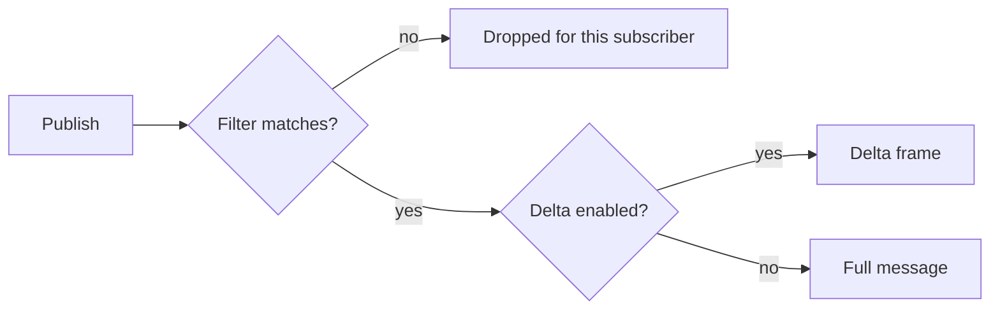

Filters and deltas solve different bandwidth problems:

- **Filters** stop irrelevant messages at the server, so they never reach the client.
- **Deltas** shrink the relevant messages that do arrive, by sending only what changed since a
  base message the client already holds.

Both are Protocol V2 features, negotiated per subscription. Protocol V1 clients on the same server
keep receiving every message in full. Examples on this page use the
[JavaScript SDK](/docs/clients/javascript); the native SDKs expose the same options through their
own subscription types.



## Tag filtering

Tag filtering matches on flat string **tags** that the publisher attaches to each message.

<Steps>

1. Enable predicates on the server with `[tag_filtering] enabled = true`. It is off by default.
2. Publish with a top-level `tags` object of string values.
3. Subscribe from a Protocol V2 client with a filter expression over those tags.

</Steps>

The publisher sets `tags` in the HTTP event body:

```http title="POST /apps/{app_id}/events"
Content-Type: application/json

{
  "name": "tick",
  "channel": "market:btc",
  "data": "{\"price\":67210}",
  "tags": {
    "market": "spot",
    "asset": "BTC",
    "region": "us"
  }
}
```

The client subscribes with a filter built from the `Filter` helper:

```ts title="market.ts"
import { Filter } from "@sockudo/client/filter";

client.subscribe("market:btc", {
  filter: Filter.and(
    Filter.eq("market", "spot"),
    Filter.eq("asset", "BTC"),
  ),
});
```

`[tag_filtering] enable_tags` (default `true`) controls whether the `tags` object is also delivered
to subscribers. Set it to `false` to save bytes when clients only need tags for server-side
matching.

### Compound predicates

Protocol V2 subscriptions can combine event names, tag filters, and a bounded JMESPath expression.
Every supplied component must match:

```ts title="orders.ts"
client.subscribe("orders.*", {
  events: ["order.updated"],
  filter: Filter.eq("region", "eu"),
  expression: 'data.total >= `100` && headers.priority == `"high"`',
});
```

The expression sees a projection of the message: `event`, `channel`, `data`, `name`, `userId`,
`tags`, public `headers`, `messageId`, `streamId`, `serial`, and `action`. Internal `sockudo_`
headers and idempotency keys are never exposed. Predicates compile once at subscribe time, apply
consistently to live fanout, rewind, and recovery, and fail closed on evaluation errors. See
[Subscription predicates](/docs/reference/protocol#subscription-predicates) for the wire shape.

The native .NET, Flutter/Dart, Kotlin, Python, and Swift clients expose the same compound predicate
through their language-specific `SubscriptionOptions` type.

### Supported comparisons

| Comparison | `Filter` helper | Meaning |
| --- | --- | --- |
| `eq`, `neq` | `Filter.eq`, `Filter.neq` | Equality and inequality. |
| `in`, `nin` | `Filter.in`, `Filter.nin` | Membership in a non-empty list of values. |
| `ex`, `nex` | `Filter.exists`, `Filter.notExists` | The tag is present or absent. |
| `sw`, `ew`, `ct` | `Filter.startsWith`, `Filter.endsWith`, `Filter.contains` | String prefix, suffix, and substring. |
| `gt`, `gte`, `lt`, `lte` | `Filter.gt`, `Filter.gte`, `Filter.lt`, `Filter.lte` | Numeric comparisons. Both sides are parsed as numbers. |

Combine comparisons with `Filter.and(...)`, `Filter.or(...)`, and `Filter.not(node)`.

<Callout type="warn" title="Numeric comparisons need numeric tags">
Tag values are strings on the wire. `gt`, `gte`, `lt`, and `lte` parse both the tag value and the
filter value as numbers; if either is not numeric, the comparison is false and the message is not
delivered. Publish numeric tags such as `"total": "100"`, never `"total": "100 EUR"`.
</Callout>

## Delta compression

Delta compression sends a compact diff against a previous message on the same channel (or the same
conflation group) instead of the full payload. The client keeps the base and reconstructs the full
message before your handlers run, so application code receives normal events.

Sockudo supports the Fossil and Xdelta3 (VCDIFF) algorithms. Server-side delta compression is
enabled by default with `fossil`.

In the JavaScript SDK, turn on client reconstruction with the `deltaCompression` option, then tune
each subscription:

```ts title="deltas.ts"
const client = new Sockudo("app-key", {
  wsHost: "127.0.0.1",
  wsPort: 6001,
  forceTLS: false,
  protocolVersion: 2,
  deltaCompression: { enabled: true },
});

client.subscribe("doc:123", {
  delta: {
    enabled: true,
    algorithm: "xdelta3",
  },
});

// Opt a noisy but small-message channel out.
client.subscribe("presence-cursors", { delta: { enabled: false } });
```

<Callout type="warn" title="The client must be able to decode deltas">
A subscription `delta` setting asks the server to send delta frames for that channel. Only a client
constructed with `deltaCompression` decodes them; otherwise they reach the channel as raw
`sockudo:delta` events. Encrypted channels ignore per-subscription delta settings.
</Callout>

<Callout type="info" title="JSON wire format only">
Delta bases are the server's JSON serialization of each message, which a MessagePack or Protobuf
connection never receives and cannot reproduce. On those wire formats the server refuses both
`enable_delta_compression` and per-subscription `delta` settings and answers with
`sockudo:delta_compression_enabled` carrying `{"enabled": false, "reason": "delta compression
requires the JSON wire format"}` (plus `channel` for a subscription); messages arrive in full.
</Callout>

Use deltas when messages are frequent and similar, such as document snapshots, sports state, price
books, or device telemetry. A publisher can force a full message for one publish with
`"delta": false` in the HTTP event body.

### Server settings

| `[delta_compression]` key | Default | Meaning |
| --- | --- | --- |
| `enabled` | `true` | Global switch for delta compression. |
| `algorithm` | `"fossil"` | Default algorithm when a subscription does not choose one. |
| `full_message_interval` | `10` | Send a full message after this many deltas, bounding drift. |
| `min_message_size` | `100` | Messages smaller than this many bytes are always sent in full. |
| `max_state_age_secs` | `300` | A full message is sent when the cached base is older than this. |
| `max_channel_states_per_socket` | `100` | Bound on cached channel states per connection. |
| `conflation_key_path` | not set | Default JSON path used to group messages, see below. |

## Conflation keys

A single channel often carries interleaved updates for many entities, such as every symbol on a
`market` channel. Diffing a BTC update against an ETH update would be wasteful. **Conflation**
groups messages by a key extracted from the payload, so each update is diffed against the previous
message for the same entity.

The key is a JSON path into the message data, configured on the server rather than sent by the
publisher. Set a global default with `[delta_compression] conflation_key_path`, or per channel
pattern in the app policy:

```toml title="config.toml"
[app_manager.array.apps.policy.channels.channel_delta_compression."price:*"]
enabled = true
algorithm = "Fossil"
conflation_key = "item_id"
max_messages_per_key = 10
max_conflation_keys = 100
```

With that policy, these two publishes on `price:spot` are diffed independently because their
`item_id` values differ:

```json
{ "item_id": "BTC", "price": 67210 }
{ "item_id": "ETH", "price": 3150 }
```

`max_messages_per_key` bounds the cached bases per key and `max_conflation_keys` bounds how many
keys a channel tracks.

## Operational guidance

- Start with tag filtering when clients receive too many irrelevant events.
- Add deltas when relevant events are large or highly repetitive.
- Track raw bytes, compressed bytes, reconstruction failures, and resync requests. In JavaScript,
  `client.getDeltaStats()` reports bytes saved per channel and `deltaCompression.onError` surfaces
  reconstruction failures.
- Do not use deltas for tiny messages unless measurements show a real win; `min_message_size`
  already skips the smallest ones.
- Include stable IDs in push payloads instead of attempting delta-style push notifications.

## Next steps

<Cards>
  <Card title="Protocol V2" href="/docs/clients/protocol-v2" description="What V2 adds on the wire and how to enable it." />
  <Card title="JavaScript SDK" href="/docs/clients/javascript" description="Filter and delta options in the JavaScript client." />
  <Card title="Protocol reference" href="/docs/reference/protocol" description="Subscription predicate wire format and broadcast metadata." />
  <Card title="Configuration" href="/docs/reference/configuration" description="Server keys for delta compression and tag filtering." />
</Cards>
