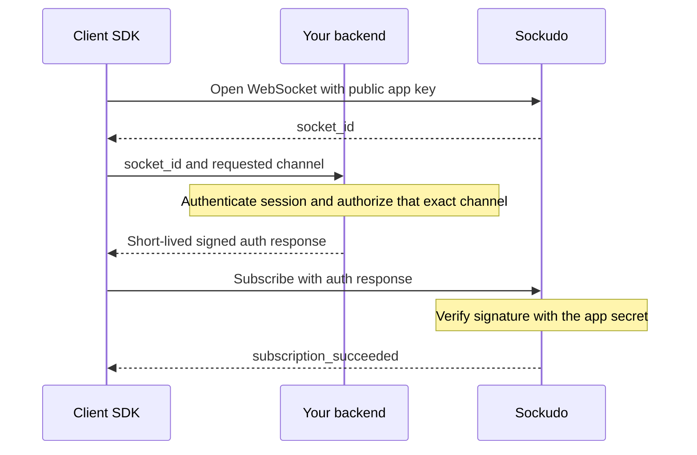

A realtime client SDK holds a long-lived WebSocket connection to Sockudo. Over that one connection it
subscribes to **channels** (named streams of events such as `orders` or `presence-lobby`), delivers
each incoming event to the handlers you bind, reconnects after network failures, and asks your
backend to authorize channels that carry protected data. On Protocol V2 it also exposes Sockudo's
native features: recovery, rewind, filters, deltas, and versioned messages.

Install client SDKs from the package names below. The old per-SDK repositories should be treated as
archived/legacy mirrors.

## Official clients

| SDK | Package | Runtime | Default protocol |
| --- | --- | --- | --- |
| [JavaScript / TypeScript](/docs/clients/javascript) | `@sockudo/client` | Web, Node, worker, React, Vue, React Native, NativeScript | Protocol V1 compatibility |
| [Swift](/docs/clients/swift) | `SockudoSwift` via SwiftPM | iOS, macOS, tvOS, watchOS, visionOS | Protocol V1 compatibility |
| [Kotlin](/docs/clients/kotlin) | `io.sockudo:sockudo-kotlin` | Android and JVM | Protocol V2 |
| [Flutter / Dart](/docs/clients/flutter) | `sockudo_flutter` | Flutter | Protocol V1 compatibility |
| [.NET realtime](/docs/clients/dotnet) | `Sockudo.Client` | .NET apps | Protocol V2 |
| [Python realtime](/docs/clients/python) | `sockudo-python` | Python 3.10+ and asyncio | Protocol V2 |
| [Rust realtime](/docs/clients/rust) | `sockudo-client` | Rust 1.88+ and Tokio | Protocol V2 |

Every SDK page follows the same order: install, connect, subscribe, protected channels, Protocol V2
features, connection lifecycle, error handling, and platform notes.

## Choose a protocol

Sockudo serves two protocols on the same port, chosen per connection:

- **Protocol V1** is byte-compatible with Pusher. Use it when migrating existing Pusher or Laravel
  Echo clients without code changes.
- **Protocol V2** is Sockudo-native. Use it for recovery, rewind, delta compression, tag filters,
  mutable messages, annotations, and native Sockudo metadata.

A backend publishes once; Sockudo strips V2-only fields from deliveries to V1 subscribers. Read
[Protocol V2](/docs/clients/protocol-v2) for the details.

## Clients and servers have different trust levels

The realtime and HTTP SDKs have different trust boundaries. Realtime clients hold only the public
app key and maintain WebSocket subscriptions. Server SDKs hold the app secret, publish over HTTP,
authorize protected subscriptions, and validate webhooks. For Python and .NET in particular, make
sure you choose the package whose role matches your process.

| Language | Realtime package | Trusted HTTP package |
| --- | --- | --- |
| JavaScript / TypeScript | `@sockudo/client` | `sockudo` |
| Python | `sockudo-python` | `sockudo-http-python` |
| Rust | `sockudo-client` | `sockudo-http` |
| .NET | `Sockudo.Client` | `SockudoServer` |
| Swift | `SockudoSwift` | `Sockudo` server package |

### Client responsibilities

Client SDKs should:

- connect with public app key only
- call your backend for private, presence, encrypted, push, and history proxy operations
- keep app secrets out of the client bundle
- bind events and update UI state
- store recovery positions when V2 recovery is enabled
- register devices for push through trusted backend endpoints

<Callout type="warn" title="Nothing secret ships in a client">
A client must never contain the app secret, provider credentials, an encryption master key, or an
unrestricted capability token. Anything in a browser bundle or mobile binary can be extracted.
</Callout>

### Server responsibilities

Server SDKs should:

- publish events over the HTTP API
- sign channel and user authentication responses
- proxy presence history and versioned message reads for clients
- validate webhooks
- manage push registration, credentials, channel push subscriptions, and publish workflows

## Common V2 setup

```ts title="realtime.ts"
const client = new Sockudo("app-key", {
  wsHost: "realtime.example.com",
  forceTLS: true,
  protocolVersion: 2,
  connectionRecovery: true,
});
```

Use this sequence in every client:

<Steps>

1. Construct one long-lived client with your public key and public WebSocket endpoint.
2. Bind connection diagnostics and event handlers.
3. Subscribe to channels, using a backend auth endpoint for protected names.
4. Connect and let the SDK resubscribe after transient failures.
5. If recovery fails, replace derived state from an authoritative snapshot.
6. Unbind or unsubscribe when a screen or worker no longer needs a channel.
7. Disconnect during application shutdown.

</Steps>

## Choosing features

| Requirement | Client setting or API | Backend requirement |
| --- | --- | --- |
| Pusher migration | Protocol V1 | Pusher-compatible app config |
| Resume after a short outage | Protocol V2 recovery | Durable or hot recovery configured |
| Initial backlog | Subscription rewind | History enabled with suitable retention |
| Gap-free late join | History with `until_attach` | Durable history enabled for the channel |
| Lower high-volume bandwidth | Tag filters and delta compression | V2 filtering/delta enabled |
| Private data | Private channel auth | Session-aware auth endpoint |
| End-to-end content encryption | `private-encrypted-*` | Shared-secret auth and key management |
| User-targeted events | User sign-in | User auth endpoint |
| Mobile notifications | Provider token collection | Push registration and publish backend |

## Connection and state model

A successful WebSocket connection does not mean every channel is subscribed. Wait for each
channel's subscription-success event before treating its state as live. During reconnect, keep the
last rendered state but mark it stale. After a successful resume, continue from the recovered
serial; after a failed resume, discard derived state and fetch a fresh snapshot.

<Callout type="tip" title="Write idempotent handlers">
Event handlers should be idempotent. Network reconnects, application retries, and upstream
publishing workflows can all repeat logical work even when the client deduplicates messages by
`message_id`.
</Callout>

## Protected-channel auth flow

Channels named `private-*`, `presence-*`, or `private-encrypted-*` carry data that not every
holder of the public app key may see. Sockudo cannot know who your users are, so it delegates that
decision to your backend: the client asks your auth endpoint to sign a specific socket and channel,
and Sockudo verifies the signature with the app secret before completing the subscription.



Do not implement an auth endpoint that signs every requested channel. Validate tenant ownership,
resource access, and presence identity before signing. For encrypted channels, return only the
derived channel shared secret, not the encryption master key.

Protocol V2 can also authorize the whole connection with a scoped capability token instead of
per-channel signatures. See [Authentication](/docs/getting-started/authentication) for both flows
end to end.

## Production checklist

- Terminate TLS at Sockudo or a load balancer and use `wss://`.
- Keep a single client per app or process unless isolation is intentional.
- Observe connected, unavailable, failed, and reconnecting states.
- Set auth and proxy request timeouts; handle `401`, `403`, and `429` separately from transport
  failures.
- Bound rewind and history page sizes.
- Test a rolling restart, network interruption, auth expiry, and resume failure.
- Unsubscribe and unbind handlers when views or jobs end.

## Push from clients

Mobile and browser clients can collect provider tokens, but they should not call Sockudo push admin
APIs directly. Send provider tokens to your backend, bind them to the authenticated user, and let
the backend call Sockudo.

```ts title="register-device.ts"
await fetch("/api/push/devices", {
  method: "POST",
  headers: { "Content-Type": "application/json" },
  body: JSON.stringify({
    device_id: "browser-device-1",
    platform: "webpush",
    provider_token: subscription,
  }),
});
```

See [Push notifications](/docs/server/push-notifications) for the backend side.

## Next steps

<Cards>
  <Card title="JavaScript" href="/docs/clients/javascript" description="Browser, Node, React, Vue, worker, React Native, and NativeScript examples." />
  <Card title="Swift" href="/docs/clients/swift" description="Apple platforms with auth, recovery, filters, deltas, and push proxy notes." />
  <Card title="Kotlin" href="/docs/clients/kotlin" description="Android and JVM WebSocket client examples." />
  <Card title="Flutter" href="/docs/clients/flutter" description="Flutter client examples with auth, recovery, and push helpers." />
  <Card title=".NET realtime" href="/docs/clients/dotnet" description="Protocol V2 by default for .NET applications." />
  <Card title="Python realtime" href="/docs/clients/python" description="Asyncio client for services, agents, workers, and CLIs." />
  <Card title="Rust realtime" href="/docs/clients/rust" description="Tokio client for high-throughput services, agents, and CLIs." />
  <Card title="Protocol V2" href="/docs/clients/protocol-v2" description="Recovery, history, and native metadata." />
  <Card title="Filters and delta compression" href="/docs/clients/filters-delta" description="Reduce delivered traffic per subscription." />
</Cards>
