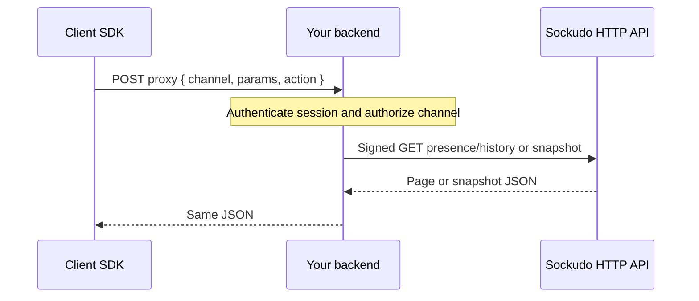

Presence answers two separate questions:

- **Who is subscribed now?** Current presence is live channel state. The server pushes it to every
  member of a `presence-` channel over the WebSocket.
- **What membership transitions happened over time?** Presence history is a durable, retained log
  of joins and leaves. Clients read it on demand over HTTP, through your backend.

The two are deliberately separate. Current membership keeps working even if the durable tier is
unavailable, while history reads fail closed rather than return an incomplete log.

## Current members

Subscribing to a `presence-` channel requires an auth response that includes `channel_data` with a
server-derived `user_id` (see [private and presence channels](/docs/clients/javascript#private-and-presence-channels)).
Once subscribed, the client receives the full member list and then incremental changes:

```ts title="lobby.ts"
const channel = client.subscribe("presence-lobby");

channel.bind("sockudo:subscription_succeeded", (members) => {
  console.log("online:", members.count, "me:", members.me);
  members.each((member) => console.log(member.id, member.info));
});

channel.bind("sockudo:member_added", (member) => console.log("joined", member.id));
channel.bind("sockudo:member_removed", (member) => console.log("left", member.id));
```

Under the default Protocol V1 these events keep their Pusher names: `pusher:subscription_succeeded`,
`pusher:member_added`, and `pusher:member_removed`.

<Callout type="note" title="Membership is per user, not per connection">
A user with several tabs or devices on the same channel is one member. `member_added` fires on the
user's first connection and `member_removed` after their last connection leaves. Presence history
records the same user-level transitions.
</Callout>

## How history reads work

Presence history is served by the signed Sockudo HTTP API, which requires the app secret. Client
SDKs therefore never call it directly. They `POST` to a proxy endpoint on your backend, which checks
the caller's access and forwards a signed request.



The JavaScript SDK sends `{ channel, params, action: "history" }` for history and
`{ channel, params, action: "snapshot" }` for snapshots.

## Read history

Configure the proxy endpoint on the client, then call `history()` on a presence channel:

```ts title="presence-history.ts"
const client = new Sockudo("app-key", {
  wsHost: "127.0.0.1",
  wsPort: 6001,
  forceTLS: false,
  presenceHistory: {
    endpoint: "/sockudo/presence-history",
    headersProvider: () => ({ Authorization: `Bearer ${getSessionToken()}` }),
  },
});

const channel = client.subscribe("presence-lobby");

let page = await channel.history({
  limit: 50,
  direction: "newest_first",
});

for (const item of page.items) {
  console.log(item.serial, item.event, item.cause, item.user_id);
}

while (page.hasNext()) {
  page = await page.next();
}
```

| Parameter | Description |
| --- | --- |
| `direction` | `newest_first` or `oldest_first`. |
| `limit` | Page size, bounded by the server's `max_page_size`. |
| `cursor` | Opaque cursor from a previous page. `next()` passes it for you. |
| `start_serial`, `end_serial` | Serial bounds. |
| `start_time_ms`, `end_time_ms` | Millisecond time bounds. `start` and `end` are accepted aliases. |

Each item carries `stream_id`, `serial`, `published_at_ms`, `event` (`member_added` or
`member_removed`), `cause`, `user_id`, optional `connection_id` and `dead_node_id`, and the original
`presence_event`. Causes include `join`, `disconnect`, `timeout`, `forced_disconnect`, and
`orphan_cleanup`. Every page also returns `continuity` (retained range, `complete`, `degraded`,
`truncated_by_retention`), so you can tell a short history from a truncated one.

## Snapshot

A snapshot reconstructs effective membership at a point in the presence stream, by serial or by
time:

```ts title="snapshot.ts"
const snapshot = await channel.snapshot({ at_serial: 42 });
// or: await channel.snapshot({ at_time_ms: Date.now() - 60_000 });

console.log(snapshot.member_count);
for (const member of snapshot.members) {
  console.log(member.user_id, member.last_event, member.last_event_serial);
}
```

The response includes `members`, `member_count`, `events_replayed`, `snapshot_serial`,
`snapshot_time_ms`, and `continuity`. `at` is accepted as an alias for `at_time_ms`.

## Backend proxy

A minimal proxy with the [Node.js server SDK](/docs/server-sdks/node). It forwards only the two
supported actions, after confirming the caller may see the channel:

```ts title="server/presence-history.ts"
app.post("/sockudo/presence-history", express.json(), async (req, res) => {
  const user = requireSessionUser(req);
  const { channel, params = {}, action } = req.body;

  if (!channel.startsWith("presence-") || !canAccessChannel(user, channel)) {
    return res.status(403).end();
  }

  if (action === "history") {
    return res.json(await sockudo.channelPresenceHistory(channel, params));
  }
  if (action === "snapshot") {
    const response = await sockudo.get({
      path: `/channels/${channel}/presence/history/snapshot`,
      params,
    });
    return res.status(response.status).json(await response.json());
  }
  res.status(400).end();
});
```

The underlying routes are `GET /apps/{appId}/channels/{channelName}/presence/history` and
`GET /apps/{appId}/channels/{channelName}/presence/history/snapshot`; see the
[HTTP endpoint reference](/docs/reference/http-endpoints).

<Callout type="warn" title="Degraded history fails closed">
If the durable presence tier fails, current membership keeps working but the channel is marked
degraded. History reads then return an error until the stream is healthy or explicitly reset; they
never return a partial page as complete. Surface that error instead of retrying in a tight loop.
</Callout>

## Push relationship

Presence is about connected clients. Push registrations are about reachable devices. A user can be
absent from a presence channel and still have a device eligible for push.

Use presence for live collaboration indicators. Use push channel subscriptions for offline
notification eligibility.

## Next steps

<Cards>
  <Card title="JavaScript SDK" href="/docs/clients/javascript" description="Presence channels, auth, and proxy configuration." />
  <Card title="History and recovery" href="/docs/server/history-recovery" description="Server-side presence history, retention, and degraded state." />
  <Card title="HTTP endpoints" href="/docs/reference/http-endpoints" description="Presence history, state, reset, and snapshot routes." />
  <Card title="Push notifications" href="/docs/server/push-notifications" description="Reach users who are not connected." />
</Cards>
