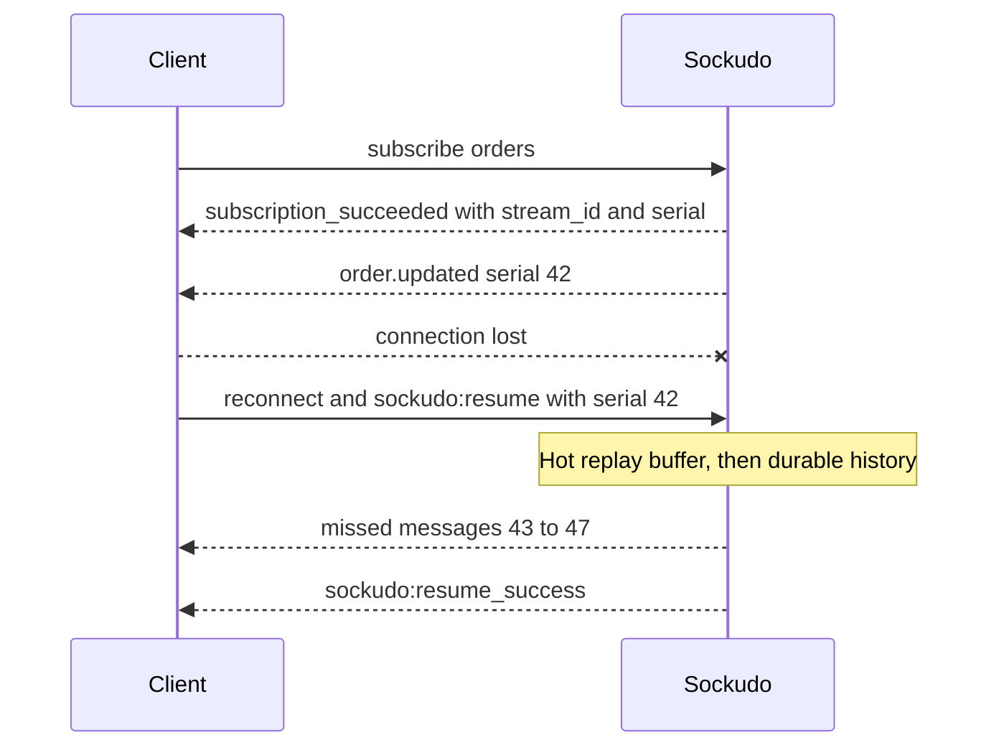

Protocol V2 is Sockudo's native WebSocket protocol. It keeps the familiar channel model
(`subscribe`, `bind`, public/private/presence channels) and adds the metadata and events a client
needs to reason about **continuity**: which messages it has seen, what it missed while offline, and
whether the server can prove the gap was filled.

Sockudo serves both protocols on the same port. A backend publishes once, and Sockudo shapes each
delivery for the subscriber's protocol: Protocol V1 subscribers receive Pusher-compatible frames
with V2-only fields stripped, and V2 subscribers receive the full envelope.

## V1 or V2

| | Protocol V1 | Protocol V2 |
| --- | --- | --- |
| Compatibility | Byte-compatible with Pusher clients | Sockudo-native |
| System event prefixes | `pusher:`, `pusher_internal:` | `sockudo:`, `sockudo_internal:` |
| Message metadata | `event`, `channel`, `data` | Adds `message_id`, `stream_id`, `serial`, `tags`, `extras` |
| After a disconnect | Resubscribe; missed messages are gone | Resume from the last serial when continuity can be proven |
| Rewind, history, filters, deltas | Not available | Available per subscription |
| Mutable messages, annotations | Not exposed | Explicit `sockudo:message.*` and annotation events |
| Wire formats | JSON | JSON, MessagePack, Protobuf |

Use Protocol V1 when migrating existing Pusher or Laravel Echo clients unchanged. Use Protocol V2
for new applications, and for any client that must not silently lose messages across reconnects.

## Enable V2

The protocol is negotiated per connection by the `protocol` query parameter on the WebSocket URL;
only the value `2` selects V2. Each SDK sets it from one option, and the defaults differ:

| SDK | Option | Default |
| --- | --- | --- |
| JavaScript | `protocolVersion: 2` | V1 |
| Swift | `protocolVersion: 2` | V1 |
| Flutter / Dart | `protocolVersion: 2` | V1 |
| Kotlin | `protocolVersion = 2` | V2 |
| .NET | `ProtocolVersion: 2` | V2 |
| Python | `protocol_version=2` | V2 |

```ts title="realtime.ts"
const client = new Sockudo("app-key", {
  wsHost: "127.0.0.1",
  wsPort: 6001,
  forceTLS: false,
  protocolVersion: 2,
  connectionRecovery: true,
});
```

<Callout type="note" title="Server features are opt-in too">
Negotiating V2 unlocks the protocol surface. Each feature also needs its server section enabled:
`[connection_recovery]`, `[history]`, `[presence_history]`, `[versioned_messages]`,
`[annotations]`, `[delta_compression]`, and `[tag_filtering]`. See
[Configuration](/docs/reference/configuration).
</Callout>

## V2 metadata

V2 broadcasts can include:

| Field | Purpose |
| --- | --- |
| `message_id` | Stable broadcast identity for deduplication. |
| `serial` | Monotonically increasing per-channel stream position used for continuity. |
| `stream_id` | Opaque stream identity. Changes only when Sockudo can no longer prove continuity. |
| `tags` | Flat string tags used by [tag filtering](/docs/clients/filters-delta). |
| `extras` | Headers, tags, echo controls, idempotency metadata, and feature-specific data. |

```json
{
  "event": "order.updated",
  "channel": "orders",
  "data": { "id": "ord_123" },
  "message_id": "msg_01HX",
  "stream_id": "orders",
  "serial": 42,
  "extras": { "headers": { "tenant": "acme" } }
}
```

Official clients drop repeated deliveries with the same `message_id`. Treat `serial` as a position
to store, not as an application identifier.

When recovery is enabled, V2 `sockudo_internal:subscription_succeeded` acknowledgements also include
a `stream_id` and `serial`. Store that initial position even if no application events have been
received yet; it lets the client resume an attached but idle channel and receive messages
published during a short disconnect.

Successful V2 subscriptions may include `attach_serial` in `sockudo_internal:subscription_succeeded`
when durable history is enabled for the channel. That value is the channel history head captured at
attach time.

## Native events

Protocol V2 uses `sockudo:` and `sockudo_internal:` prefixes for system events. Protocol V1 keeps
`pusher:` and `pusher_internal:` prefixes. In SDK code this means binding, for example,
`sockudo:subscription_succeeded` instead of `pusher:subscription_succeeded`.

| Event | Scope | Meaning |
| --- | --- | --- |
| `sockudo:subscription_succeeded` | Channel | The subscription is live. |
| `sockudo:subscription_error` | Channel | Raised by the SDK when channel auth fails. |
| `sockudo:member_added`, `sockudo:member_removed` | Presence channel | Membership changed. |
| `sockudo:rewind_complete` | Channel | Subscribe-time rewind finished. |
| `sockudo:resume_success` | Connection | Recovery replayed missed messages. |
| `sockudo:resume_failed` | Connection | Recovery could not prove continuity for a channel. Payload includes `channel`, `code`, `reason`, and the expected and current `stream_id`. |
| `sockudo:channel_history` | Channel | Response to a client history request. |
| `sockudo:message.update`, `.delete`, `.append` | Channel | Mutable-message actions. |

## Recovery contract

With recovery enabled, the client tracks the last `stream_id` and `serial` per channel. When the
connection drops and comes back, it sends those positions and Sockudo decides whether it can
replay the gap.



Recovery is authoritative only when Sockudo returns a successful resume. If the stream reset, the
buffer expired, or continuity cannot be proven, the client must resubscribe and rebuild state.

```ts title="recovery.ts"
client.bind("sockudo:resume_success", (payload) => {
  // payload.recovered: [{ channel, source, replayed, position }]
  console.log("recovered", payload.recovered);
});

client.bind("sockudo:resume_failed", (payload) => {
  // payload: { channel, code, reason, ... }
  console.warn("rebuild state", payload.channel, payload.code);
});
```

Each recovered entry reports its `source` (`hot` for the in-memory replay buffer, `cold` for
durable history), the number of messages `replayed`, and may include an authoritative terminal
`position`. Official clients apply that position even when a subscription predicate suppressed the
recovered tail, so the next resume starts from the canonical channel position.

| `resume_failed` code | Meaning |
| --- | --- |
| `position_expired` | The gap is older than the hot buffer and durable window, or larger than `max_buffer_size`. |
| `stream_reset` | The channel's `stream_id` changed; earlier serials are no longer comparable. |
| `continuity_unverifiable` | The position was ahead, non-contiguous, duplicate, or non-progressing. |
| `persistence_unavailable` | The durable tier could not be read, so continuity cannot be proven. |

When `payload.code === "position_expired"`, resubscribe and use channel history with
`until_attach: true` to backfill up to the new attach serial. Treat every other code the same way:
discard derived state and rebuild from an authoritative source.

<Callout type="warn" title="Never advance past a failed resume">
After `resume_failed`, do not keep applying live events on top of the old state. The client has a
gap it cannot see. Rebuild from history or a snapshot first.
</Callout>

## Client history

V2 clients request channel history over the WebSocket with the existing `channel_history` action:

```json
{
  "event": "sockudo:channel_history",
  "data": {
    "channel": "chat",
    "limit": 100,
    "direction": "backwards",
    "cursor": null,
    "until_attach": true
  }
}
```

The response event is `sockudo:channel_history`. It returns `items`, `has_more`, `next_cursor`,
`bounds`, `continuity`, and `stream_state`. `limit` defaults to `100` and is capped by the
channel's history `max_page_size` and by `1000`. `direction` accepts `newest_first` (alias
`backwards`, the default) or `oldest_first` (alias `forwards`). Serial and time bounds
(`start_serial`, `end_serial`, `start_time_ms`, `end_time_ms`) are also accepted.

`until_attach: true` returns only history at or below the subscription `attach_serial`, so
combining those items with live messages produces a gap-free view without duplicates. The client
must already be subscribed to the channel, and the request fails if no attach serial was recorded.

<Steps>

1. Subscribe and buffer live events as they arrive.
2. On `subscription_succeeded`, request history with `until_attach: true`.
3. Render the history items, following `next_cursor` while `has_more` is true.
4. Apply the buffered live events, then continue live.

</Steps>

## Binary wire data

MessagePack and Protobuf preserve application message data as native bytes:
`byte[]` on .NET, `Uint8List` on Dart, `ByteArray` on Kotlin, `bytes` on Python,
`Data` on Swift, and `Uint8Array` on JavaScript. MessagePack uses the additive
`["binary", <bin>]` tagged data variant; the existing string and JSON variants
remain unchanged. V1 connections always use JSON.

## Heartbeats

Protocol V2 prefers native WebSocket ping/pong frames. Browser-like runtimes may still use
lightweight `sockudo:ping` and `sockudo:pong` fallback messages for liveness checks. Fallback
heartbeat messages are not broadcast continuity events and do not carry `message_id`, `serial`, or
`stream_id`.

## Use cases

Use V2 for:

- collaboration documents that need reconnect continuity
- dashboards that benefit from deltas
- market data streams with tag filters
- chat systems with mutable messages and annotations
- mobile apps combining realtime channels and push notifications
- operators who need history and recovery visibility

## Next steps

<Cards>
  <Card title="Filters and delta compression" href="/docs/clients/filters-delta" description="Cut delivered traffic per subscription." />
  <Card title="Presence history" href="/docs/clients/presence-history" description="Membership transitions and snapshots." />
  <Card title="History and recovery" href="/docs/server/history-recovery" description="Server-side recovery tiers, rewind, and durable history." />
  <Card title="Protocol reference" href="/docs/reference/protocol" description="Every frame, prefix, and compatibility rule." />
</Cards>
