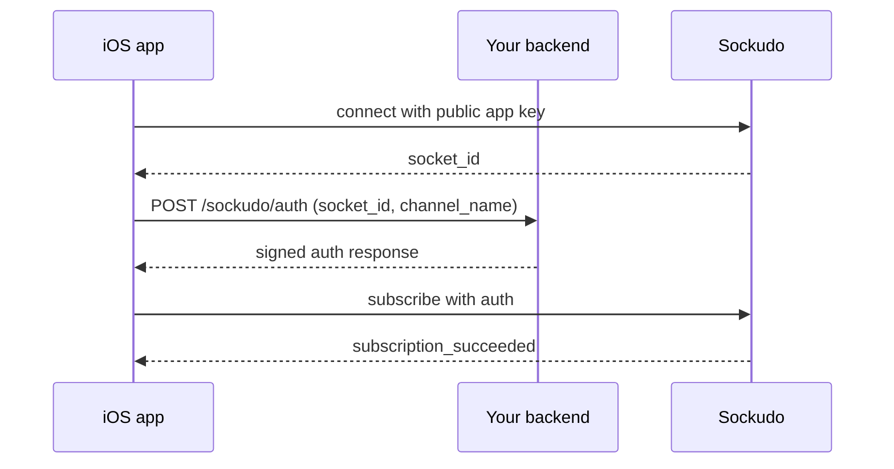

`SockudoSwift` is the official realtime client for Apple platforms. It opens a
WebSocket to Sockudo, subscribes to channels, and delivers events to your
callbacks. It supports public, private, presence, and encrypted channels, user
sign-in, client events, and the Protocol V2 feature set: connection recovery,
rewind, tag filters, delta compression, mutable messages, and proxy-backed
history helpers.

Supported deployment targets are iOS 13+, macOS 10.15+, tvOS 13+, watchOS
6+, and visionOS 1+. The package uses Swift 6.2 concurrency and isolates the
client, channels, and callbacks on `@SockudoActor`.

<Callout type="note" title="Protocol V1 is the default">
`SockudoSwift` starts in Pusher-compatible Protocol V1 mode (`protocol=7`). Set
`protocolVersion: 2` explicitly for new Sockudo applications that need
continuity metadata, recovery, filters, deltas, or any other V2 feature.
</Callout>

## Install

Install through Swift Package Manager from the SockudoSwift mirror. SwiftPM resolves this from
the `v3.0.0` Git tag and the mirror repository's root `Package.swift` manifest.

<Steps>

1. Add the package dependency to `Package.swift`:

   ```swift title="Package.swift"
   .package(url: "https://github.com/sockudo/sockudo-swift", from: "3.0.0")
   ```

2. Depend on the `SockudoSwift` product from your target:

   ```swift title="Package.swift"
   .target(
       name: "YourApp",
       dependencies: [
           .product(name: "SockudoSwift", package: "sockudo-swift"),
       ]
   )
   ```

3. In an Xcode project, add the same URL through **File > Add Package Dependencies** and select
   the `SockudoSwift` library.

</Steps>

For local development against the monorepo, point SwiftPM at the package
directory instead:

```swift title="Package.swift"
.package(path: "../sockudo/client-sdks/sockudo-swift")
```

The package depends on `swift-sodium` for encrypted channels and vendors
xdelta3 for delta decoding; both resolve automatically.

## Connect

A `SockudoClient` owns one WebSocket connection for your app. Over that
connection you subscribe to **channels**: named streams such as
`public-updates` that your backend publishes events to. The client holds only
the public app key; the app secret stays on your server.

```swift title="Realtime.swift"
import SockudoSwift

@SockudoActor
func startRealtime() throws -> SockudoClient {
    let client = try SockudoClient(
        "app-key",
        options: .init(
            cluster: "local",
            protocolVersion: 2,
            forceTLS: false,
            enabledTransports: [.ws],
            wsHost: "127.0.0.1",
            wsPort: 6001,
            wssPort: 6001,
            connectionRecovery: true
        )
    )

    let channel = client.subscribe("public-updates")
    channel.bind("price-updated") { data, _ in
        print(data ?? "")
    }

    client.connect()
    return client
}
```

The function is annotated `@SockudoActor` because every client and channel
method is isolated to that actor. From other contexts, call it with `await`.

For production, point `wsHost` at the public ingress or load balancer
hostname, set `forceTLS: true`, and remove `enabledTransports: [.ws]` so the
client uses the secure transport.

<Callout type="warn" title="Pass options in declaration order">
`SockudoClient.Options` uses a memberwise-style initializer, so Swift requires
labelled arguments in the order they are declared. `protocolVersion` comes
directly after `cluster`, and `connectionRecovery` comes after the auth, history,
and delta options. The table below lists options in declaration order.
</Callout>

### Connection options

| Option | Type | Default | Description |
| --- | --- | --- | --- |
| `cluster` | `String` | required | Cluster name. Must be non-empty. |
| `protocolVersion` | `Int` | `7` | `7` is Protocol V1 (Pusher-compatible); `2` enables Protocol V2. |
| `activityTimeout` | `TimeInterval` | `120` | Idle seconds before the client checks liveness. |
| `forceTLS` | `Bool?` | `nil` | Force `wss://`. Use `true` in production. |
| `enabledTransports` | `[Transport]?` | `nil` | Restrict to `.ws` and/or `.wss`. |
| `wsHost` | `String?` | `nil` | Sockudo hostname. |
| `wsPort` | `Int` | `80` | Port for `ws://`. |
| `wssPort` | `Int` | `443` | Port for `wss://`. |
| `wsPath` | `String` | `""` | Path prefix for the WebSocket URL. |
| `pongTimeout` | `TimeInterval` | `30` | Seconds to wait for a pong. |
| `unavailableTimeout` | `TimeInterval` | `10` | Seconds before a stalled connection is reported `unavailable`. |
| `channelAuthorization` | `ChannelAuthorizationOptions` | endpoint `/sockudo/auth` | Private, presence, and encrypted channel auth. |
| `userAuthentication` | `UserAuthenticationOptions` | endpoint `/sockudo/user-auth` | User sign-in auth. |
| `presenceHistory` | `PresenceHistoryOptions?` | `nil` | Backend proxy for presence history and snapshots. |
| `versionedMessages` | `VersionedMessagesOptions?` | `nil` | Backend proxy for channel history and mutable-message helpers. |
| `capabilityToken` | `CapabilityTokenOptions?` | `nil` | Protocol V2 capability-token auth. |
| `deltaCompression` | `DeltaOptions?` | `nil` | Connection-level delta negotiation. |
| `messageDeduplication` | `Bool` | `true` | Drop repeated `message_id` values. |
| `messageDeduplicationCapacity` | `Int` | `1000` | Size of the deduplication window. |
| `connectionRecovery` | `Bool` | `false` | Track positions and resume after reconnect (V2). |
| `echoMessages` | `Bool` | `true` | Receive your own published messages. |
| `wireFormat` | `SockudoWireFormat` | `.json` | `.json`, `.messagepack`, or `.protobuf` (V2). |
| `appendMode` | `SockudoAppendMode` | `.delta` | `.delta` or `.full` delivery of message appends. |
| `appendRollupWindow` | `Int?` | `nil` | Append rollup window in milliseconds: `0`, `20`, `40`, `100`, or `500`. |
| `maxReconnectAttempts` | `Int?` | `6` | Reconnect attempts before giving up; `nil` is unlimited. |
| `maxReconnectGapInSeconds` | `Double` | `120` | Upper bound on reconnect delay. |
| `reconnectJitter` | `Double` | `0` | Fraction (0 to 1) of each reconnect delay to randomize. |

## Subscribe and bind events

`subscribe(_:options:)` returns a `Channel` immediately; the subscription
completes asynchronously once the socket is connected (and, for protected
channels, once your auth endpoint responds). `bind` attaches a callback for one
event name and returns an `EventBindingToken`.

```swift title="PriceFeed.swift"
@SockudoActor
final class PriceFeed {
    private let client: SockudoClient
    private var channel: Channel?
    private var token: EventBindingToken?

    init(client: SockudoClient) {
        self.client = client
    }

    func start() {
        let channel = client.subscribe("public-updates")
        channel.bind("sockudo:subscription_succeeded") { _, _ in
            print("public-updates is live")
        }
        token = channel.bind("price-updated") { data, _ in
            print("price:", data ?? "")
        }
        self.channel = channel
    }

    func stop() {
        if let token {
            channel?.unbind(eventName: "price-updated", token: token)
        }
        client.unsubscribe("public-updates")
    }
}
```

System events use the protocol prefix: `sockudo:` on Protocol V2 and `pusher:`
on Protocol V1 (for example `pusher:subscription_succeeded`). Use
`bindGlobal` to observe every event name on a channel or client, and
`unbindAll()` only when the owner is being torn down.

### Callbacks run on SockudoActor

Event callbacks execute on the dedicated Sockudo actor, not the main thread,
and in binding order. Hop to `MainActor` for UIKit or SwiftUI state:

```swift
channel.bind("price-updated") { data, _ in
    Task { @MainActor in
        viewModel.latestPrice = String(describing: data)
    }
}
```

From code outside `@SockudoActor`, access client methods with `await`:

```swift
func startRealtime() async {
    await client.connect()
}

func stopRealtime() async {
    await client.unsubscribe("public-updates")
    await client.disconnect()
}
```

### Client events

Private and presence channels can send `client-` prefixed events directly to
other subscribers. `trigger(event:data:)` throws `SockudoError.badEventName`
for any other name:

```swift
_ = try channel.trigger(event: "client-typing", data: ["user": "alice"])
```

Client events triggered while the channel is not yet subscribed are buffered,
up to 50 per channel (oldest dropped on overflow), and replayed after the
subscription succeeds. Unsubscribing clears that buffer.

## Private and presence channels

Anyone with your public app key can open a socket, so Sockudo cannot decide by
itself who may join `private-*`, `presence-*`, or `private-encrypted-*`
channels. Instead, the client sends its `socket_id` and the requested channel
name to **your** backend, which checks the user's session and returns a
signature made with the app secret. Sockudo verifies that signature before
completing the subscription.



```swift title="Realtime.swift"
let client = try SockudoClient(
    "app-key",
    options: .init(
        cluster: "local",
        forceTLS: false,
        wsHost: "127.0.0.1",
        wsPort: 6001,
        channelAuthorization: .init(
            endpoint: "https://api.example.com/sockudo/auth",
            headersProvider: { ["Authorization": "Bearer \(SessionStore.token)"] }
        )
    )
)
```

`ChannelAuthorizationOptions` accepts `endpoint` (default `/sockudo/auth`),
static `headers` and `params`, `headersProvider` and `paramsProvider` closures
evaluated per request, and a `customHandler` when you need to perform the
request yourself. `userAuthentication` has the same shape (default endpoint
`/sockudo/user-auth`) and is used by `client.signIn()` for user-targeted events
and watchlists.

<Callout type="warn" title="Authorize the exact channel">
The backend must authenticate the current user and authorize the exact
`channel_name` before signing. Presence identity must come from the server-side
session, not a value supplied by the app. Never ship the app secret in the
app bundle.
</Callout>

### Presence

Subscribe as `PresenceChannel` to access members and V2 in-place presence
updates:

```swift title="Lobby.swift"
let presence = client.subscribe("presence-agent:session-123") as! PresenceChannel

presence.bind("sockudo:subscription_succeeded") { _, _ in
    print("members:", presence.members.count, "me:", presence.members.myID ?? "")
}
presence.bind("sockudo:member_added") { member, _ in
    print("joined:", member as Any)
}
presence.bind("sockudo:member_removed") { member, _ in
    print("left:", member as Any)
}
presence.bind("sockudo:presence_update") { member, _ in
    print("updated:", member as Any)
}

_ = try presence.update(data: ["status": "thinking"])
```

Wait for the subscription-success event before treating the initial membership
set as authoritative. `presence.members` exposes `count`, `myID`, `me`,
`member(id:)`, and `forEach`. `update(data:)` changes your member data without a
leave/rejoin cycle and throws `SockudoError.unsupportedFeature` on Protocol V1.

### Capability tokens

Protocol V2 also supports scoped capability tokens instead of per-channel
signatures:

```swift title="Realtime.swift"
let client = try SockudoClient(
    "app-key",
    options: .init(
        cluster: "local",
        protocolVersion: 2,
        forceTLS: true,
        wsHost: "realtime.example.com",
        capabilityToken: .init(asyncProvider: {
            try await tokenService.fetchSockudoToken()
        })
    )
)
```

The initial token is sent as the WebSocket `token` query parameter. JWTs with
expiry metadata refresh proactively at 80% of their lifetime, and providers are
called before reconnects. On `sockudo:token_expired`, only expiry code `40142`
refreshes in place through `sockudo:auth`; revocation code `40160` and static
tokens are not resent. Configuring token auth outside Protocol V2 throws
`SockudoError.invalidOptions`.

## Protocol V2 features

The features below require `protocolVersion: 2`. See
[Protocol V2](/docs/clients/protocol-v2) for the wire-level contract.

### Recovery and rewind

With `connectionRecovery: true`, the client records a `RecoveryPosition` per
channel and asks Sockudo to resume from it after a reconnect. `rewind` replays
recent history when a subscription starts.

```swift title="Market.swift"
let channel = client.subscribe(
    "market:BTC",
    options: .init(rewind: .seconds(30))
)

channel.bind("trade") { _, _ in
    print(client.recoveryPosition(for: "market:BTC") as Any)
}

channel.bind("sockudo:rewind_complete") { data, _ in
    print(data as Any)
}

client.bind("sockudo:resume_success") { data, _ in
    print(data as Any)
}

client.bind("sockudo:resume_failed") { data, _ in
    print("rebuild state:", data as Any)
}
```

`SubscriptionRewind` is `.count(n)` or `.seconds(n)`. `recoveryPositions()`
and `setRecoveryPositions(_:)` let you persist positions across app launches.
On `sockudo:resume_failed` the client drops the stored position and
resubscribes; your app must discard derived state and reload an authoritative
snapshot.

### Channel history and late join

`channel.attachSerial` holds the history head captured when the subscription
attached. Load history up to that serial for a gap-free late join. Channel
history is served through the `versionedMessages` backend proxy:

```swift
print(channel.attachSerial as Any)
channel.channelHistory(.init(limit: 50, untilAttach: true)) { result in
    print(result)
}
```

### Filters and deltas

Tag filters, event-name filters, and JMESPath expressions are evaluated on the
server, so non-matching messages never reach the device. Delta compression
sends only the difference against the previous message.

```swift title="Market.swift"
let channel = client.subscribe(
    "price:btc",
    options: .init(
        filter: Filter.eq("market", "spot"),
        delta: .init(enabled: true, algorithm: .xdelta3),
        events: ["price.updated"],
        expression: .source("data.price >= `100`")
    )
)
```

`Filter` provides `eq`, `neq`, `in`, `nin`, `exists`, `notExists`,
`startsWith`, `endsWith`, `contains`, `gt`, `gte`, `lt`, `lte`, `and`, `or`,
and `not`. Delta algorithms are `.fossil` and `.xdelta3`. See
[Filters and delta compression](/docs/clients/filters-delta).

### Mutable messages

Protocol V2 mutable messages arrive as update, delete, and append actions for
an existing `message_serial`. Apply them in serial order:

- an update replaces local content with the full event payload
- a delete is the latest visible version and may carry `nil` data
- an append concatenates onto the current local string state

If an append arrives before you have a string base, fetch the latest visible
message first and seed local state before applying more appends.

Configure `versionedMessages.endpoint` to use proxy-backed write and read
helpers without exposing Sockudo app secrets in the app. The proxy accepts
JSON `{ channel, messageSerial?, action, payload }` and calls Sockudo's signed
REST API server-side. The Swift SDK does not send WebSocket mutation frames.

```swift title="Chat.swift"
let client = try SockudoClient(
    "app-key",
    options: .init(
        cluster: "local",
        protocolVersion: 2,
        forceTLS: false,
        wsHost: "127.0.0.1",
        wsPort: 6001,
        versionedMessages: .init(
            endpoint: "https://api.example.com/sockudo/versioned"
        )
    )
)

let channel = client.subscribe("chat:room-1")
client.connect()

channel.createMessage(
    .init(name: "chat.message", data: ["text": "hello"], messageID: "msg-1")
) { result in
    guard case .success(let ack) = result else { return }
    Task { @SockudoActor in
        channel.appendMessage(
            ack.messageSerial,
            request: .init(data: " world", opID: "append-1")
        ) { result in
            print(result)
        }
    }
}
```

Each helper returns a `VersionedMessageAck` with `messageSerial`,
`versionSerial`, `historySerial`, `deliverySerial`, and `status`.
`updateMessage`, `deleteMessage`, `getMessage`, and `getMessageVersions` follow
the same pattern. Proxy requests time out after 10 seconds.

### Presence history

Presence history and snapshots are also proxy-backed, because a mobile client
must not sign Sockudo REST requests:

```swift title="Lobby.swift"
let client = try SockudoClient(
    "app-key",
    options: .init(
        cluster: "local",
        forceTLS: false,
        wsHost: "127.0.0.1",
        wsPort: 6001,
        presenceHistory: .init(
            endpoint: "https://api.example.com/sockudo/presence-history"
        )
    )
)

let channel = client.subscribe("presence-lobby") as! PresenceChannel
channel.history(.init(direction: "newest_first", limit: 50)) { result in
    print(result)
}
channel.snapshot(.init(atSerial: 4)) { result in
    print(result)
}
```

The proxy accepts `{channel, params, action}`. Authorize the caller and channel
on every request, bound page sizes, and forward opaque cursors unchanged. See
[Presence history](/docs/clients/presence-history).

### Binary wire formats

Set `wireFormat: .messagepack` or `.protobuf` to negotiate a binary encoding.
Both preserve `Data` message payloads as native binary. The MessagePack
representation uses the additive `["binary", <bin>]` tagged value; existing
string and JSON variants are unchanged.

### Encrypted channels

`private-encrypted-*` channels decrypt automatically when the protected-channel
auth response contains a derived `shared_secret`:

```swift
let encrypted = client.subscribe("private-encrypted-documents")
encrypted.bind("doc-updated") { payload, _ in
    print(payload as Any)
}
```

Keep the encryption master key on the backend. Continue to use TLS and normal
channel authorization.

## Connection lifecycle and reconnection

The client moves through the `ConnectionState` values `initialized`,
`connecting`, `connected`, `reconnecting`, `disconnected`, `unavailable`, and
`failed`. Every transition emits `state_change` with `previous` and `current`
keys, followed by an event named after the new state:

```swift
client.bind("state_change") { change, _ in
    print("connection:", change as Any)
}
client.bind("reconnecting") { _, _ in
    print("reconnecting")
}
```

A connected socket can still have a pending or rejected channel. Gate
channel-dependent UI on the channel's `subscription_succeeded` event, not on
the global `connected` state.

Unexpected disconnects reconnect with quadratic backoff: `attempt²` seconds
(0s, 1s, 4s, 9s, 16s, ...) capped by `maxReconnectGapInSeconds` (default 120),
for up to `maxReconnectAttempts` (default 6, `nil` for unlimited). The attempt
counter resets after a successful connection and on explicit `connect()` or
`disconnect()` calls.

```swift title="Realtime.swift"
let client = try SockudoClient(
    "app-key",
    options: .init(
        cluster: "local",
        maxReconnectAttempts: 10,
        maxReconnectGapInSeconds: 60,
        reconnectJitter: 0.5
    )
)
```

Jitter is off by default. Set `reconnectJitter` (0 to 1) to randomize each
delay by that fraction so clients dropped by one event do not retry in
lockstep. Close codes `4200`–`4299` and the TLS-upgrade code `4000` reconnect
immediately; codes `4001`–`4099` are refused and are not retried.

<Callout type="tip" title="Tune reconnects for background apps">
Apply an app-specific reconnect limit for backgrounded mobile processes, and
call `disconnect()` on explicit sign-out rather than letting the retry budget
run out.
</Callout>

## Error handling

- **Construction:** `SockudoClient.init` throws `SockudoError.invalidAppKey`
  for an empty key and `SockudoError.invalidOptions` for an empty cluster,
  token auth without Protocol V2, or an unsupported `appendRollupWindow`.
- **Connection:** bind `"error"` on the client. Payloads include
  `SockudoError` values such as `connectionUnavailable` as well as server
  error events.
- **Subscription:** a failed auth request emits `sockudo:subscription_error`
  (`pusher:subscription_error` on V1) on the channel with `type` and `error`
  keys. Treat it as a permission problem, not a reason to reconnect.
- **Recovery:** on `sockudo:resume_failed`, reload authoritative application
  state.
- **Helpers:** history, versioned-message, and push helpers deliver
  `Result` values; a missing proxy endpoint fails with
  `SockudoError.unsupportedFeature`.

```swift
client.bind("error") { error, _ in
    print("Sockudo error:", error as Any)
}

channel.bind("sockudo:subscription_error") { error, _ in
    print("subscription failed:", error as Any)
}
```

See [Errors](/docs/reference/errors) for server error and close codes.

## Platform notes

### Threading model

Message decoding, deduplication, and delta reconstruction run on a background
`MessageProcessor` actor before events reach `@SockudoActor` for routing and
callback delivery. Neither stage blocks the main thread. Synchronous reads of
client state such as `connectionState` and `socketID` require `await` from
outside `@SockudoActor`.

### Heartbeats

On Protocol V2 the client uses `URLSessionWebSocketTask.sendPing` for native
liveness checks. Lightweight `sockudo:ping` / `sockudo:pong` fallback messages
remain reserved for compatibility and diagnostics and do not carry
`message_id`, `serial`, or `stream_id`.

### Push notifications

Use APNs to obtain a device token, then send it to your backend. Your backend
registers the device with Sockudo and keeps APNs credentials server-side.

```swift title="AppDelegate.swift"
func application(
    _ application: UIApplication,
    didRegisterForRemoteNotificationsWithDeviceToken deviceToken: Data
) {
    let token = deviceToken.map { String(format: "%02x", $0) }.joined()
    Task {
        await registerDeviceWithBackend(
            deviceId: UIDevice.current.identifierForVendor?.uuidString ?? token,
            platform: "apns",
            providerToken: token
        )
    }
}
```

`SockudoPushRegistration` wraps device registration, channel subscription, and
publish calls against **your** authenticated proxy. `publish` and
`publishBatch` always send `sync = false` and expect `202 Accepted` with a
`publish_id`; list helpers use `limit` and `cursor`.

```swift title="Push.swift"
let push = SockudoPushRegistration(
    options: .init(
        endpoint: "https://api.example.com/sockudo/push",
        headers: ["Authorization": "Bearer session-token"]
    )
)

push.publish(
    [
        "recipients": [["type": "channel", "channel": "orders"]],
        "payload": ["title": "Order updated", "body": "Ready for pickup"],
    ]
) { result in
    if case .success(let payload) = result {
        print(payload["publish_id"] as Any)
    }
}
```

### Live Activities

ActivityKit can rotate Live Activity tokens. Observe the token sequence for
the full lifetime of the activity and upload every replacement:

```swift title="LiveActivity.swift"
let tokenTask = SockudoLiveActivityTokens.observePushTokens(for: activity) {
    activityID, token in
    await backend.replaceLiveActivityToken(activityID: activityID, token: token)
}

push.publishLiveActivity(
    activityToken: currentToken,
    payload: .init(
        event: .update,
        contentState: ["etaMinutes": 2],
        priority: .conservePower
    )
) { result in
    print(result)
}
```

`observePushTokens` requires iOS 16.1; `observePushToStartTokens` requires
iOS 17.2. For iOS 18 shared-content audiences, use
`createLiveActivityBroadcastChannel` and `publishLiveActivityBroadcast`.
Broadcast channel management belongs on the trusted backend. See
[Apple Live Activities](/docs/server/apple-live-activities).

<Callout type="warn" title="No credentials in the app">
Do not embed APNs private keys, Sockudo app secrets, or push-admin credentials
in the app. Every push helper must point at your authenticated backend.
</Callout>

### Production checklist

- Use one long-lived client for the app session and disconnect it on explicit
  sign-out.
- Select Protocol V2 deliberately; do not assume the default changed during a
  Pusher migration.
- Move UI mutations from `@SockudoActor` to `MainActor`.
- Apply an app-specific reconnect limit for backgrounded mobile processes.
- Treat failed recovery as a signal to reload authoritative application state.
- Keep auth, history, versioned-message, and push proxy credentials on the
  backend.
- Unbind view-owned callbacks to prevent retained views and duplicate updates.
- Test offline/online transitions, token expiry, app suspension, and a rolling
  Sockudo restart.

## Next steps

<Cards>
  <Card title="Protocol V2" href="/docs/clients/protocol-v2" description="Recovery, rewind, history, and native event semantics." />
  <Card title="Filters and delta compression" href="/docs/clients/filters-delta" description="Cut delivered traffic with server-side filters and deltas." />
  <Card title="Authentication" href="/docs/getting-started/authentication" description="Build the backend auth endpoint for private and presence channels." />
  <Card title="Push notifications" href="/docs/server/push-notifications" description="Register devices and publish through your backend." />
</Cards>
