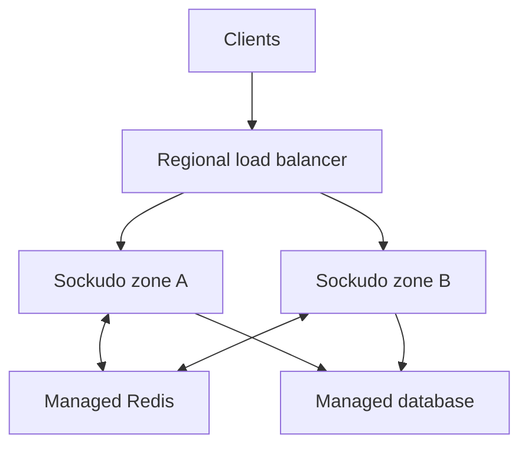

This guide maps the Sockudo deployment model onto AWS, Google Cloud, and Azure: which compute
shape to pick, how to configure the provider's load balancer for WebSockets, and how to tune
managed Kubernetes nodes. Read [Kubernetes and Helm](/docs/deployment/kubernetes) or
[Linux VM and bare metal](/docs/deployment/linux) first; this page adds the provider-specific
parts.

Sockudo uses the same runtime model on every cloud: long-lived client connections at the edge,
shared fanout and coordination between instances, and optional durable stores. Provider services
change the failure modes and tuning controls, not those requirements.



Whatever the provider, the same three questions decide the shape:

1. **How long can a connection stay open?** Managed container platforms often cap request
   duration, which forces periodic reconnects.
2. **Do you control the node?** Kernel sysctls and process file limits are only tunable on VMs and
   self-configured Kubernetes node pools.
3. **Where does shared state live?** Managed Redis and databases should sit in the same region as
   Sockudo, on a private network.

## Platform map

| Need | AWS | Google Cloud | Azure |
| --- | --- | --- | --- |
| Direct VM control | EC2 Auto Scaling group | Compute Engine managed instance group | Virtual Machine Scale Sets |
| Managed Kubernetes | EKS | GKE Standard or Autopilot | AKS |
| Managed containers | ECS, including Fargate | Cloud Run | Azure Container Apps |
| WebSocket ingress | ALB or NLB | External Application Load Balancer | Application Gateway, Load Balancer, or platform ingress |
| Redis-compatible shared state | Managed Redis-compatible service | Memorystore for Redis | Managed Redis-compatible service |
| Relational app/history store | RDS or Aurora | Cloud SQL or AlloyDB | Azure Database for PostgreSQL/MySQL |
| Native fanout option | Redis, MSK, or self-managed NATS | Google Pub/Sub adapter | Redis, Kafka-compatible service, or self-managed NATS |

The table is a starting map, not a requirement to use every managed service. Keep latency-sensitive
dependencies in the same region as Sockudo and test cross-zone or cross-region traffic costs.

## AWS

### Recommended shapes

| Shape | Use when | Notes |
| --- | --- | --- |
| EC2 + ALB/NLB | You need full kernel, `rlimit`, NIC, and process control. | Best match for very high connection density and stable workloads. |
| EKS managed node group | You already operate Kubernetes and need pod-level rollout and placement. | Use a dedicated node pool when tuning or noisy neighbors matter. |
| ECS on EC2 | You want task scheduling with host control. | Set task `ulimits`; tune the EC2 host separately. |
| ECS Fargate | Moderate workloads and low node-operations overhead. | Validate supported `ulimits`, system controls, ENI, and per-task connection density. |

For a regional cluster, put Sockudo targets in at least two Availability Zones. Use one shared
adapter and cache across all replicas. Keep a minimum target count available during deployments.

### Application Load Balancer

Application Load Balancers support WebSockets natively. Their idle timeout defaults to 60 seconds,
which is too close to many heartbeat configurations. Set it deliberately and test through every
proxy layer:

<Steps>

1. Raise the idle timeout above Sockudo's 120-second default `activity_timeout`, with margin:

   ```bash
   aws elbv2 modify-load-balancer-attributes \
     --load-balancer-arn "$SOCKUDO_ALB_ARN" \
     --attributes Key=idle_timeout.timeout_seconds,Value=180
   ```

2. Confirm the attribute:

   ```bash
   aws elbv2 describe-load-balancer-attributes \
     --load-balancer-arn "$SOCKUDO_ALB_ARN" \
     --query "Attributes[?Key=='idle_timeout.timeout_seconds'].Value"
   ```

   The output is `["180"]`.

3. Hold a quiet WebSocket open through the public endpoint for longer than 60 seconds and confirm it
   is not closed by the load balancer.

</Steps>

AWS documents the default, valid range, and keepalive interaction in
[Application Load Balancer attributes](https://docs.aws.amazon.com/elasticloadbalancing/latest/application/edit-load-balancer-attributes.html).
ALB access logs identify `ws` and `wss` requests and are useful for separating target disconnects
from client-side failures.

Configure:

- target health on `/up/<app-id>` (or the capacity-aware `/ready`) and process monitoring on `/live`
- deregistration delay and service termination grace as one drain budget
- security groups that expose the Sockudo port only to the load balancer
- metrics on target connection errors, rejected connections, and 5xx responses

### EKS on Amazon Linux 2023

Amazon EKS managed node groups that use launch templates require MIME multipart user data for
Amazon Linux AMIs. Amazon Linux 2023 uses `nodeadm` and the `application/node.eks.aws` content type.
AWS documents the merge behavior and required self-managed fields in
[Customize managed nodes with launch templates](https://docs.aws.amazon.com/eks/latest/userguide/launch-templates.html).

This example applies a conservative node profile and allows a pod to request the otherwise unsafe
`net.core.somaxconn` sysctl:

```text
MIME-Version: 1.0
Content-Type: multipart/mixed; boundary="SOCKUDO"

--SOCKUDO
Content-Type: text/x-shellscript; charset="us-ascii"

#!/bin/bash
set -o errexit
set -o nounset
set -o pipefail

cat > /etc/sysctl.d/99-sockudo.conf <<'EOF'
net.core.somaxconn = 65535
net.core.netdev_max_backlog = 16384
net.ipv4.tcp_max_syn_backlog = 65535
net.ipv4.tcp_keepalive_time = 600
net.ipv4.tcp_keepalive_intvl = 60
net.ipv4.tcp_keepalive_probes = 5
net.ipv4.tcp_slow_start_after_idle = 0
EOF

sysctl --system

--SOCKUDO
Content-Type: application/node.eks.aws

apiVersion: node.eks.aws/v1alpha1
kind: NodeConfig
spec:
  kubelet:
    config:
      allowedUnsafeSysctls:
        - "net.core.somaxconn"

--SOCKUDO--
```

For a managed node group, EKS merges its bootstrap data with the launch-template user data. For a
self-managed AL2023 group or a custom AMI workflow, include the required `spec.cluster.name`,
`apiServerEndpoint`, base64 certificate authority, and service CIDR described by AWS.

The two parts do different jobs:

- the shell script changes the node-wide baseline
- `allowedUnsafeSysctls` only permits a pod to request that exact sysctl in its own security context

If the pod does not request an unsafe sysctl, the allowlist alone changes nothing. Verify effective
values inside the Sockudo pod.

Do not add `/etc/security/limits.d` to EKS user data expecting it to raise a container's `nofile`.
PAM limits do not control the existing container process. Check `/proc/1/limits` inside the pod and
customize the node runtime only if the effective value is too low.

<Callout type="warn" title="Node configuration changes replace nodes">
Apply this profile to a dedicated, canary node group first. A launch-template or node configuration
change replaces nodes and causes pod movement, and every moved pod disconnects its clients.
</Callout>

### AWS service choices

- a managed Redis-compatible service is the simplest shared adapter, cache, queue, and rate-limit
  authority for most clusters
- RDS or Aurora PostgreSQL/MySQL can hold dynamic apps and supported durable state
- DynamoDB is available for supported app/history/version paths when the matching feature is built
- use private subnets and security groups; broker and database ports should not be public
- use workload identity or instance/task roles instead of long-lived AWS access keys

## Google Cloud

### Recommended shapes

| Shape | Use when | Notes |
| --- | --- | --- |
| Compute Engine managed instance group | Maximum connection density and host control. | Pair with an external load balancer and health checks. |
| GKE Standard | Kubernetes with node-pool and sysctl control. | Best GKE fit for dedicated realtime nodes. |
| GKE Autopilot | Lower cluster operations overhead. | Node configuration is more constrained; verify all required controls. |
| Cloud Run | Moderate connection count with forced reconnect tolerance. | WebSockets are requests with a finite timeout and per-instance concurrency. |

Google Pub/Sub is a supported horizontal adapter, but durable feature coordination still needs the
documented shared cache and stores. Choose it when managed GCP fanout fits the latency and request
pattern; do not assume it replaces every Redis responsibility.

### GKE node system configuration

GKE Standard supports a node system configuration file for kubelet and a defined set of Linux
sysctls. Google warns that changing it recreates nodes and recommends testing with a PodDisruption
Budget. See [Customizing node system configuration](https://cloud.google.com/kubernetes-engine/docs/how-to/node-system-config).

```yaml
kubeletConfig:
  allowedUnsafeSysctls:
    - "net.core.somaxconn"

linuxConfig:
  sysctl:
    net.core.somaxconn: "65535"
    net.core.netdev_max_backlog: "16384"
```

Create a dedicated node pool with the file:

```bash
gcloud container node-pools create sockudo \
  --cluster="$GKE_CLUSTER" \
  --location="$GKE_LOCATION" \
  --system-config-from-file=gke-sockudo-system.yaml
```

GKE accepts only its documented sysctl set and ranges. Check the current provider table before
adding a value. Use an exact unsafe allowlist rather than `net.*`, then set the matching pod sysctl
only when the node baseline is insufficient.

After pods are scheduled on the new pool, verify the effective value inside a pod:

```bash
kubectl exec -n sockudo deploy/sockudo -- cat /proc/sys/net/core/somaxconn
```

Pin Sockudo to the pool with a `nodeSelector` such as `cloud.google.com/gke-nodepool: sockudo` in
the chart values.

### Cloud Run

Cloud Run supports WebSockets, but treats them as long-running HTTP requests. Google currently
documents a request timeout of up to 60 minutes, best-effort session affinity, and up to 1000
concurrent connections per container. See
[Using WebSockets on Cloud Run](https://cloud.google.com/run/docs/triggering/websockets).

<Callout type="warn" title="Every Cloud Run socket is closed at the request timeout">
A WebSocket on Cloud Run ends when its request timeout expires, however healthy it is. With a
60-minute timeout, every client reconnects at least once an hour. Design for it: shared state across
instances and, where continuity matters, Protocol V2 recovery.
</Callout>

For Sockudo that means:

- configure the maximum request timeout and expect forced reconnects
- use a horizontal adapter and shared stores because a reconnect may reach another instance
- enable and test Protocol V2 recovery when continuity matters
- set minimum instances for latency and capacity rather than relying on a cold scale-out
- set maximum concurrency only after measuring memory per socket and burst CPU
- do not enable end-to-end HTTP/2 for the WebSocket service
- account for active WebSocket instances in the billing model

Cloud Run is useful when those constraints are acceptable. GKE Standard or Compute Engine is a
better fit when connections should remain open indefinitely or node-level tuning is required.

### Google Cloud service choices

- Memorystore for Redis can provide shared Redis state close to GKE or Compute Engine
- Cloud SQL or AlloyDB can provide supported relational app and durable stores
- workload identity avoids shipping service-account JSON in images
- place Sockudo, Redis, and database services in compatible regions and private networks
- report load-balancer and Cloud NAT limits separately from pod or VM limits

## Azure

### Recommended shapes

| Shape | Use when | Notes |
| --- | --- | --- |
| Virtual Machine Scale Sets | Full host control and dense, stable sockets. | Configure load balancing, health probes, and rolling upgrades explicitly. |
| AKS | Kubernetes rollout, node pools, identities, and managed control plane. | Use a dedicated Linux node pool for custom OS or kubelet settings. |
| Azure Container Apps | Managed container ingress for moderate workloads. | WebSocket ingress is supported; validate request/idle timeout and scaling behavior. |

Azure Application Gateway and Azure Load Balancer have different layers, health semantics, and
timeout controls. Document the selected path and test a quiet WebSocket through the public endpoint,
not only a busy local client.

### AKS custom node configuration

AKS accepts separate kubelet and Linux OS configuration files when creating a cluster or node pool.
Microsoft documents the supported ranges and notes that unsafe sysctls can affect node security and
stability in [Customize AKS node configuration](https://learn.microsoft.com/azure/aks/custom-node-configuration).

`aks-kubelet.json`:

```json
{
  "allowedUnsafeSysctls": [
    "net.core.somaxconn"
  ]
}
```

`aks-linux-os.json`:

```json
{
  "sysctls": {
    "netCoreSomaxconn": 65535,
    "netCoreNetdevMaxBacklog": 16384,
    "netIpv4TcpMaxSynBacklog": 65535,
    "netIpv4TcpKeepaliveTime": 600,
    "netIpv4TcpKeepaliveIntvl": 60,
    "netIpv4TcpKeepaliveProbes": 5
  }
}
```

Create a dedicated pool:

```bash
az aks nodepool add \
  --resource-group "$AKS_RESOURCE_GROUP" \
  --cluster-name "$AKS_CLUSTER" \
  --name sockudo \
  --kubelet-config ./aks-kubelet.json \
  --linux-os-config ./aks-linux-os.json
```

AKS uses camelCase names in the JSON API even though the documentation tables show kernel names.
Provider defaults can already be high; for example, system-wide file handle ceilings on current
AKS Linux images may not be the limiting `nofile`. Always inspect the process limit inside the pod.

Verify the node pool and the effective values once pods are scheduled on it:

```bash
az aks nodepool show \
  --resource-group "$AKS_RESOURCE_GROUP" \
  --cluster-name "$AKS_CLUSTER" \
  --name sockudo \
  --query "linuxOsConfig.sysctls"
kubectl exec -n sockudo deploy/sockudo -- cat /proc/sys/net/core/somaxconn
```

### Azure Container Apps

Azure Container Apps ingress supports WebSockets. Environment ingress settings can include an idle
request timeout, and the platform owns the underlying nodes. See
[Container Apps ingress](https://learn.microsoft.com/azure/container-apps/ingress-overview) and
[environment ingress configuration](https://learn.microsoft.com/azure/container-apps/ingress-environment-configuration).

Use the same managed-container precautions as Cloud Run:

- shared fanout and coordination from the first multi-replica deployment
- minimum replicas sized for quiet socket capacity
- tested reconnect and recovery behavior
- no dependency on host sysctl or custom container-runtime limits
- explicit ingress idle-timeout validation in the selected environment tier

Use AKS or Virtual Machine Scale Sets when connection density requires host control.

### Azure service choices

- use a managed Redis-compatible service for the common shared adapter/cache path
- Azure Database for PostgreSQL or MySQL can provide supported relational storage
- use managed identities and Key Vault-backed secret delivery instead of static cloud credentials
- use private endpoints or VNet integration for Redis and databases
- watch SNAT/connection tracking for outbound dependencies and load generators

## Other providers

The same decision tree works on DigitalOcean, Hetzner, Oracle Cloud, Fly.io, Render, Railway, or an
on-premises Kubernetes platform:

<Steps>

1. Confirm native WebSocket support and the maximum idle or request duration.
2. Confirm per-instance concurrent connection, file descriptor, bandwidth, and packet limits.
3. Confirm whether you control node sysctls and process `rlimit`.
4. Confirm scale-down and connection-drain semantics.
5. Use a shared adapter before adding a second instance.
6. Keep stateful dependencies close enough for the measured latency budget.
7. Run a quiet-socket soak and reconnect storm, not only a short message-throughput test.

</Steps>

<Callout type="tip" title="Unpublished limits are unknowns, not infinities">
If the provider does not publish a socket or timeout limit, treat it as an unknown to test and
monitor, not as unlimited.
</Callout>

## Production checklist

On any provider, confirm before taking traffic:

- Sockudo runs in at least two zones behind one regional load balancer
- the load balancer idle timeout exceeds the client heartbeat interval, verified with a quiet socket
- target health uses `/up/<app-id>` or `/ready`; process restarts use `/live`
- the Sockudo port accepts traffic only from the load balancer; metrics only from monitoring
- Redis and databases are private, in the same region, and reached through workload identity or
  secrets, not long-lived keys in images
- `ADAPTER_FALLBACK_TO_LOCAL=false` on every replica
- node sysctls and the process `nofile` limit are verified inside a running instance or pod
- deregistration delay plus Sockudo's shutdown grace and drain budgets fit inside the platform's
  termination window

## Next steps

<Cards>
  <Card title="Kubernetes and Helm" href="/docs/deployment/kubernetes" description="Chart values, probes, and drain timing for EKS, GKE, and AKS." />
  <Card title="Capacity planning" href="/docs/deployment/capacity-planning" description="Size instances and run benchmarks from realistic client regions." />
  <Card title="Scaling" href="/docs/server/scaling" description="Choose between Redis, NATS, Google Pub/Sub, and other adapters." />
  <Card title="Security" href="/docs/server/security" description="Network boundaries, secrets, and origin policy." />
</Cards>
