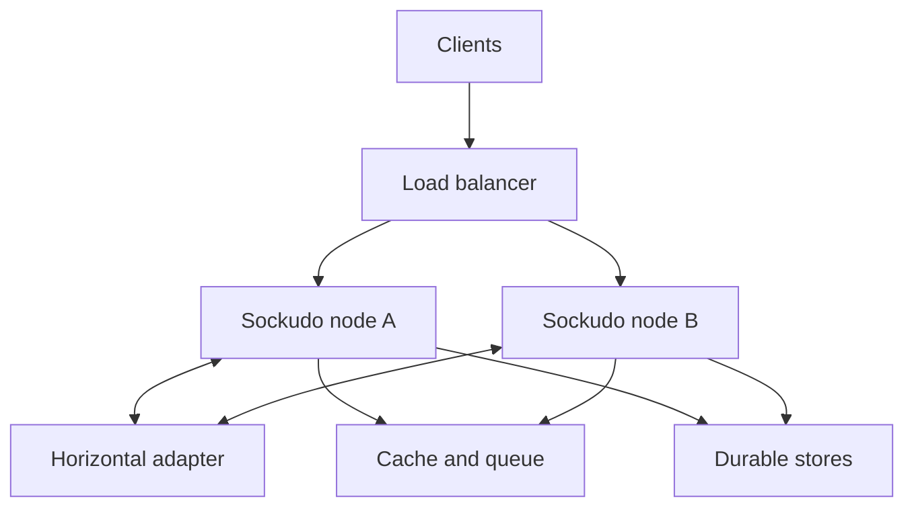

This guide helps you pick a production shape for Sockudo before you pick a platform. It is for
anyone taking Sockudo beyond a laptop, from a first single-container deployment to a multi-zone
cluster. Read it first, then follow the platform guide that matches the topology you choose.

A good Sockudo deployment starts with the failure model, not the platform logo. Decide whether one
process is sufficient, which state must survive a restart, and whether a client may reconnect to a
different node. Those decisions determine the adapter, cache, queue, app manager, and history
backends.

<Cards>
  <Card title="Static configuration" href="/docs/deployment/static-configuration" description="Use TOML or JSON for structure, environment variables for overrides, and secret stores for credentials." />
  <Card title="Linux host" href="/docs/deployment/linux" description="Run a binary under systemd, raise file limits correctly, tune the node, and configure a reverse proxy." />
  <Card title="Docker and Compose" href="/docs/deployment/docker" description="Mount configuration, set container limits, handle secrets, and move from one host to several." />
  <Card title="Kubernetes and Helm" href="/docs/deployment/kubernetes" description="Configure probes, disruption budgets, resources, ingress, autoscaling, and pod or node sysctls." />
  <Card title="Cloud platforms" href="/docs/deployment/cloud-platforms" description="Apply the same architecture on AWS, Google Cloud, and Azure, including managed-node tuning examples." />
  <Card title="Capacity planning" href="/docs/deployment/capacity-planning" description="Budget connections, find the real bottleneck, and run geographically honest benchmarks." />
</Cards>

## How a Sockudo cluster fits together

Each Sockudo node holds the WebSocket connections that landed on it. Everything a node cannot
answer alone goes through a shared backend:

Each backend exists for a different reason, which is why they are configured separately:

| Backend | What it does | Why it must be shared across nodes |
| --- | --- | --- |
| Adapter | Fans a publish out to every node with matching subscribers, and answers cross-node queries such as channel occupancy and presence. | A client on node A must receive an event published through node B. |
| Cache | Holds coordination state such as idempotency keys and cached channel data. | A retried publish can land on a different node and must still be deduplicated. |
| Rate limiter | Counts requests against per-app and per-client limits. | Limits enforced per node multiply by the node count. |
| Queue | Carries webhook and push jobs. | Work enqueued on a node that dies should still be delivered. |
| App manager | Stores app IDs, keys, secrets, and policy. | Every node must agree on which apps exist and what they may do. |
| History and version stores | Persist Protocol V2 history, recovery data, and mutable-message versions. | Recovery and mutations must work when a client reconnects to another node. |

You can mix drivers. A common pattern is a NATS adapter for fanout with Redis for cache, queue,
and rate limits, plus PostgreSQL for apps and history.

## Choose a topology

| Deployment | Good fit | Runtime backends | Main limitation |
| --- | --- | --- | --- |
| One process, memory only | Local development, demos, CI | Local adapter, memory cache, queue, app manager, history | Restart loses process-local state; no failover. |
| One production VM | Small stable workload with a simple operational model | Local adapter; static apps or a durable app manager; optional durable history | The host is one failure domain. |
| Multiple nodes with Redis | Most regional production workloads | Redis adapter, cache, queue, and rate limiter; shared app manager when apps change dynamically | Redis availability and capacity become part of the realtime path. |
| Multiple nodes with NATS | High fanout or high subscription churn | NATS adapter, Redis cache, durable queue and app manager | NATS carries fanout, but coordination and durable features still need shared stores. |
| Durable Protocol V2 cluster | Recovery, history, mutable messages, annotations, AI Transport | Shared adapter and cache plus durable history and version stores | More write amplification and more dependencies to operate. |
| Managed/serverless container platform | Moderate socket counts with platform-managed rollout and scaling | Shared adapter and stores from the first replica | Platform connection duration, concurrency, and node-tuning limits apply. |

Memory drivers are not shared because several processes use identical configuration. Every
multi-node deployment needs a horizontal adapter. Any feature whose correctness crosses nodes also
needs its documented shared authority.

<Callout type="warn" title="Disable the local adapter fallback in clusters">
`adapter.fallback_to_local` defaults to `true`. If the configured horizontal adapter cannot be
initialized at startup, the node logs a warning and runs with the local adapter instead. In a
cluster that silently splits clients into isolated islands that never see each other's events. Set
`fallback_to_local = false` (or `ADAPTER_FALLBACK_TO_LOCAL=false`) on every multi-node deployment
so a broken adapter fails startup instead.
</Callout>

See [Scaling](/docs/server/scaling) for the cross-node semantics of each adapter.

## Recommended production baseline

A conventional regional cluster has:

- at least two Sockudo instances spread across failure domains
- a load balancer that supports WebSocket upgrades and has a deliberate idle timeout
- Redis or another supported horizontal adapter
- a shared Redis or Redis Cluster cache for coordination, idempotency, and distributed rate limits
- durable app storage if app records change at runtime
- a durable queue when webhook or push work must survive a node failure
- durable history and version storage when Protocol V2 recovery or mutable state must cross nodes
- metrics, structured logs, readiness checks, and a tested drain path

Sticky sessions are not required for basic pub/sub. With a shared adapter, any node can serve any
client. They can still reduce reconnect churn, but a Protocol V2 reconnect to a different node
recovers only when the replay state is available through a shared backend. Start with
[Scaling](/docs/server/scaling) for cross-node semantics and [Security](/docs/server/security) for
network and secret boundaries.

## Configuration strategy

Use three layers with distinct responsibilities:

1. Put stable structure in a version-controlled TOML or JSON file: enabled features, driver choices,
   limits, queue reliability, history retention, and per-app policy.
2. Put environment-specific addresses and non-secret switches in deployment variables or a
   generated config file.
3. Inject app secrets, database passwords, broker credentials, and provider keys from the
   platform's secret store.

The split keeps reviews meaningful: a pull request that changes a driver or a limit is visible in
Git, while credentials rotate without a code change and never appear in the repository.

Sockudo does not treat environment variables as a complete alternative syntax for every nested
configuration field. Complex policy and multi-app definitions belong in a file or persistent app
manager. Config files can reference environment variables with `${VAR}` placeholders when a nested
value must come from the environment. See [Static configuration](/docs/deployment/static-configuration)
for exact precedence and equivalent TOML and JSON examples.

## Workload questions to answer first

Document these inputs before choosing instance sizes:

| Input | Why it matters |
| --- | --- |
| Peak concurrent sockets and reconnect surge | Sets file descriptor, memory, load-balancer, and admission budgets. |
| Messages per second and average payload | Sets CPU, network, adapter, and serialization load. |
| Subscribers per publish | Distinguishes ingest throughput from fanout throughput. |
| Public, private, and presence mix | Adds authentication, membership, and transition work. |
| Subscription churn | Can dominate otherwise quiet chat or room workloads. |
| Protocol V1 or V2 features | Recovery, deltas, filtering, history, and mutations change state and compute costs. |
| Retention and recovery objectives | Selects memory buffers versus durable stores. |
| Client geography | Changes handshake time, RTT, reconnect behavior, and apparent benchmark throughput. |

[Capacity planning](/docs/deployment/capacity-planning) turns these answers into per-node limits.

## Rollout sequence

<Steps>

1. Build or pin one exact Sockudo image or binary version and the required Cargo features.
   Verify with `sockudo --version`, which prints the version, for example `sockudo 5.2.0`.
2. Validate the resolved config in staging. Startup must log `explicit configuration applied` and
   `applied environment variable overrides`, and `curl -fsS http://<node>:6001/up/<app-id>` must
   print `OK`.
3. Load test from realistic client regions and confirm the load generators are not saturated.
4. Set a per-node `SOCKUDO_MAX_CONNECTIONS` below the measured safe ceiling. Above 95% of that
   value, `/ready` returns `503 CAPACITY` so a load balancer can stop routing new clients.
5. Deploy at minimum capacity before enabling autoscaling.
6. Remove a node while traffic is active and verify that its clients reconnect elsewhere and that
   recovery succeeds.
7. Fail or pause each shared dependency and verify readiness, alerts, and backpressure.
8. Roll in small batches while watching connection churn, adapter errors, and recovery failures.

</Steps>

## Production gate

Do not call a deployment ready until all of these are true:

- `/live` is used for liveness and startup checks
- `/up`, `/up/<app-id>`, or the capacity-aware `/ready` is used for readiness
- the load balancer idle timeout and Sockudo heartbeat behavior have been tested together
- file descriptor limits have been checked in the actual process or container
- credentials are absent from images, ConfigMaps, command lines, and logs
- every replica has a unique `INSTANCE_PROCESS_ID`, stable across restarts when logs, metrics, or
  Iggy consumers depend on it
- `adapter.fallback_to_local` is `false` on every multi-node deployment
- multi-node drivers and feature flags pass Sockudo startup validation
- termination grace exceeds Sockudo's shutdown grace period plus its drain budgets
- load testing includes connect, steady-state, fanout, churn, and reconnect phases
- dashboards distinguish a Sockudo bottleneck from the load generator, load balancer, NAT, or broker

<Callout type="note" title="Why not use /up for liveness">
`/up` checks the app manager, adapter, cache, and queue. If a liveness probe uses it, a slow Redis
makes the orchestrator restart every healthy Sockudo process at once, and every client reconnects
into the same slow Redis. `/live` answers only whether the process is running.
</Callout>

## Next steps

<Cards>
  <Card title="Static configuration" href="/docs/deployment/static-configuration" description="Learn the exact loading order, environment overrides, and placeholder substitution." />
  <Card title="Scaling" href="/docs/server/scaling" description="Understand adapters, duplicate delivery, recovery across nodes, and rolling deploys." />
  <Card title="Capacity planning" href="/docs/deployment/capacity-planning" description="Turn workload numbers into per-node connection limits." />
  <Card title="HTTP endpoints" href="/docs/reference/http-endpoints" description="Reference for /live, /up, /ready, /accept-traffic, and /metrics." />
</Cards>
