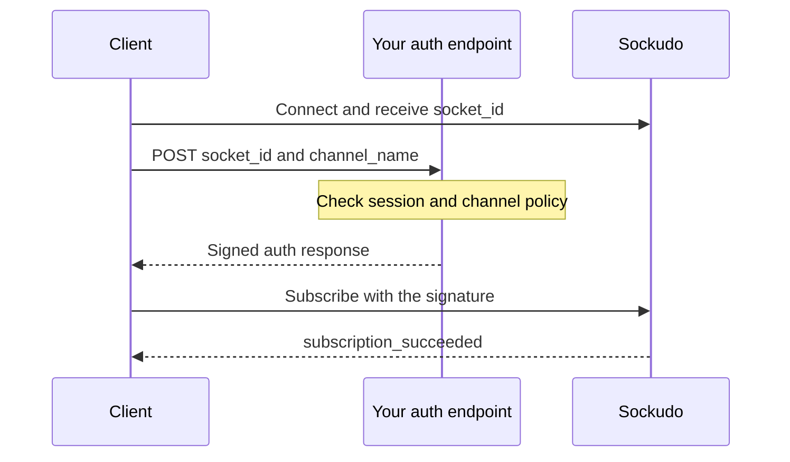

Sockudo never trusts client-provided access to protected channels. Clients request a subscription, your application server decides whether the user is allowed, then the server returns a signed response. This page covers every way your backend grants access, from Pusher-compatible channel authorization to Protocol V2 capability tokens. You need it as soon as you use a channel whose name starts with `private-` or `presence-`, or when you want Sockudo to know which user owns a connection.

## Who holds which credential

Every app has three credentials, and where they live is the foundation of Sockudo's security model:

| Credential | Visible to clients | Used for |
| --- | --- | --- |
| App ID | Yes | Identifies the app in HTTP API paths such as `/apps/app-id/events`. |
| App key | Yes | Identifies the app on the WebSocket URL. Shipping it in browser and mobile code is expected. |
| App secret | **Never** | Signs channel authorization, user authentication, capability tokens, HTTP API requests, and webhooks. |

Anything signed with the secret proves that your backend approved it. That is why every mechanism below runs on a server you control.

| Mechanism | Use it when | Protocol |
| --- | --- | --- |
| [Channel authorization](#channel-authorization-flow) | A client subscribes to a `private-`, `presence-`, or `private-encrypted-` channel. | V1 and V2 |
| [User authentication](#user-authentication) | You want Sockudo to know which user owns a connection, for user-targeted events and watchlists. | V1 and V2 |
| [Capability tokens](#protocol-v2-capability-tokens) | A V2 client should carry a short-lived, scoped grant for the whole connection. | V2 only |
| HTTP API signing | Your backend publishes or queries the HTTP API. Server SDKs do this for you. | Both |

## Channel authorization flow

1. Client subscribes to `private-orders` or `presence-room`.
2. The client SDK sends `socket_id` and `channel_name` to your auth endpoint.
3. Your backend validates the current user and channel policy.
4. A server SDK signs the response using the app secret.
5. Sockudo validates the signature and completes the subscription.



The signature covers the exact `socket_id` and `channel_name`, plus the presence `channel_data` when present. A signature for one connection or channel cannot be replayed on another.

## Set up channel authorization

<Steps>

1. Add an auth endpoint to your backend that authenticates the user and signs the subscription with a server SDK.
2. Point the client's `channelAuthorization.endpoint` at it. The `@sockudo/client` default is `/sockudo/auth`.
3. Subscribe to a `private-` or `presence-` channel and confirm the subscription succeeds.

</Steps>

## Node.js auth endpoint

The client SDK sends the auth request as an HTML form post (`application/x-www-form-urlencoded`), so parse URL-encoded bodies. `requireUser` and `canAccessChannel` stand in for your own session lookup and authorization rules.

```ts title="auth-server.ts"
import express from "express";
import Sockudo from "sockudo";

const app = express();
app.use(express.urlencoded({ extended: false }));

const sockudo = new Sockudo({
  appId: process.env.SOCKUDO_APP_ID!,
  key: process.env.SOCKUDO_APP_KEY!,
  secret: process.env.SOCKUDO_APP_SECRET!,
  host: "127.0.0.1",
  port: 6001,
  useTLS: false,
});

app.post("/sockudo/auth", (req, res) => {
  const { socket_id, channel_name } = req.body;
  const user = requireUser(req);

  if (!canAccessChannel(user, channel_name)) {
    return res.status(403).json({ error: "Forbidden" });
  }

  if (channel_name.startsWith("presence-")) {
    return res.json(
      sockudo.authorizeChannel(socket_id, channel_name, {
        user_id: user.id,
        user_info: { name: user.name, role: user.role },
      }),
    );
  }

  return res.json(sockudo.authorizeChannel(socket_id, channel_name));
});
```

`authorizeChannel` returns a different shape depending on the channel type:

| Channel | Response body |
| --- | --- |
| `private-` | `{ "auth": "app-key:<signature>" }` |
| `presence-` | `{ "auth": "...", "channel_data": "<JSON string with user_id and user_info>" }` |
| `private-encrypted-` | `{ "auth": "...", "shared_secret": "<base64 key>" }` |

For presence channels, `user_id` identifies the member, and `user_info` is shown to every other member of the channel.

## Client configuration

```ts title="client.ts"
import Sockudo from "@sockudo/client";

const client = new Sockudo("app-key", {
  wsHost: "127.0.0.1",
  wsPort: 6001,
  forceTLS: false,
  channelAuthorization: {
    endpoint: "/sockudo/auth",
  },
});

client.subscribe("private-orders");
```

`channelAuthorization` also accepts `headers` and `headersProvider` when your endpoint expects a bearer token instead of a session cookie.

<Callout type="tip" title="Moving from pusher-js?">
`@sockudo/client` posts to `/sockudo/auth` by default. If your backend still serves the endpoint your Pusher client used, set `channelAuthorization.endpoint` explicitly.
</Callout>

## User authentication

User authentication signs a connection identity. It powers watchlists and user-targeted server events. The client calls `client.signin()`, which posts the `socket_id` to your user-auth endpoint (default `/sockudo/user-auth`):

```ts
app.post("/sockudo/user-auth", (req, res) => {
  const user = requireUser(req);

  res.json(
    sockudo.authenticateUser(req.body.socket_id, {
      id: user.id,
      user_info: { name: user.name },
    }),
  );
});
```

The response contains `auth` and `user_data`. Once a connection is signed in, your backend can reach every connection of that user, for example with `sockudo.sendToUser(userId, event, data)`.

User authentication is off unless the app enables it, either with `enable_user_authentication = true` under the app's `policy.features` or with `SOCKUDO_DEFAULT_APP_ENABLE_USER_AUTHENTICATION=true` for an app defined through environment variables.

<Callout type="warn" title="Sign in before the timeout">
When user authentication is enabled for an app, Sockudo closes any connection that has not signed in within `user_authentication_timeout` seconds (default `3600`) with close code `4009`. Call `client.signin()` right after connecting on every client of that app.
</Callout>

## Protocol V2 capability tokens

Protocol V2 clients may authenticate the WebSocket connection with a short-lived capability token: a JWT, signed with the app secret, that lists which channels the connection may use and for which operations. Instead of one auth round trip per channel, the client presents one token for the whole connection and refreshes it before it expires.

Configure the client with `authUrl` (or an `authCallback` function for full control over the request):

```ts title="client.ts"
const client = new Sockudo("app-key", {
  wsHost: "127.0.0.1",
  wsPort: 6001,
  forceTLS: false,
  protocolVersion: 2,
  authUrl: "/sockudo/token",
});
```

The client sends a JSON `POST` to `authUrl` with `socket_id` and `reason` (`initial`, `reconnect`, `refresh`, or `expired`), and expects either a token string or an object with a `token` field in response.

<Callout type="note" title="V2 only">
The client rejects `token`, `authUrl`, and `authCallback` at construction unless `protocolVersion` is `2`.
</Callout>

Your backend issues the JWT after authenticating the user. Never ship the app secret to browsers, mobile apps, or untrusted clients.

Node.js example:

```ts title="token-endpoint.ts"
import jwt from "jsonwebtoken";
import crypto from "node:crypto";

app.post("/sockudo/token", express.json(), (req, res) => {
  const user = requireUser(req);
  const now = Math.floor(Date.now() / 1000);

  const capability = {
    "private-orders:*": ["subscribe", "history"],
    "presence-orders:*": ["subscribe", "presence"],
    "private-orders:input": ["publish"],
  };

  const token = jwt.sign(
    {
      "x-sockudo-capability": JSON.stringify(capability),
      "x-sockudo-client-id": user.id,
      iat: now,
      exp: now + 3600,
      jti: crypto.randomUUID(),
    },
    process.env.SOCKUDO_APP_SECRET!,
    {
      algorithm: "HS256",
      header: { kid: process.env.SOCKUDO_APP_KEY! },
    },
  );

  res.json({ token });
});
```

Rust example:

```rust
use jsonwebtoken::{encode, Algorithm, EncodingKey, Header};
use serde::Serialize;
use std::collections::BTreeMap;

#[derive(Serialize)]
struct Claims {
    #[serde(rename = "x-sockudo-capability")]
    capability: String,
    #[serde(rename = "x-sockudo-client-id")]
    client_id: String,
    iat: i64,
    exp: i64,
    jti: String,
}

fn issue_token(app_key: &str, app_secret: &str, client_id: &str) -> anyhow::Result<String> {
    let now = chrono::Utc::now().timestamp();
    let mut capability = BTreeMap::new();
    capability.insert("private-orders:*", vec!["subscribe", "history"]);

    let mut header = Header::new(Algorithm::HS256);
    header.kid = Some(app_key.to_owned());

    Ok(encode(
        &header,
        &Claims {
            capability: serde_json::to_string(&capability)?,
            client_id: client_id.to_owned(),
            iat: now,
            exp: now + 3600,
            jti: uuid::Uuid::new_v4().to_string(),
        },
        &EncodingKey::from_secret(app_secret.as_bytes()),
    )?)
}
```

Token rules:

- Header `kid` must equal the Sockudo app key and `alg` must be `HS256`.
- `x-sockudo-capability` is a JSON map from channel pattern to operations; its stringified form is
  accepted for compatibility.
- Operations include `publish`, `subscribe`, `history`, and `presence`; AI Transport also accepts
  the explicit annotation, message-mutation, and push operations documented in
  [AI Transport authentication](/docs/server/ai-transport-authentication).
- Patterns are exact names, namespace prefixes such as `orders:*`, or `*`; matching is case-sensitive.
- `x-sockudo-client-id` is the verified identity used for presence and user-limited channels.
- `iat`, `exp`, and `jti` are required. Tokens may live at most 24 hours; 1 hour or less is recommended.
- Clients refresh in place with `sockudo:auth` carrying `{ "token": "..." }`. Expired tokens emit `sockudo:token_expired` with code `40142` and close after a 30 second grace window.

| Limit | Value |
| --- | --- |
| Token size | 8 KiB |
| Channel patterns per token | 100 |
| `x-sockudo-client-id` and `jti` length | 1 to 128 bytes |
| Maximum lifetime (`exp` minus `iat`) | 24 hours |
| Clock skew tolerated on `iat`, `exp`, and the optional `nbf` | 30 seconds |

`@sockudo/client` refreshes provider-backed tokens automatically at 80% of their lifetime, so a client configured with `authUrl` or `authCallback` keeps its connection without interruption. To cut access before a token expires, revoke it by `jti` or `client_id` with `POST /apps/{appId}/revocations`; see [Security](/docs/server/security).

## Encrypted channels

Encrypted channels start with `private-encrypted-`. Payloads are encrypted end to end: Sockudo relays ciphertext and never sees the key. Your backend holds a 32-byte encryption master key, and when it signs a subscription it returns a per-channel shared secret derived from that key.

Generate a master key once and store it with your other secrets:

```bash
openssl rand -base64 32
```

Pass it to the server SDK:

```ts
const sockudo = new Sockudo({
  appId: "app-id",
  key: "app-key",
  secret: "app-secret",
  host: "127.0.0.1",
  port: 6001,
  encryptionMasterKeyBase64: process.env.SOCKUDO_ENCRYPTION_MASTER_KEY!,
});
```

The same SDK instance encrypts the payload when you `trigger` to an encrypted channel. An encrypted publish must target a single channel; the Node SDK rejects a multi-channel trigger that includes one.

Clients must use the encryption-capable build of the SDK to decrypt payloads:

```ts
import Sockudo from "@sockudo/client/with-encryption";
```

Keep the master key outside the browser. Client SDKs only receive the derived shared secret for authorized encrypted channels.

## Push authorization boundary

Push registration and push publish helpers are also authentication boundaries. Mobile and browser clients should call your backend proxy, not Sockudo directly with app secrets.

```ts
app.post("/sockudo/push", async (req, res) => {
  const user = requireUser(req);
  await assertDeviceBelongsToUser(user, req.body.device_id);

  const response = await sockudo.publishPush({
    recipients: [{ type: "client", client_id: user.id }],
    payload: req.body.payload,
  });

  res.status(202).json(response);
});
```

## Security checklist

- Read `socket_id` and `channel_name` from the request body; do not accept them from query parameters unless your framework requires it.
- Authenticate the user before signing anything.
- Enforce channel ownership and tenant boundaries before calling the SDK signing helper.
- Return presence user data that is safe for all channel members to see.
- Keep app secrets, webhook secrets, push provider credentials, and encryption master keys server-side only.
- Issue capability tokens from a backend endpoint only; do not mint them in client code.
- Use short request timeouts and structured audit logs for denied auth attempts.

## Next steps

<Cards>
  <Card title="Security" href="/docs/server/security" description="Origin checks, rate limits, token revocation, and hardening." />
  <Card title="Server SDKs" href="/docs/server-sdks" description="Channel auth and user auth helpers in every supported language." />
  <Card title="Troubleshooting" href="/docs/getting-started/troubleshooting" description="Diagnose rejected subscriptions and signature mismatches." />
</Cards>
