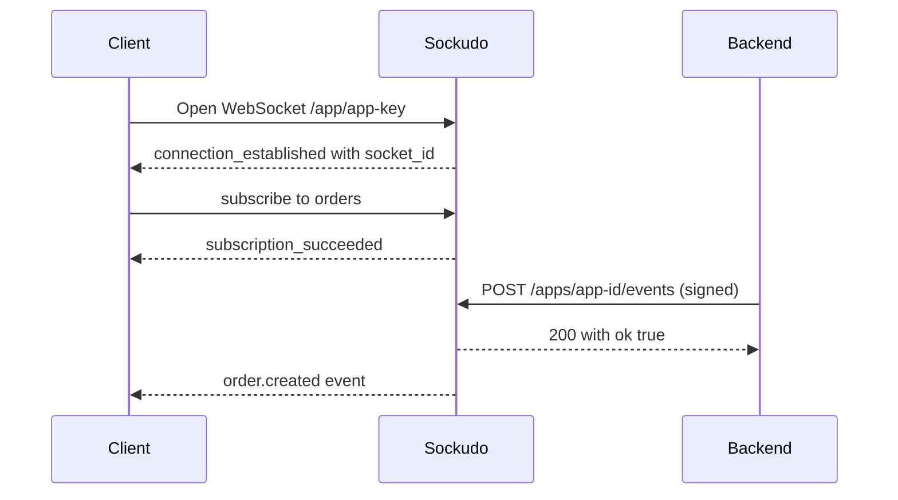

This guide proves the full loop: Sockudo accepts a WebSocket connection, the client subscribes to a channel, and your backend publishes an event over the HTTP API that the client receives. Once this loop works, every other feature (auth, presence, Protocol V2, history, push) is an addition on top of it, so it is the best place to start debugging too.

## How the loop works

Clients and backends never talk to each other directly. The client holds a WebSocket connection to Sockudo; the backend sends a signed HTTP request; Sockudo delivers the event to every subscriber of the channel.



The client connects with the app **key**, which is public. The backend signs its request with the app **secret**, which must stay on trusted servers.

## Run the loop

<Steps>

1. **Start Sockudo.** Run the container with the development app the guides use:

   ```bash
   docker run --rm --name sockudo \
     -p 6001:6001 -p 9601:9601 \
     -e SOCKUDO_DEFAULT_APP_ID=app-id \
     -e SOCKUDO_DEFAULT_APP_KEY=app-key \
     -e SOCKUDO_DEFAULT_APP_SECRET=app-secret \
     ghcr.io/sockudo/sockudo:latest
   ```

   Confirm the app exists. The command prints `OK`:

   ```bash
   curl -s http://127.0.0.1:6001/up/app-id
   ```

2. **Install the SDKs.** `@sockudo/client` is the realtime client; `sockudo` is the Node.js server SDK.

   ```bash
   npm install @sockudo/client sockudo
   ```

3. **Subscribe from a client.** Run the [client code](#subscribe-from-javascript) in a browser app or a Node.js script and leave it running.

4. **Publish from your backend.** Run the [publish script](#publish-from-nodejs) in a second terminal.

5. **Check the client output.** The client logs the event as soon as Sockudo accepts the publish.

</Steps>

## Subscribe from JavaScript

```ts title="client.ts"
import Sockudo from "@sockudo/client";

const client = new Sockudo("app-key", {
  wsHost: "127.0.0.1",
  wsPort: 6001,
  forceTLS: false,
  enabledTransports: ["ws"],
  protocolVersion: 2,
});

client.connection.bind("connected", () => {
  console.log("connected as", client.connection.socket_id);
});

const channel = client.subscribe("orders");

channel.bind("order.created", (payload) => {
  console.log("received", payload);
});
```

| Option | What it does |
| --- | --- |
| `wsHost`, `wsPort` | Where the Sockudo server listens. The client requires either `wsHost` or `cluster`. |
| `forceTLS` | Use `wss://`. Set it to `false` for a local server without TLS. |
| `enabledTransports` | Limits the client to plain WebSockets, which keeps local tests predictable. |
| `protocolVersion` | `2` selects Sockudo's native Protocol V2. Omit it to connect with Protocol V1, the Pusher-compatible default. |

Protocol V1 clients use the same server with Pusher-compatible options:

```ts title="pusher-client.ts"
import Pusher from "pusher-js";

const pusher = new Pusher("app-key", {
  wsHost: "127.0.0.1",
  wsPort: 6001,
  forceTLS: false,
  cluster: "local",
  enabledTransports: ["ws"],
});

pusher.subscribe("orders").bind("order.created", console.log);
```

`pusher-js` expects a `cluster` value, but the explicit `wsHost` decides where it connects.

## Publish from Node.js

```ts title="publish.ts"
import Sockudo from "sockudo";

const sockudo = new Sockudo({
  appId: "app-id",
  key: "app-key",
  secret: "app-secret",
  host: "127.0.0.1",
  port: 6001,
  useTLS: false,
});

await sockudo.trigger("orders", "order.created", {
  id: "ord_123",
  total: 42_00,
});
```

The client prints:

```text
connected as 1234567890.1234567890
received { id: 'ord_123', total: 4200 }
```

The socket ID differs on every connection.

## Publish over raw HTTP

Server SDKs are preferred because they handle signing, but the underlying API is small. Every HTTP API request carries Pusher-style HMAC authentication in its query string; an unsigned request is rejected:

```bash
curl -s -X POST "http://127.0.0.1:6001/apps/app-id/events" \
  -H "Content-Type: application/json" \
  -d '{"name": "order.created", "channel": "orders", "data": {"id": "ord_123", "total": 4200}}'
```

```json
{"error":"Missing authentication query parameters","code":"invalid_input","status":400}
```

To sign a request, compute an HMAC-SHA256 with the app secret over the method, the path, and the sorted query parameters, then append it as `auth_signature`. POST requests with a body must include the body's MD5 hash as `body_md5`:

```bash title="publish.sh"
APP_ID=app-id
APP_KEY=app-key
APP_SECRET=app-secret

BODY='{"name":"order.created","channel":"orders","data":"{\"id\":\"ord_123\",\"total\":4200}"}'
TIMESTAMP=$(date +%s)
BODY_MD5=$(printf '%s' "$BODY" | openssl dgst -md5 | sed 's/^.* //')
QUERY="auth_key=${APP_KEY}&auth_timestamp=${TIMESTAMP}&auth_version=1.0&body_md5=${BODY_MD5}"
SIGNATURE=$(printf 'POST\n/apps/%s/events\n%s' "$APP_ID" "$QUERY" \
  | openssl dgst -sha256 -hmac "$APP_SECRET" | sed 's/^.* //')

curl -s -X POST "http://127.0.0.1:6001/apps/${APP_ID}/events?${QUERY}&auth_signature=${SIGNATURE}" \
  -H "Content-Type: application/json" \
  -d "$BODY"
```

A successful publish returns:

```json
{"ok":true}
```

<Callout type="warn" title="Signatures expire">
Sockudo rejects a signed request whose `auth_timestamp` is more than 600 seconds away from the server clock. Generate the timestamp at request time and keep server clocks synchronized with NTP.
</Callout>

## What is on the wire

Seen from a raw WebSocket, the Protocol V1 exchange for this guide looks like this:

```json
{"event":"pusher:connection_established","data":"{\"socket_id\":\"9501381246.8633737996\",\"activity_timeout\":120}"}
{"event":"pusher_internal:subscription_succeeded","channel":"orders","data":"{}"}
{"event":"order.created","channel":"orders","data":"{\"id\":\"ord_123\",\"total\":4200}"}
```

Protocol V2 connections use the same flow with `sockudo:` and `sockudo_internal:` prefixes, and V2 messages can carry extra fields such as `message_id`. Client SDKs handle these frames for you; see the [Protocol reference](/docs/reference/protocol) when you need the details.

## Use idempotency for retries

When a backend may retry a publish after a timeout, attach an idempotency key. Sockudo deduplicates matching keys inside the configured window: the first request is broadcast, and a repeat with the same key returns the stored response without broadcasting again.

```ts
await sockudo.trigger(
  "orders",
  "order.created",
  { id: "ord_124" },
  { idempotency_key: "order-created-ord_124" },
);
```

| Setting | Default | What it does |
| --- | --- | --- |
| `[idempotency] enabled` | `true` | Turns publish deduplication on or off. |
| `[idempotency] ttl_seconds` | `120` | How long a key is remembered. Apps can override it in their `policy.idempotency` settings. |
| `[idempotency] max_key_length` | `128` | Longest accepted key. |

Raw HTTP clients can send the key as the `idempotency_key` body field or the `X-Idempotency-Key` header. The Node SDK can also generate keys for you with the `autoIdempotencyKey: true` constructor option.

<Callout type="warn" title="Keys belong to one payload">
Reusing a key with a different payload returns HTTP `400`. Derive keys from the business operation, such as `order-created-ord_124`, not from a random value per attempt, or retries will not be recognized as duplicates.
</Callout>

<Callout type="note" title="Deduplication lives in the cache">
Keys are stored in the configured cache backend. With the in-memory cache each node remembers only its own keys, so use a shared cache such as Redis when several nodes receive publishes.
</Callout>

## Add push notification fanout

Realtime events and push notifications are complementary. Use WebSockets for connected clients, and push for devices that are offline, backgrounded, or outside the active channel session.

```ts
const accepted = await sockudo.publishPush({
  recipients: [{ type: "channel", channel: "orders" }],
  payload: {
    title: "Order created",
    body: "Order ord_124 is ready for review",
  },
});

console.log(accepted.publish_id ?? accepted.publishId);
```

`publishPush` always submits the publish asynchronously. Sockudo answers `202 Accepted` with a publish ID as soon as the request is admitted; delivery to providers happens afterwards. Track progress with `sockudo.getPublishStatus(publishId)`.

Push requires a server built with the `push` feature (included in the prebuilt binaries and images) and configured provider credentials. Set it up with [Push notifications](/docs/server/push-notifications).

## Expected result

1. The client logs `received { id: 'ord_123', total: 4200 }`.
2. The HTTP publish returns `{"ok":true}`.
3. If push is configured, the push publish returns a publish ID.
4. Metrics under `/metrics` show connection and publish counters moving.

Check the counters directly:

```bash
curl -s http://127.0.0.1:9601/metrics \
  | grep -E '^sockudo_(connected|new_connections_total|http_calls_received_total)'
```

`sockudo_connected` reports open sockets, `sockudo_new_connections_total` counts connection attempts, and `sockudo_http_calls_received_total` counts HTTP API calls, each labeled by `app_id`.

## Debug checkpoints

Use this table when the first loop does not behave as expected.

| Symptom | Check | Fix |
| --- | --- | --- |
| WebSocket connection fails | Browser devtools shows a failed request to `/app/app-key`. | Confirm `wsHost`, `wsPort`, `forceTLS`, and `enabledTransports` match the local server. |
| Connection closes immediately | The server may not know the app key. `curl http://127.0.0.1:6001/up/app-id` returns `404` for an unknown app. | Use the credentials the server actually loaded. Docker Compose uses `demo-app`, `demo-key`, and `demo-secret`. |
| Subscribe succeeds but no event arrives | The backend publish may target a different app, channel, or event name. | Reuse the same `app-key`, `app-id`, channel, and event name from the snippets above. |
| The publishing tab never sees its own event | Publishing with a `socket_id` parameter excludes that connection from delivery. | Omit `socket_id` while testing, or listen from a second client. |
| Private or presence channels reject auth | Auth signatures are generated on a trusted backend and include the exact socket ID and channel name. | Use a server SDK for channel auth before writing custom signing code. |
| Retried publishes create duplicates | The request does not include a stable idempotency key. | Derive keys from business identifiers such as `order-created-ord_123`. |
| Metrics do not move | You may be checking the wrong process, port, or app credentials. | Query `/up`, then scrape `:9601/metrics` while publishing a fresh event. |

When debugging compatibility, first prove the same event works with a public channel. Then add private auth, presence user data, Protocol V2 options, history, push, or mutations one feature at a time.

## Next steps

<Cards>
  <Card title="Add authentication" href="/docs/getting-started/authentication" description="Protect private, presence, and encrypted channels with your backend." />
  <Card title="JavaScript client" href="/docs/clients/javascript" description="Every client option, runtime entrypoint, and recovery feature." />
  <Card title="Node.js server SDK" href="/docs/server-sdks/node" description="Publishing, batching, channel state, history, and webhooks from Node.js." />
</Cards>
