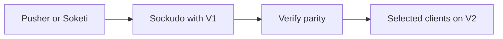

Sockudo can be adopted in phases. Start with Protocol V1 compatibility, then opt selected clients into Protocol V2 when you want native Sockudo features. This page walks through both phases, the configuration differences from a hosted Pusher account, and a cutover and rollback plan that keeps production traffic safe throughout.

## Migration phases

The two phases are independent. Many teams finish phase one, run on it for weeks, and only then move individual features to V2.



| Phase | What changes | What stays the same |
| --- | --- | --- |
| Compatibility (V1) | Client host, ports, and TLS settings; backend host and credentials. | Client libraries, channel names, event names, auth endpoints, payloads, and webhooks. |
| Native (V2) | Selected clients move to Sockudo SDKs with `protocolVersion: 2`. | Backend publish calls and channel naming. V1 clients keep working alongside V2 clients. |

## What maps directly

Sockudo implements the Pusher Channels protocol and HTTP API, so most concepts carry over unchanged:

| Pusher concept | In Sockudo |
| --- | --- |
| App ID, key, and secret | An app record in the app manager, with the same three values. |
| Cluster hostname | Your own hostname, set with `wsHost` on clients and `host` on server SDKs. |
| `pusher:` system events | Unchanged on Protocol V1. Protocol V2 uses `sockudo:` instead. |
| Channel prefixes `private-`, `presence-`, `private-encrypted-` | Same names, same auth rules. |
| Publish endpoints `/apps/{appId}/events` and `/apps/{appId}/batch_events` | Same paths and HMAC request signing. |
| Channel state `/apps/{appId}/channels` and `/apps/{appId}/channels/{channelName}/users` | Same paths. |
| Webhooks signed with `X-Pusher-Key` and `X-Pusher-Signature` | Same headers, so existing webhook validation keeps working. |

## Compatibility-first migration

For existing Pusher clients, point the host and ports at Sockudo:

```ts title="pusher-client.ts"
import Pusher from "pusher-js";

const pusher = new Pusher(process.env.NEXT_PUBLIC_PUSHER_KEY!, {
  wsHost: "realtime.example.com",
  wsPort: 80,
  wssPort: 443,
  forceTLS: true,
  enabledTransports: ["ws", "wss"],
  cluster: "local",
});
```

Backend SDKs continue to publish through Pusher-compatible REST endpoints. Change host, port, TLS, and credentials, then run your existing private and presence auth tests.

Laravel applications keep using Laravel Echo with the Pusher connector; [Laravel](/docs/server-sdks/laravel#connect-laravel-echo) shows the broadcaster and Echo configuration.

<Callout type="tip" title="Mirror credentials as well as hosts">
The app key in client code, the app ID and secret in backend code, and the app record in Sockudo must all describe the same app. Mirror your existing Pusher credentials into Sockudo first, and the only change clients need is the host.
</Callout>

## Native migration

After compatibility is stable, migrate clients to Sockudo SDKs and enable Protocol V2:

```ts title="client.ts"
import Sockudo from "@sockudo/client";

const client = new Sockudo("app-key", {
  wsHost: "realtime.example.com",
  forceTLS: true,
  protocolVersion: 2,
  connectionRecovery: true,
});
```

Protocol V2 is the right choice for recovery, rewind, deltas, filters, versioned messages, annotations, and push helper workflows.

<Callout type="warn" title="System event names change on V2">
Under Protocol V2, system events use the `sockudo:` prefix. Code that binds `pusher:subscription_succeeded` or other `pusher:` events must bind the `sockudo:` equivalents once a client switches to `protocolVersion: 2`. Your own event names, such as `order.created`, do not change.
</Callout>

<Callout type="note" title="Recovery needs the server side too">
`connectionRecovery: true` lets the client resume after a disconnect, but Sockudo only keeps the replay buffer when `[connection_recovery] enabled = true` is set on the server. It is off in the built-in defaults; the sample `config/config.toml` turns it on.
</Callout>

## Server configuration differences

A hosted Pusher account manages apps, fanout, and storage for you. With Sockudo you choose a backend for each of those jobs. Sockudo prefers TOML:

```toml title="config/config.toml"
[app_manager]
driver = "pgsql"

[adapter]
driver = "redis"

[cache]
driver = "redis"

[queue]
driver = "redis"
```

| Section | Role during migration |
| --- | --- |
| `[app_manager]` | Stores the app IDs, keys, and secrets you mirror from Pusher. |
| `[adapter]` | Shares broadcasts and presence between Sockudo nodes. Required as soon as you run more than one node. |
| `[cache]` | Holds idempotency keys and other short-lived shared state. |
| `[queue]` | Runs background work such as webhook delivery. |

Keep one source of truth for app credentials. If you previously hardcoded credentials in application config, move them into Secret Manager, Kubernetes Secrets, or the persistent app manager.

## Push notification migration

If your old realtime stack only handled WebSockets, plan push as part of the migration instead of after it. Sockudo's push platform covers:

- device registration and activation
- provider credentials for FCM, APNs, Web Push, HMS, and WNS
- channel push subscriptions
- async publish admission
- scheduled push
- provider delivery status callbacks
- push metrics and capacity planning

Keep push provider credentials in Sockudo or your trusted backend. Clients should only receive short-lived activation or identity tokens. Start with [Push notifications](/docs/server/push-notifications).

## Cutover checklist

<Steps>

1. Run Sockudo next to the existing realtime provider.
2. Mirror app credentials into Sockudo.
3. Point staging clients at Sockudo in Protocol V1 mode.
4. Verify public, private, presence, encrypted, webhook, and push flows.
5. Enable metrics and alerting before production traffic.
6. Move a small tenant, region, or traffic shard first.
7. Migrate selected applications to Protocol V2 only after V1 parity is verified.

</Steps>

## Rollback

Rollback is simplest when client configuration is environment-driven. Read the realtime host and protocol version from your own application settings rather than hardcoding them:

```bash title=".env"
REALTIME_HOST=realtime.example.com
REALTIME_PROTOCOL_VERSION=1
REALTIME_FORCE_TLS=true
```

These are your application's variables, not Sockudo settings. Switching `REALTIME_HOST` back to the previous provider, or `REALTIME_PROTOCOL_VERSION` back to `1`, then becomes a configuration deploy instead of a code change.

Keep idempotency keys on backend publishes during cutover. If a retry crosses providers, use an application-level operation ID so downstream consumers can suppress duplicates.

## Next steps

<Cards>
  <Card title="Compatibility reference" href="/docs/reference/compatibility" description="Exactly what Protocol V1 and V2 support, and where they differ." />
  <Card title="Protocol V2" href="/docs/clients/protocol-v2" description="Message IDs, serials, recovery, rewind, and V2 system events." />
  <Card title="Deployment" href="/docs/deployment" description="Topologies, configuration, and rollout on your infrastructure." />
</Cards>
