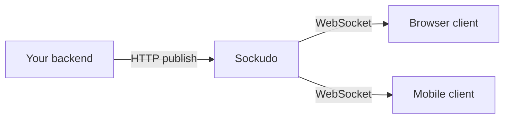
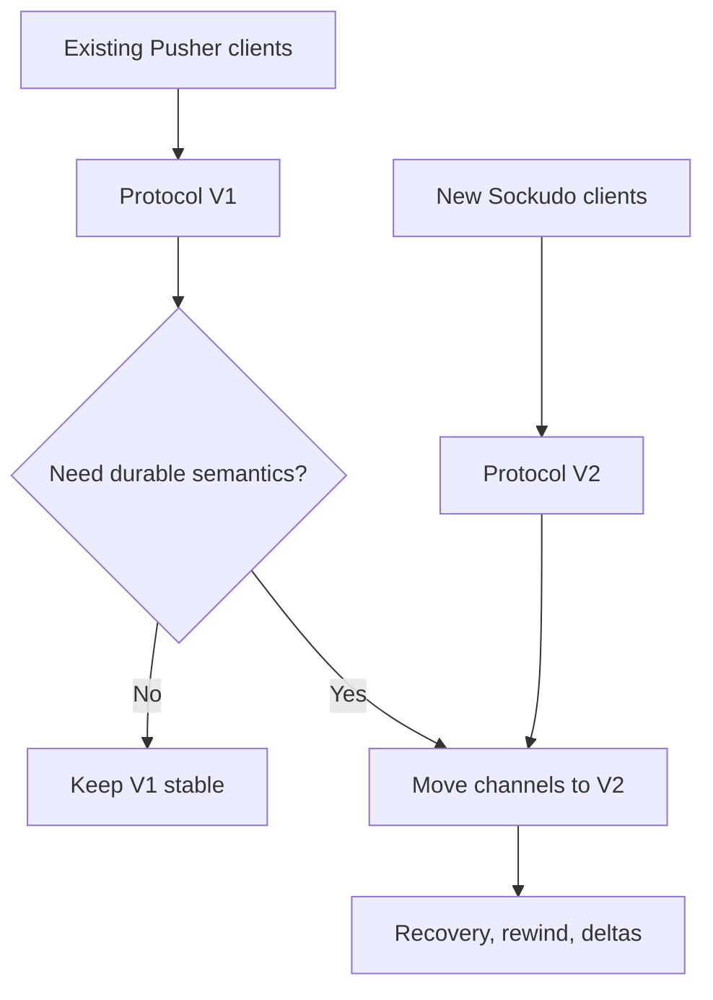

Sockudo is a Rust realtime server that exposes the Pusher Channels protocol while adding a native Sockudo protocol for features that do not fit inside the Pusher compatibility contract. This page gives you the mental model behind the rest of the documentation: what the moving parts are, how the two protocols relate, and what a production deployment looks like. Read it before you install anything if you are new to realtime servers, or skim the tables if you are evaluating Sockudo against an existing stack.

## How a realtime server works

A realtime server keeps a persistent WebSocket connection open to every client so it can push data the moment something happens, instead of waiting for the client to poll. Your application never talks to those sockets directly. It sends an event to Sockudo over HTTP, and Sockudo delivers that event to every client subscribed to the target channel.

A few terms come up constantly:

- **App:** a tenant on the server, identified by an `id`. Clients connect with the app's public `key`; your backend signs requests with the app's `secret`, which never leaves trusted servers.
- **Channel:** a named stream, such as `orders` or `presence-room-42`. Clients subscribe to channels and receive the events published to them.
- **Event:** a named message on a channel, such as `order.created`, with a payload.
- **Socket ID:** the unique identifier Sockudo assigns to each connection when it opens. Auth signatures are bound to it.
- **Presence:** a channel type that tracks which users are subscribed and notifies members when someone joins or leaves.

## Mental model

Sockudo has four major surfaces:

| Surface | Purpose | Where to start |
| --- | --- | --- |
| WebSocket server | Accepts client connections, subscriptions, auth results, presence transitions, and realtime events. | [First connection](/docs/getting-started/first-connection) |
| HTTP API | Lets trusted backends publish events, inspect channels, read history, mutate messages, and manage push. | [HTTP API](/docs/server/http-api) |
| Client SDKs | Browser, mobile, desktop, .NET, and Python realtime clients that subscribe and react to events. | [Realtime Clients](/docs/clients) |
| Server SDKs | Backend libraries that sign auth responses, publish events, validate webhooks, and call REST endpoints. | [Server SDKs](/docs/server-sdks) |

The WebSocket server and the HTTP API run in the same process and share one port (`6001` by default). Prometheus metrics are served separately on port `9601`.

## Pick your path

| You are building | Start with | You should finish with |
| --- | --- | --- |
| A Pusher replacement | [Migration](/docs/getting-started/migration) and [Protocol reference](/docs/reference/protocol) | Existing clients connecting through Protocol V1 with unchanged auth and publish semantics. |
| A new realtime product | [First connection](/docs/getting-started/first-connection) and [Authentication](/docs/getting-started/authentication) | Public, private, and presence channels wired through client and server SDKs. |
| A clustered production deployment | [Deployment](/docs/deployment), [Scaling](/docs/server/scaling), and [Observability](/docs/server/observability) | Load-balanced nodes, shared adapter, health probes, metrics, and dependency-specific alerts. |
| A durable collaboration or AI workflow | [Protocol V2](/docs/clients/protocol-v2), [History and recovery](/docs/server/history-recovery), and [Mutable messages](/docs/server/mutable-messages) | Serial continuity, message IDs, rewind, annotations, and safe retry behavior. |

## Protocol modes

Every connection uses exactly one protocol version, chosen by the client when it connects. The client sends a `protocol` query parameter on the WebSocket URL: `protocol=2` selects Protocol V2, and any other value, including the `protocol=7` that `pusher-js` sends, selects Protocol V1.

| | Protocol V1 | Protocol V2 |
| --- | --- | --- |
| Purpose | Pusher compatibility | Sockudo-native features |
| Selected by | Default | `protocolVersion: 2` in Sockudo client SDKs |
| System event prefixes | `pusher:` and `pusher_internal:` | `sockudo:` and `sockudo_internal:` |
| Works with | `pusher-js`, Laravel Echo, Pusher server SDKs | Sockudo client SDKs |

Protocol V1 is the compatibility layer. Use it when you want existing `pusher-js`, Laravel Echo, or Pusher-shaped server SDK integrations to keep working with minimal changes.

Protocol V2 is the native layer. Use it when your application needs one or more of:

- connection recovery with `stream_id` and `serial`
- `message_id` on broadcasts
- subscribe-time rewind
- delta compression and conflation
- server-side tag filtering
- durable channel history
- versioned mutable messages
- annotations for reactions, receipts, moderation, and summaries
- push notification helper workflows

Three V2 fields carry most of these guarantees. `message_id` is a stable identity for each broadcast, so clients can drop duplicates. `serial` is the message's position in its stream, so a client knows exactly where it left off. `stream_id` is an opaque identifier for the stream those serials belong to. Together they let a reconnecting client ask for "everything after this point" and get a definitive answer.

Adopt V2 by channel or client cohort. Keeping V1 clients stable while enabling V2 for new experiences is the safest migration shape.

<Callout type="note" title="V2 fields never reach V1 clients">
V1 and V2 clients can subscribe to the same channel. Sockudo strips V2-only metadata from V1 deliveries, so adding V2 clients does not change the payloads your existing Pusher clients receive.
</Callout>

## Channel types

Sockudo follows Pusher channel naming rules for public, private, presence, and encrypted channels. The prefix of the channel name decides whether a subscription needs approval from your backend.

| Channel | Prefix | Auth required | Typical use |
| --- | --- | --- | --- |
| Public | none | No | dashboards, public feeds, unauthenticated status |
| Private | `private-` | Yes | account data, order updates, team-only streams |
| Presence | `presence-` | Yes with user data | rooms, collaboration, online member lists |
| Encrypted | `private-encrypted-` | Yes with shared secret | payloads that should stay opaque to the transport |

[Authentication](/docs/getting-started/authentication) explains how your backend approves private, presence, and encrypted subscriptions.

## Production shape

A production deployment usually has:

1. One or more Sockudo nodes behind a load balancer.
2. A shared adapter such as Redis, Redis Cluster, NATS, Kafka, RabbitMQ, Pulsar, Google Pub/Sub, or Iggy, so an event published on one node reaches subscribers on every node.
3. A persistent app manager such as PostgreSQL, MySQL, DynamoDB, ScyllaDB, or SurrealDB when apps are not configured statically in the config file.
4. A cache and queue backend for rate limits, idempotency, webhooks, and optional push workflows.
5. Prometheus scraping and alerting for connection, fanout, push, history, and adapter health.

<Callout type="warn" title="The local adapter does not cluster">
The default `local` adapter only delivers events to clients connected to the same node. Running two nodes with the `local` adapter behind a load balancer silently splits your subscribers: each publish reaches only the clients on the node that received it. Configure a shared adapter before you scale out.
</Callout>

Backend drivers are Cargo features. The prebuilt Linux binaries and container images ship with every production backend; source builds include only the features you select. See [Installation](/docs/getting-started/installation#feature-flags).

## What to read next

<Cards>
  <Card title="Install Sockudo" href="/docs/getting-started/installation" description="Docker, Cargo, feature flags, and local configuration." />
  <Card title="Connect a client" href="/docs/getting-started/first-connection" description="Subscribe to a channel and publish from a backend." />
  <Card title="Add authentication" href="/docs/getting-started/authentication" description="Private, presence, encrypted, and user authentication." />
  <Card title="Migrate from Pusher" href="/docs/getting-started/migration" description="Compatibility notes and cutover strategy." />
  <Card title="Deploy to production" href="/docs/deployment" description="Static configuration, Linux, Docker, Kubernetes, cloud platforms, and capacity planning." />
</Cards>
