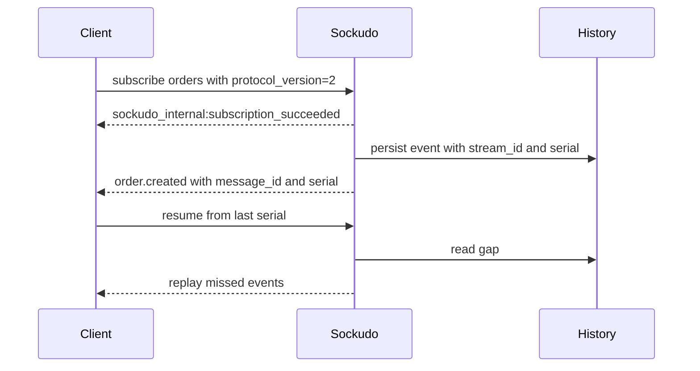

Sockudo serves two WebSocket protocols from the same server and the same port. Protocol V1 is a
byte-compatible Pusher protocol for existing clients; Protocol V2 is Sockudo's native protocol and
adds continuity metadata, recovery, rewind, filtering, and mutable messages. Use this page to look
up frame names, payload shapes, and the boundary between the two.

## Negotiating a protocol

The protocol is chosen per connection by the `protocol` query parameter on the WebSocket upgrade
URL, `GET /app/{appKey}`. Only the exact value `2` selects Protocol V2; an omitted or any other
value selects Protocol V1, so unmodified Pusher clients always land on V1.

```text
wss://realtime.example.com/app/app-key?protocol=2&format=msgpack
```

| Query parameter | Applies to | Meaning |
| --- | --- | --- |
| `protocol` | Both | `2` selects Protocol V2. Anything else, including omission, selects Protocol V1. |
| `format` | V2 | Wire format: `json` (default), `msgpack` or `messagepack`, `protobuf` or `proto`. An unknown value rejects the upgrade with `400`. V1 always uses JSON and ignores this parameter. |
| `echo_messages` | V2 | `false` stops the connection receiving its own publishes. Honored only when `[echo_control].enabled`. |
| `append_mode` | V2 | Delivery mode for mutable-message appends: `delta` (default) or `full`. An unknown value rejects the upgrade with `400`. |
| `append_rollup_window` | V2 | AI Transport append rollup window in milliseconds. Must be one of `0`, `20`, `40`, `100`, `500` and within the configured rollup bounds, otherwise the upgrade is rejected with `400`. |
| `token` | V2 | Capability-token JWT used instead of signed channel auth. |
| `client`, `version` | Both | Client library name and version, accepted for Pusher compatibility. |

See [HTTP endpoints](/docs/reference/http-endpoints#websocket) for the full upgrade contract.

## Protocol V1

Protocol V1 is Pusher-compatible. It preserves familiar event prefixes, channel names, subscription
flows, auth response shapes, and HTTP API semantics.

Use V1 for:

- existing `pusher-js` clients
- Laravel Echo migrations
- backend SDK compatibility
- minimal drop-in deployments

Typical V1 connection and event frames keep the Pusher names and payload conventions. Note that V1
`data` is a JSON-encoded string, exactly as Pusher sends it:

```json
{
  "event": "pusher:connection_established",
  "data": "{\"socket_id\":\"123.456\",\"activity_timeout\":120}"
}
```

```json
{
  "event": "order.created",
  "channel": "orders",
  "data": "{\"id\":\"ord_123\",\"total\":4200}"
}
```

Keep V1 payloads compatible with existing clients. Do not require V2-only fields such as
`message_id`, `serial`, `stream_id`, tags, deltas, or annotation metadata when the recipient
negotiated V1.

## Protocol V2

Protocol V2 is Sockudo-native and uses `sockudo:` system event prefixes. Serials, message IDs, and
connection recovery are native to V2 rather than opt-in extensions.

Use V2 for:

- `message_id`
- `serial`
- `stream_id`
- connection recovery
- subscribe-time rewind
- delta compression
- tag filtering
- durable history
- mutable messages
- annotations
- push-helper client workflows through backend proxies

V2 keeps the event/channel shape familiar, then adds metadata required for continuity and durable
workflows:

```json
{
  "event": "order.created",
  "channel": "orders",
  "data": { "id": "ord_123", "total": 4200 },
  "message_id": "msg_01HX6J2P5N0Z9E",
  "stream_id": "orders",
  "serial": 42,
  "tags": { "status": "paid", "region": "eu" },
  "extras": {
    "headers": { "tenant": "acme" }
  }
}
```

Use V2 when the client needs to reconnect without guessing what it missed, rewind a subscription
from known history, filter by event, tags, or message content, receive deltas, or render mutable
message state.

<Callout type="note" title="One server, two shapes">
A backend publishes once. Sockudo shapes each delivery for the subscriber's negotiated protocol:
V1 subscribers receive the Pusher frame with V2-only fields stripped, while V2 subscribers receive
the full envelope.
</Callout>

## System events

Every system event has one canonical name. On the wire it carries the `pusher:` or
`pusher_internal:` prefix for V1 and the `sockudo:` or `sockudo_internal:` prefix for V2. The
server accepts either prefix on inbound frames, and always replies with the prefix of the
connection's protocol.

| Canonical name | Direction | V1 | V2 | Purpose |
| --- | --- | --- | --- | --- |
| `connection_established` | Server to client | Yes | Yes | Assigns the `socket_id` and announces `activity_timeout`. |
| `error` | Server to client | Yes | Yes | Reports a protocol, auth, or limit error with a numeric `code`. |
| `ping` / `pong` | Both | Yes | Yes | Application-level heartbeat. |
| `subscribe` / `unsubscribe` | Client to server | Yes | Yes | Join or leave a channel. |
| `subscription_succeeded` | Server to client (internal) | Yes | Yes | Confirms a subscription; presence channels include the member list. |
| `subscription_error` | Server to client (internal) | Yes | Yes | Rejects a subscription. |
| `member_added` / `member_removed` | Server to client (internal) | Yes | Yes | Presence membership changes. |
| `signin` / `signin_success` | Both | Yes | Yes | User authentication. |
| `cache_miss` | Server to client | Yes | Yes | Cache channel had no cached event on subscribe. |
| `presence_update` | Both | No | Yes | Update the current member's presence data. |
| `auth` / `auth_success` | Both | No | Yes | Refresh a capability token on a live connection. |
| `token_expired` | Server to client | No | Yes | Capability token expired or was revoked. |
| `resume` / `resume_success` / `resume_failed` | Both | No | Yes | Connection recovery. |
| `rewind_complete` | Server to client | No | Yes | Subscribe-time rewind finished. |
| `channel_history` | Both | No | Yes | Read durable history over the WebSocket. |
| `message.*` | Server to client | No | Yes | Mutable message actions such as `sockudo:message.update`, `sockudo:message.delete`, and `sockudo:message.append`. |

### Connection established

Sent once, immediately after the upgrade. Store `socket_id`; backend publishes pass it as
`socket_id` to suppress echo to the originating connection.

```json
{
  "event": "sockudo:connection_established",
  "data": "{\"socket_id\":\"123.456\",\"activity_timeout\":120}"
}
```

### Subscribe and subscription succeeded

The client subscribes to a channel. Private and presence channels include the signed `auth`
string, and presence channels add `channel_data`. V2 subscriptions may also carry `filter`,
`rewind`, and `delta` options.

```json
{
  "event": "sockudo:subscribe",
  "data": {
    "channel": "private-orders",
    "auth": "app-key:3f2a9c..."
  }
}
```

The server confirms the subscription. For presence channels, `data` carries the current
`presence` object with `ids`, `hash`, and `count`.

```json
{
  "event": "sockudo_internal:subscription_succeeded",
  "channel": "private-orders",
  "data": "{}"
}
```

When recovery is enabled, V2 acknowledgements also include a `stream_id` and `serial`. Successful
V2 subscriptions may include `attach_serial` when durable history is enabled for the channel. See
[Protocol V2 metadata](/docs/clients/protocol-v2#v2-metadata).

### Errors

`error` frames carry a numeric `code` and a human-readable `message`, plus the `channel` when the
error relates to one. See [Error codes](/docs/reference/errors#websocket-error-and-close-codes)
for the code ranges.

```json
{
  "event": "pusher:error",
  "data": { "code": 4009, "message": "Connection is unauthorized" }
}
```

### Presence membership

Presence channels broadcast membership transitions. Sockudo emits `member_added` on a user's first
connection and `member_removed` on their last disconnect, not once per socket.

```json
{
  "event": "sockudo_internal:member_added",
  "channel": "presence-room-1",
  "data": "{\"user_id\":\"user-42\",\"user_info\":{\"name\":\"Ada\"}}"
}
```

### Presence update

A V2 member replaces its own `user_info` with `presence_update`. The channel travels inside
`data`, which may be a JSON object or a JSON-encoded string:

```json
{
  "event": "sockudo:presence_update",
  "data": { "channel": "presence-room-1", "data": { "status": "typing" } }
}
```

Other members receive the new info:

```json
{
  "event": "sockudo_internal:presence_update",
  "channel": "presence-room-1",
  "data": "{\"user_id\":\"user-42\",\"user_info\":{\"status\":\"typing\"}}"
}
```

The sender must be a current member of the channel, the update must be at most 1024 bytes, and
updates are rate-limited per member. Servers released before this fix reject the object form of
`data` with "presence_update channel is required"; clients that must support them should send the
JSON-encoded string form, which every server version accepts.

### Capability-token refresh

V2 clients that connected with `?token=` refresh before expiry by sending `sockudo:auth` with a new
token. The refreshed token must keep the same `client_id`.

```json
{ "event": "sockudo:auth", "data": { "token": "eyJhbGciOiJIUzI1NiIs..." } }
```

```json
{
  "event": "sockudo:auth_success",
  "data": { "client_id": "user-42", "jti": "tok_9f1c", "exp": 1710003600 }
}
```

When a token expires the server sends `token_expired` with code `40142` and reason `expired`; a
revoked token produces code `40160` and reason `revoked`.

```json
{ "event": "sockudo:token_expired", "data": { "code": 40142, "reason": "expired" } }
```

### Connection recovery

After reconnecting, a V2 client sends its last known position per channel. `channel_positions`
is the current form; the older `channel_serials` map of channel to serial is still accepted.

```json
{
  "event": "sockudo:resume",
  "data": {
    "channel_positions": {
      "orders": { "serial": 42, "stream_id": "orders", "last_message_id": "msg_01HX" }
    }
  }
}
```

Recoverable channels are replayed, then the server sends one aggregate `resume_success`:

```json
{
  "event": "sockudo:resume_success",
  "data": "{\"recovered\":[...],\"failed\":[]}"
}
```

Each channel that cannot be recovered also receives its own `resume_failed`. The `code` is one of
`position_expired`, `stream_reset`, `continuity_unverifiable`, or `persistence_unavailable`.

```json
{
  "event": "sockudo:resume_failed",
  "channel": "orders",
  "data": "{\"code\":\"position_expired\",\"reason\":\"...\",\"expected_stream_id\":\"orders\",\"current_stream_id\":\"orders\",\"oldest_available_serial\":120,\"newest_available_serial\":180}"
}
```

<Callout type="warn" title="Fail closed on recovery failure">
`resume_failed` means Sockudo could not prove continuity. Resubscribe and rebuild state, for
example with `channel_history` and `until_attach: true`. Never advance the client cursor past a
failed position. See [History and recovery](/docs/server/history-recovery#recovery).
</Callout>

### Rewind complete

A V2 subscription with `rewind` (a message count, or `{ "seconds": N }`) replays recent history
before live delivery, then reports what was sent:

```json
{
  "event": "sockudo:rewind_complete",
  "channel": "orders",
  "data": {
    "historical_count": 25,
    "live_count": 0,
    "complete": true,
    "truncated_by_retention": false,
    "truncated_by_limit": false
  }
}
```

### Channel history

V2 clients read durable history over the WebSocket. The response uses the same event name. See
[Client history](/docs/clients/protocol-v2#client-history) for the response fields.

```json
{
  "event": "sockudo:channel_history",
  "data": { "channel": "chat", "limit": 100, "direction": "backwards", "until_attach": true }
}
```

## Subscription predicates

V2 subscriptions accept one compound `filter`. Its non-empty `events`, `tags`, and `expression`
components use AND semantics; separate exact and wildcard subscriptions use OR semantics. The
expression form is either a JMESPath source string or
`{ "language": "jmespath", "source": "..." }`.

```json
{
  "channel": "orders.*",
  "filter": {
    "events": ["order.updated"],
    "tags": { "cmp": "eq", "key": "region", "val": "eu" },
    "expression": "data.total >= `100` && headers.priority == `\"high\"`"
  }
}
```

Predicates compile once at subscription time and apply consistently to live fanout, rewind, and
recovery. Expression projection exposes `event`, `channel`, `data`, `name`, `userId`, `tags`,
public `headers`, `messageId`, `streamId`, `serial`, and `action`. Internal `sockudo_` headers,
extras, and idempotency keys are never exposed. Source, AST, filter-tree, and projected-document
sizes are bounded; invalid input is rejected and evaluation errors fail closed. This remains gated
by Protocol V2 and `[tag_filtering].enabled`; Protocol V1 channel validation and delivery are
unchanged.



## Prefixes

| Event family | V1 | V2 |
| --- | --- | --- |
| Public system events | `pusher:` | `sockudo:` |
| Internal events | `pusher_internal:` | `sockudo_internal:` |
| Mutable messages | not available | `sockudo:message.*` |
| Recovery | not available | `sockudo:resume_*` |
| Rewind | not available | `sockudo:rewind_complete` |

## Channel names

Channel names are limited to 200 bytes by default (configurable per app and per namespace) and may
contain ASCII letters, digits, and `- _ = @ , ; .`, plus `:` for namespaces and `#` for V2
user-limited channels. The prefix selects the channel type.

| Channel | Prefix | Auth required |
| --- | --- | --- |
| Public | none | No |
| Private | `private-` | Yes |
| Presence | `presence-` | Yes, with `channel_data` |
| Encrypted | `private-encrypted-` | Yes |

Namespaced channel rules, user-limited channel syntax, and per-namespace permissions are covered
in [Channel namespaces](/docs/reference/configuration#channel-namespaces).

## Broadcast metadata

V2 deliveries add these fields to the familiar `event`, `channel`, and `data`:

| Field | Purpose |
| --- | --- |
| `message_id` | Stable broadcast identity for deduplication. |
| `stream_id` | Opaque per-channel continuity token. Changes only when Sockudo can no longer prove continuity for the stream. |
| `serial` | Monotonically increasing per-channel position used by recovery and history. |
| `tags` | Flat string tags used by tag filtering. |
| `extras` | V2 envelope for `headers`, `ephemeral`, `echo`, `push`, and AI Transport metadata. |

```json
{
  "event": "order.updated",
  "channel": "orders",
  "data": { "id": "ord_123" },
  "message_id": "msg_01HX",
  "stream_id": "orders",
  "serial": 42,
  "tags": { "status": "packed" },
  "extras": {
    "headers": { "tenant": "acme" }
  }
}
```

V1 clients should not depend on V2-only fields. Idempotency keys are never sent to WebSocket
clients in either protocol.

## Compatibility boundary

The compatibility rule is simple: negotiate the richest protocol a client can safely understand,
then deliver only fields that belong to that protocol.

| Concern | V1 behavior | V2 behavior |
| --- | --- | --- |
| System prefixes | `pusher:` and `pusher_internal:` | `sockudo:` and `sockudo_internal:` |
| Event metadata | Pusher-compatible event, channel, and data | Adds serials, message IDs, stream IDs, extras, tags, and headers where enabled. |
| Recovery | Client reconnects and resubscribes | Client can resume from continuity metadata when recovery is configured. |
| Mutable messages | Not exposed | Message updates, deletes, appends, versions, and annotations are explicit V2 events. |
| Heartbeats | Pusher application `ping`/`pong` | Native WebSocket Ping/Pong, with `sockudo:ping` fallback. |
| Server publish | Pusher-shaped HTTP API | Same trusted API plus V2 acknowledgement fields when enabled. |

For mixed deployments, treat Protocol V1 as a stable contract and Protocol V2 as an opt-in
capability layer. A backend may publish once, but Sockudo must shape the delivery for each
subscriber according to the subscriber protocol.

## Push is outside the WebSocket protocol

Push notifications are HTTP-driven. They target device registrations, channel push subscriptions,
clients, or explicit recipients. A push payload may reference a realtime channel or message serial,
but provider delivery is not part of WebSocket ordering.

The optional Ably compatibility facade can resolve an Ably realtime-channel push recipient into a
native `MessageService` publish. This is an internal push target, not another network provider or
fallback transport; it follows the channel's ordinary fanout, persistence, history, version, and
idempotency semantics.

## Next steps

<Cards>
  <Card title="Protocol V2 for clients" href="/docs/clients/protocol-v2" description="Enable V2 in a client and handle recovery, history, and heartbeats." />
  <Card title="History and recovery" href="/docs/server/history-recovery" description="How replay buffers, durable history, and rewind prove continuity." />
  <Card title="HTTP endpoints" href="/docs/reference/http-endpoints" description="Publish, history, and mutable-message endpoints behind these frames." />
  <Card title="Error codes" href="/docs/reference/errors" description="Interpret WebSocket error codes and HTTP failures." />
</Cards>
