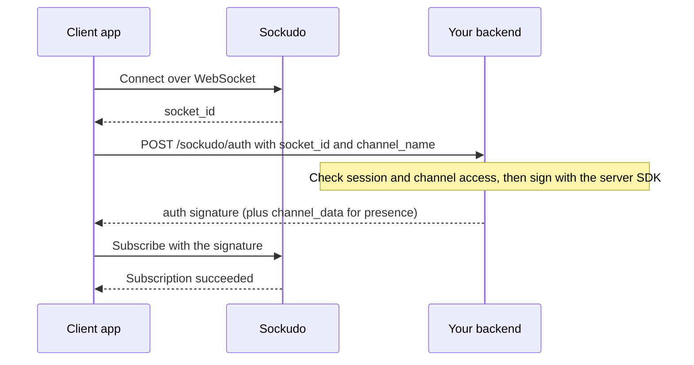

Server SDKs are trusted backend libraries for the Sockudo HTTP API. They hold your app secret and use
it to sign HTTP requests, sign private and presence channel authorizations, validate webhook
signatures, publish realtime events, read history, and manage push notifications. They do not open a
WebSocket; a [realtime client](/docs/clients) does that.

Every language guide follows the same structure, so you can move between languages and find the same
section in the same place: install, configure the client, publish, batch, idempotency, channel
authorization, webhooks, state and history, versioned messages, push, and errors.

## Official SDKs

| Language | Package | Install | Minimum runtime | Guide |
| --- | --- | --- | --- | --- |
| Node.js | `sockudo` | `npm install sockudo` | Node.js 16 | [Node.js](/docs/server-sdks/node) |
| Python | `sockudo-http-python` | `pip install sockudo-http-python` | Python 3.9 | [Python](/docs/server-sdks/python) |
| PHP | `sockudo/sockudo-php-server` | `composer require sockudo/sockudo-php-server` | PHP 8.0 | [PHP](/docs/server-sdks/php) |
| Ruby | `sockudo` | `bundle add sockudo` | Ruby 2.6 | [Ruby](/docs/server-sdks/ruby) |
| Go | `github.com/sockudo/sockudo/server-sdks/sockudo-http-go/v2` | `go get github.com/sockudo/sockudo/server-sdks/sockudo-http-go/v2@v2.2.0` | Go 1.25 | [Go](/docs/server-sdks/go) |
| Rust | `sockudo-http` | `cargo add sockudo-http` | Rust 1.88 (2024 edition) | [Rust](/docs/server-sdks/rust) |
| Java | `io.sockudo:sockudo-http-java` | Maven or Gradle, version `2.2.0` | Java 11 | [Java](/docs/server-sdks/java) |
| .NET | `SockudoServer` | `dotnet add package SockudoServer` | .NET 10 | [.NET](/docs/server-sdks/dotnet) |
| Swift | `Sockudo` via SwiftPM | `https://github.com/sockudo/sockudo-http-swift` | Swift 5.9, Apple platforms | [Swift](/docs/server-sdks/swift) |

Install from the package names above. The old per-SDK repositories are archived/legacy mirrors;
source lives in this monorepo under `server-sdks/`. The PHP and Swift packages are mirrored to
`sockudo/sockudo-http-php` and `sockudo/sockudo-http-swift` because Packagist and SwiftPM expect the
manifest at the repository root.

## Framework integrations

| Framework | Package | Install | Guide |
| --- | --- | --- | --- |
| Laravel 12–13 | `sockudo/laravel` | `composer require sockudo/laravel` (PHP 8.2+) | [Laravel](/docs/server-sdks/laravel) |

The Laravel package registers a native `sockudo` broadcasting connection and exposes the PHP server
SDK through Laravel's container and a facade. Laravel Echo continues to use Sockudo's
Pusher-compatible Protocol V1 connection.

## Capability comparison

All SDKs share the Sockudo/Pusher HTTP signing protocol, but their typed helpers differ. The tables
below were checked against each SDK's source. "Partial" is explained in the notes; "No" means the SDK
has no helper for it.

### Publishing, auth, and webhooks

| SDK | Multi-channel publish | Batch publish | Idempotency keys | Private and presence auth | Encrypted channels | User auth (signin) | Terminate user connections | Webhook validation |
| --- | --- | --- | --- | --- | --- | --- | --- | --- |
| Node.js | Yes | Yes | Yes | Yes | Yes | Yes | Yes | Yes, with key rotation |
| Python | Yes | Yes | Yes | Yes | Yes | Yes | Yes | Yes |
| PHP | Yes | Yes | Yes | Yes | Yes | Yes | Yes | Yes |
| Laravel | Yes | Yes | Partial | Yes | Yes | Yes | Yes | Partial |
| Ruby | Yes | Yes | Yes | Yes | Yes | Yes | Yes | Yes, with key rotation |
| Go | Yes | Yes | Yes | Yes | Yes | Yes | Yes | Yes |
| Rust | Yes | Yes | Yes | Yes | Yes | Yes | Yes | Yes, with key rotation |
| Java | Yes | Yes | Yes | Yes | Yes | No | Yes | Yes |
| .NET | Yes | Yes | Yes | Yes | Yes | Yes | Yes | Yes |
| Swift | Yes | Yes | Yes | Yes | Yes | No | Yes | Yes |

### State, Protocol V2, and push

| SDK | Channel state helpers | History | Presence history | Versioned messages | Annotations | Push | Live Activities | Generic signed requests |
| --- | --- | --- | --- | --- | --- | --- | --- | --- |
| Node.js | Via `get` | Yes | Yes | Yes | Yes | Yes | Yes | Yes |
| Python | Yes | Yes | Yes | Yes | Yes | Yes | Yes | Partial |
| PHP | Yes | Yes | Yes | Partial | Yes | Yes | Yes | Yes |
| Laravel | Yes | Yes | Yes | Partial | Yes | Yes | Yes | Yes |
| Ruby | Yes | Yes | Yes | Yes | Yes | Yes | Yes | Yes |
| Go | Yes | Yes | Yes | Yes | Yes | Yes | Yes | No |
| Rust | Via `get` | Yes | Yes | Yes | Yes | Yes | Yes | Yes |
| Java | Via `get` | Yes | Yes | Yes | Yes | Yes | Yes | Yes |
| .NET | Yes | Yes | Yes | Yes | Yes | Yes | Yes | Partial |
| Swift | Yes | Yes | Yes | Yes | Yes | Yes | Yes | No |

Notes:

- **Idempotency keys.** Every SDK sends per-event keys. Only Rust and Swift can also send a
  batch-level `X-Idempotency-Key`. In Laravel, keys can be passed through the facade's `trigger`,
  but broadcast events dispatched through `ShouldBroadcast` get an automatic key that changes when the
  queue retries the job.
- **Webhook validation in Laravel.** The package provides no webhook route or middleware; validate
  through the `Sockudo` facade, which exposes the PHP SDK.
- **Versioned messages in PHP and Laravel.** `getMessage` and `getMessageVersions` work, but
  `updateMessage`, `deleteMessage`, and `appendMessage` currently fail with a `TypeError`. The PHP and
  Laravel guides show a workaround through the signed `post` helper.
- **Via `get`.** No typed channel-state methods; the SDK's signed `get` helper calls `/channels`,
  `/channels/{channel}`, and `/channels/{channel}/users`.
- **Generic signed requests.** Python supports signed `GET` plus a `signed_uri` builder for other
  methods; .NET supports signed `GET` only. Go and Swift have no exported generic request helper.
- **User auth in Java and Swift.** Neither SDK wraps `authenticateUser`. The Java guide shows a
  fallback using the public signing utility.
- **Swift platforms.** The Swift package imports `Security`, so it builds on Apple platforms only, not
  on Linux.

When a new Sockudo endpoint is not yet wrapped by a language SDK, use its generic signed-request
helper or signed URI builder rather than implementing HMAC signing yourself.

## Realtime client or server SDK?

Use a server SDK in a trusted web application, API, worker, or job process. Use a
[realtime client](/docs/clients) in browsers, mobile apps, desktop apps, or backend consumers that
need to receive events continuously.

| Task | Realtime client | Server SDK |
| --- | --- | --- |
| Subscribe and receive events | Yes | No |
| Publish application events | Client events only where allowed | Yes |
| Hold app secret | Never | Yes |
| Authorize private/presence channels | Calls your backend | Signs the response |
| Validate webhooks | No | Yes |
| Query history and application state | Through a trusted proxy | Directly |
| Manage push credentials and delivery | Through a trusted proxy | Directly |

## What belongs on the server

- event publishing and batch publishing
- idempotency keys for safe retries
- private, presence, encrypted, and user authentication
- webhook signature validation
- history, versioned messages, annotations, and presence history reads
- push device registration, channel push subscriptions, provider credentials, publish, scheduling,
  status, and delivery callbacks

The app secret signs every HTTP API call and every channel and user authorization. Anyone who holds
it can publish to any channel, read any history, and sign themselves into any presence channel as any
user. That is why it lives only in server processes and never ships in a browser bundle or mobile
app.

## Configure one reusable client

Every SDK needs the app ID, key, secret, HTTP host, port, and TLS mode. Load credentials from a secret
manager or environment at process startup, validate them once, and reuse the configured client.
Reuse preserves HTTP keep-alive pools and avoids per-request setup overhead.

For a typical deployment:

| Setting | Local development | Production |
| --- | --- | --- |
| Host | `127.0.0.1` | Internal service DNS or HTTPS API hostname |
| Port | `6001` | Service port or `443` |
| TLS | Optional | Required across untrusted networks |
| Timeout | Short, explicit | Explicit and below the caller's deadline |
| Credentials | Local test app | Secret manager, scoped per environment |

<Callout type="warn" title="Check each SDK's defaults">
SDK defaults differ. Some default to `localhost` over plain HTTP, others to TLS on port 443, and some
set no request timeout at all. Always set host, port, TLS, and timeout explicitly; each language guide
lists its verified defaults.
</Callout>

Do not log connection URLs containing credentials, signed query strings, authorization responses,
provider tokens, raw webhooks, or encryption keys.

## Publishing model

Use a single publish for one logical event, a multi-channel publish when the same event must reach
several channels, and a batch when several independent events can share one HTTP request. The server
defaults are:

| Limit | Config key | Default |
| --- | --- | --- |
| Channels per publish | `event_limits.max_channels_at_once` | `100` |
| Events per batch | `event_limits.max_batch_size` | `10` |
| Payload size | `event_limits.max_payload_in_kb` | `100` KB |
| Event and channel name length | `event_limits.max_name_length` | `200` |

Exclude the originating `socket_id` when the sender has already applied its own change
optimistically; the server then delivers to every subscriber except that connection.

## Idempotency keys

A timeout does not tell you whether Sockudo published the event: the request may have failed before
it arrived, or the event may have been published and the response lost. Retrying without a key can
deliver the event twice. Attach a stable idempotency key derived from the business operation whenever
a request may be retried:

```text title="Idempotency key"
order.created:tenant-42:order-123:version-1
```

- The key is sent as the body field `idempotency_key` or the `X-Idempotency-Key` header; the body
  field wins when both are present.
- Defaults under `[idempotency]`: `enabled = true`, `ttl_seconds = 120`, `max_key_length = 128`.
- A duplicate inside the TTL returns the original response without publishing again.
- In a batch, `X-Idempotency-Key` identifies the whole request and each item's `idempotency_key`
  identifies one event; the two key domains do not collide.

An idempotency key identifies a logical operation, not an HTTP attempt. Reusing one key for a
different payload can hide a real update. Several SDKs generate keys automatically, but those keys
change on every call and only protect the SDK's own internal retries; your job or queue retries need
a key derived from business data.

## Authorization endpoints

Private and presence channels require a signature from your backend. The client SDK calls your
authorization endpoint with its `socket_id` and the channel name; your endpoint decides whether the
user may join and, if so, asks the server SDK to sign.



A correct private or presence authorization handler performs this sequence:

<Steps>

1. Authenticate the application's user session.
2. Validate the `socket_id` and requested `channel_name`.
3. Check tenant and resource access for that exact channel.
4. Derive presence `user_id` and `user_info` from trusted application data.
5. Ask the server SDK to sign the response.
6. Return only the signed response to the client.

</Steps>

<Callout type="warn" title="Signing is not authorization">
Never implement an endpoint that signs every requested channel, and never accept presence identity
directly from the untrusted client. The signature is what grants access, so the access check must run
before it.
</Callout>

For `private-encrypted-*`, configure the SDK's encryption master key and return the derived channel
shared secret. Store and rotate the master key like any other high-value application secret. SDKs
derive the per-channel key differently, so authorize and publish to a given encrypted channel from the
same SDK.

## Webhook handling

Sockudo signs each webhook with HMAC-SHA256 over the exact request body and sends the signature in
`X-Pusher-Signature`. Validate the signature against the raw request bytes before JSON decoding: body
parsing, whitespace normalization, or character re-encoding changes the signed bytes. Return a
non-success response for an invalid signature and avoid logging the raw body.

After validation, enqueue business processing and acknowledge quickly. Webhook handlers should be
idempotent because delivery may be retried.

## Errors, timeouts, and retries

Retry only transient transport failures, `429`, and appropriate `5xx` responses, including
`503 service_unavailable` and `503 backpressure` (which carries `Retry-After: 1`). Do not retry
validation, authentication, or authorization failures without changing the request. Use exponential
backoff with jitter and a bounded attempt count.

Several SDKs retry `5xx` and network errors internally, and most do not retry `429` or honour
`Retry-After`; each guide states exactly what its SDK does. Publish retries require an idempotency
key. Keep the SDK timeout shorter than the enclosing HTTP request or job deadline so the caller has
time to handle the result. Record status code, operation, latency, and retry count without logging
credentials or message content.

## State, history, and pagination

Application-state endpoints are operational snapshots, not a transactional database. Use them for
occupied-channel and presence diagnostics rather than authorization decisions.

History and presence history use bounded pages and opaque cursors. Pass cursors back unchanged; do
not parse or construct them. A client performing a gap-free late join should subscribe first and
request history through its attach serial. See [History and recovery](/docs/server/history-recovery).

## Push as a backend concern

Client apps may collect device tokens, but server SDKs should register devices and publish push
notifications. This keeps app secrets and provider credentials away from browsers and mobile apps.

```ts title="push.ts"
const accepted = await sockudo.publishPush({
  publishId: "push-order-ord_123-packed",
  recipients: [{ type: "channel", channel: "orders" }],
  payload: {
    title: "Order updated",
    body: "Order ord_123 is packed",
  },
});
```

A push publish returns `202` with an admission record (`publishId`, `status`, `expectedRecipients`),
not a delivery receipt; inspect publish status asynchronously. Push deduplicates on a stable
`publishId`, so derive it from the business event and reuse it on retry. See
[Push notifications](/docs/server/push-notifications).

## Shared production pattern

<Steps>

1. Instantiate one SDK client per process and reuse it.
2. Use environment variables or secret managers for app credentials.
3. Add a business-derived `idempotency_key` to retryable publishes and a stable `publishId` to
   retryable push publishes.
4. Validate private and presence channel access before signing.
5. Validate webhook signatures before parsing business logic.
6. Treat push publish responses as admission records and inspect status asynchronously.
7. Set explicit connect/request timeouts and bounded retries.
8. Monitor request latency, response status, rate limits, and webhook failures.
9. Test credential rotation, duplicate delivery, Sockudo restarts, and network interruption before
   production rollout.

</Steps>

## Next steps

<Cards>
  <Card title="Node.js SDK" href="/docs/server-sdks/node" description="Install, publish, authorize channels, and validate webhooks from Node.js." />
  <Card title="Authentication" href="/docs/getting-started/authentication" description="How clients request private, presence, encrypted, and user auth." />
  <Card title="HTTP API" href="/docs/server/http-api" description="The signed endpoints every server SDK wraps." />
  <Card title="Webhooks" href="/docs/server/webhooks" description="Webhook events, signatures, delivery, and retries." />
</Cards>
