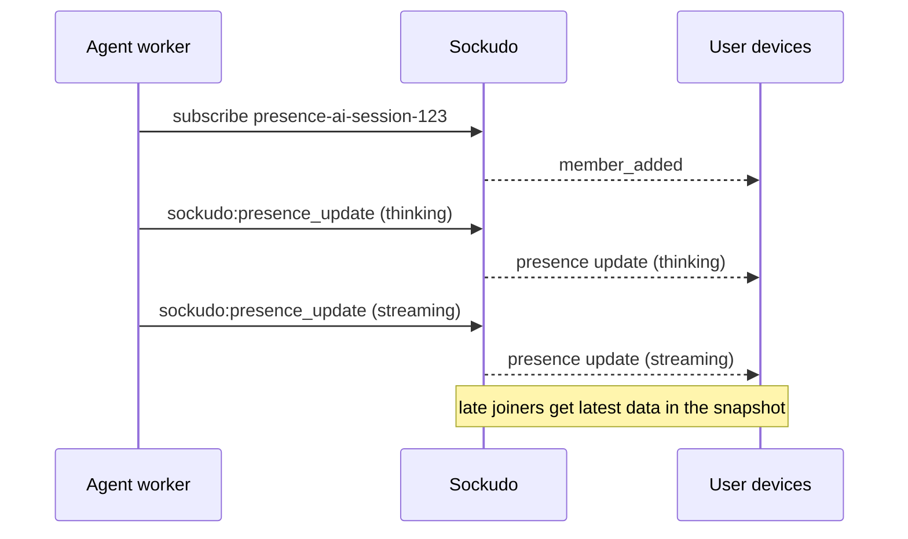

Agent presence lets every device in a session see what the agent is doing right now (idle,
thinking, or streaming) and whether it is still connected. It uses ordinary presence channels plus
one V2 frame, `sockudo:presence_update`, which changes a member's data in place instead of making
it leave and re-join. Use it to drive typing indicators, "agent is thinking" spinners, and
handoff UIs.

## How it works

A presence channel tracks who is subscribed and carries a small JSON payload per member. With
Protocol V1, the only way to change that payload is to leave and re-enter the channel, which every
other member sees as a departure followed by an arrival. `sockudo:presence_update` replaces the
payload for an existing member without that flap.



## Status convention

Sockudo does not interpret member data. The SDKs and examples use a `status` field:

```json
{ "status": "idle" }
{ "status": "thinking" }
{ "status": "streaming" }
```

Keep the payload small. Put run identifiers or progress details in channel events, not in presence
data.

## Send an update

<Steps>

1. Connect with Protocol V2 and subscribe to a `presence-` channel. Capability-token connections
   need the `presence` operation for that channel.

2. Wait until the subscription succeeds; the connection must already be a member of the presence
   channel before it can update its data.

3. Send the update frame with the channel name and the new member data:

   ```json
   {
     "event": "sockudo:presence_update",
     "data": {
       "channel": "presence-ai-session-123",
       "data": { "status": "thinking" }
     }
   }
   ```

</Steps>

Other V2 members receive a `sockudo_internal:presence_update` event whose data contains `user_id`
and the new `user_info`. If presence history is enabled for the channel, the transition is
recorded there too, and apps subscribed to the `member_updated` webhook are notified.

Late joiners see the latest member data in the presence snapshot returned with
`subscription_succeeded`.

## Limits and access

| Rule | Behavior when violated |
| --- | --- |
| Protocol V2 only. | Rejected with `104009` `ai_presence_update_invalid`. |
| The target must be a `presence-` channel, and the connection must already be a member. | Rejected with `104009`. |
| Capability-token connections need `presence` permission for the channel. | Rejected as a capability failure. |
| Member `data` is capped at 1 KiB (1024 bytes, JSON-encoded). | Rejected with `40009` `payload_too_large`. |
| Updates are rate limited per app/channel/member by `[presence].update_rate_limit_per_member_per_second`, default `10`. | Rejected with the client-event rate-limit error. |

V1/Pusher clients do not receive update events.

## Disconnect grace

Agents and mobile clients drop connections for a few seconds all the time. Presence can hold a
member during a short grace window so a brief network loss does not look like the agent left.

| Setting | Default | Applies to |
| --- | --- | --- |
| `[presence].ungraceful_timeout_seconds` | `0` | Protocol V1 abnormal disconnects. `0` preserves legacy immediate `member_removed` timing. |
| `[presence].v2_ungraceful_timeout_seconds` | `15` | Protocol V2 abnormal disconnects, so transient transport loss does not produce a leave/enter flap. |

Clean unsubscribe and clean WebSocket close still remove immediately. A V2 client that resumes
within the window keeps its membership without a flap.

```toml title="config.toml"
[presence]
update_rate_limit_per_member_per_second = 10
ungraceful_timeout_seconds = 0
v2_ungraceful_timeout_seconds = 15
```

<Callout type="warn" title="Presence is not ordered with messages">
Presence update ordering is independent from channel message ordering. Treat presence status as
latest-known member state, not as a causal marker for `ai-output` or mutable-message delivery. To
know whether a reply is finished, read the output message's `status` or the `ai-run-end` event.
</Callout>

## Next steps

<Cards>
  <Card title="AI Transport overview" href="/docs/server/ai-transport-overview" description="Where presence fits in the session channel model." />
  <Card title="Presence history" href="/docs/clients/presence-history" description="Read historical join, leave, and update transitions." />
  <Card title="Authentication" href="/docs/server/ai-transport-authentication" description="Grant the presence capability to the right members." />
  <Card title="Troubleshooting" href="/docs/server/ai-transport-troubleshooting" description="Fix presence flaps and rejected updates." />
</Cards>
