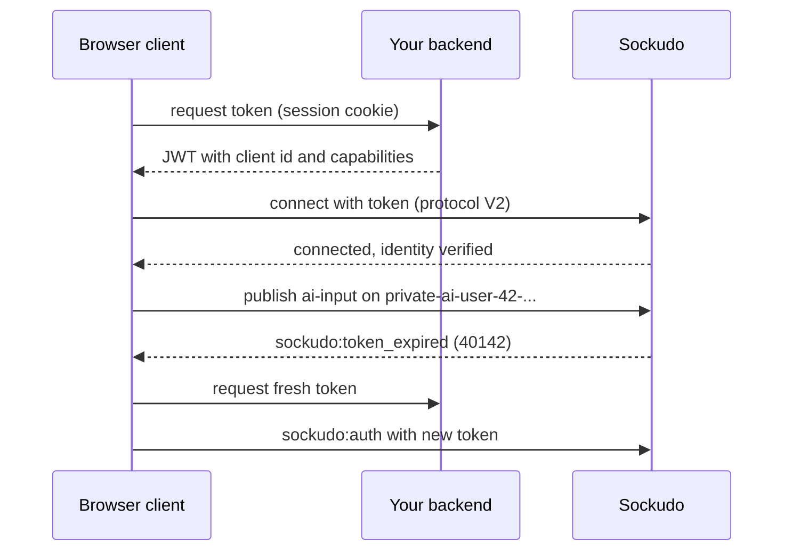

AI Transport trusts identity, never claims. Every `run-client-id` and `input-client-id` header, and
every own-scoped edit or append, is checked against an identity Sockudo verified itself. This page
shows how to issue that identity with short-lived Protocol V2 capability tokens, how to scope what
each user can do, and how to refresh and revoke tokens. You need it before letting real users
publish `ai-input` from a browser or mobile app.

## Three layers of authority

| Layer | Used for | Authority |
| --- | --- | --- |
| App-key HTTP auth | Server publishes, mutations, history reads, push management, revocation | Trusted backend with app secret |
| Private/presence channel auth | Subscription admission | Customer backend signs channel auth |
| Protocol V2 capability token | Client connection identity and channel-scoped capabilities | Customer backend issues short-lived JWT |

In practice: your **agent worker** uses the app key over HTTP, and your **browser or mobile client**
connects with a capability token that your backend minted for the signed-in user. Token auth is
additive; it never weakens the existing private and presence channel signature rules, so private
channels still need channel authorization.

Never trust `client_id` from message bodies or AI headers. Verified identity comes from signed-in
socket state, capability-token claims, or trusted server app-key context.



## Capability token claims

Capability tokens are HS256 JWTs signed with the app secret. Header `kid` must equal the app key.
Claims are:

```json
{
  "x-sockudo-client-id": "user-42",
  "x-sockudo-capability": {
    "private-ai-user-42-*": [
      "subscribe",
      "publish",
      "history",
      "message_append_own"
    ]
  },
  "iat": 1764835200,
  "nbf": 1764835200,
  "exp": 1764838800,
  "jti": "tok_01J..."
}
```

`x-sockudo-capability` accepts either the JSON object shown above or its stringified form. Each
object key is a channel pattern and its value is the list of operations granted on matching
channels. `exp`, `iat`, and `jti` are required; `nbf` is optional.

### Token limits

| Limit | Value | Result when exceeded |
| --- | --- | --- |
| Encoded token size | 8 KiB | Authentication fails. |
| Capability patterns | 100 | Authentication fails. |
| `x-sockudo-client-id` | 1 to 128 bytes | Authentication fails. |
| `jti` | 1 to 128 bytes | Authentication fails. |
| Lifetime (`exp` minus `iat`) | 24 hours | Authentication fails. |
| Clock skew tolerance | 30 seconds | Applied to `exp`, `nbf`, and future-dated `iat`. |
| Algorithm | HS256 only | Any other `alg` is rejected. |

### Operations

| Operation | Grants |
| --- | --- |
| `subscribe` | Subscribe to matching channels. |
| `publish` | Publish events, including `ai-input` and `ai-cancel` on AI channels. |
| `history` | Read channel history over the WebSocket. |
| `presence` | Join and update presence on matching presence channels. |
| `message_update_own`, `message_delete_own`, `message_append_own` | Mutate messages this client created. |
| `message_update_any`, `message_delete_any`, `message_append_any` | Mutate any message on matching channels. |
| `annotation-publish`, `annotation-subscribe`, `annotation-delete-own`, `annotation-delete-any` | Annotation operations, independent from `publish`/`subscribe`. |
| `push-admin`, `push-subscribe` | Channel-scoped push management. |

Message mutation operations accept their documented underscore spelling and equivalent hyphenated
spelling (`message-append-own`). Annotation and push operation names accept both spellings as well.
Any other operation name makes the token invalid.

<Callout type="warn" title="Tokens deny by default">
A capability token replaces the connection's implicit permissions. `subscribe`, `publish`,
`history`, and `presence` are granted only on channels that match a listed pattern, so a token that
forgets `history` cannot read history, even on a channel it can subscribe to.
</Callout>

### Channel patterns

Patterns accept exact channel names, `*`, and wildcard matching as implemented by
`ConnectionCapabilities`: one `*` may appear at the end (`private-ai-user-42-*`), at the start
(`*-sess-01J`), or in the middle. Matching is case-sensitive. Keep user tokens narrow:

```json
{
  "private-ai-user-42-*": [
    "subscribe",
    "publish",
    "history",
    "message_append_own",
    "message_update_own",
    "annotation-subscribe"
  ],
  "presence-ai-user-42-*": ["subscribe", "presence"]
}
```

Put the user (and tenant) in the channel name, as above, so a single trailing wildcard cannot reach
another user's sessions.

## Issue tokens from your backend

<Steps>

1. Authenticate the user with your own session (cookie, OAuth, or similar). Never accept a user ID
   from the request body.

2. Build the capability map for that user from server-side data.

3. Sign the JWT with the app secret and return it with its expiry.

4. Configure the client to call this endpoint for the first connection and every refresh.

</Steps>

### Node example

```ts title="lib/sockudo-token.ts"
import crypto from "node:crypto";

function base64url(value: unknown): string {
  return Buffer.from(JSON.stringify(value)).toString("base64url");
}

export function issueSockudoToken({
  appKey,
  appSecret,
  clientId,
  capabilities,
  ttlSeconds = 3600,
  now = Math.floor(Date.now() / 1000),
}: {
  appKey: string;
  appSecret: string;
  clientId: string;
  capabilities: Record<string, string[]>;
  ttlSeconds?: number;
  now?: number;
}): { token: string; exp: number } {
  const header = { alg: "HS256", typ: "JWT", kid: appKey };
  const exp = now + ttlSeconds;
  const payload = {
    "x-sockudo-client-id": clientId,
    "x-sockudo-capability": JSON.stringify(capabilities),
    iat: now,
    nbf: now,
    exp,
    jti: crypto.randomUUID(),
  };
  const signingInput = `${base64url(header)}.${base64url(payload)}`;
  const signature = crypto.createHmac("sha256", appSecret).update(signingInput).digest("base64url");
  return { token: `${signingInput}.${signature}`, exp };
}
```

```ts title="app/api/sockudo/token/route.ts"
import { issueSockudoToken } from "@/lib/sockudo-token";
// App code: returns the signed-in user's ID or throws.
import { requireUserId } from "@/lib/auth";

export async function POST(req: Request) {
  const userId = await requireUserId(req);
  const result = issueSockudoToken({
    appKey: process.env.SOCKUDO_APP_KEY!,
    appSecret: process.env.SOCKUDO_APP_SECRET!,
    clientId: userId,
    capabilities: {
      [`private-ai-${userId}-*`]: ["subscribe", "publish", "history", "message_append_own"],
      [`presence-ai-${userId}-*`]: ["subscribe", "presence"],
    },
  });
  return Response.json(result); // { token, exp }
}
```

### Rust example

```rust title="src/sockudo_token.rs"
use jsonwebtoken::{Algorithm, EncodingKey, Header, encode};
use serde::Serialize;
use std::collections::BTreeMap;

#[derive(Serialize)]
struct Claims {
    #[serde(rename = "x-sockudo-client-id")]
    client_id: String,
    #[serde(rename = "x-sockudo-capability")]
    capability: BTreeMap<String, Vec<String>>,
    iat: i64,
    nbf: i64,
    exp: i64,
    jti: String,
}

fn issue_sockudo_token(
    app_key: &str,
    app_secret: &str,
    client_id: &str,
    capabilities: BTreeMap<String, Vec<String>>,
    now: i64,
    jti: String,
) -> jsonwebtoken::errors::Result<String> {
    let mut header = Header::new(Algorithm::HS256);
    header.kid = Some(app_key.to_owned());
    encode(
        &header,
        &Claims {
            client_id: client_id.to_owned(),
            capability: capabilities,
            iat: now,
            nbf: now,
            exp: now + 3600,
            jti,
        },
        &EncodingKey::from_secret(app_secret.as_bytes()),
    )
}
```

## Connect with a token

A V2 WebSocket connection carries its first token in the `token` query parameter. With
`@sockudo/client`, set `token` for a static token, or `authUrl` / `authCallback` to fetch one on
connect and on every refresh:

```ts title="src/realtime.ts"
import Sockudo from "@sockudo/client";

export const client = new Sockudo("app-key", {
  wsHost: "realtime.example.com",
  forceTLS: true,
  protocolVersion: 2,
  channelAuthorization: { endpoint: "/api/sockudo/channel-auth" },
  authCallback: async ({ reason }) => {
    // reason is "initial", "reconnect", "refresh", or "expired"
    const res = await fetch("/api/sockudo/token", { method: "POST" });
    return res.json(); // { token, exp }
  },
});
```

Capability tokens require Protocol V2; a V1 connection cannot apply one.

## Refresh and revocation

Refresh a V2 connection with `sockudo:auth`:

```json
{
  "event": "sockudo:auth",
  "data": { "token": "<new-token>" }
}
```

Refresh cannot change `client_id`: a token for a different identity is rejected and the existing
token stays in effect.

When a token reaches `exp`, Sockudo sends `sockudo:token_expired` with `code` `40142` and
`reason` `"expired"`. The client then has 30 seconds to send `sockudo:auth` with a fresh token;
otherwise the connection closes with code `4009`. Clients configured with `authUrl` or
`authCallback` refresh automatically.

To revoke tokens, call signed HTTP:

```http
POST /apps/{appId}/revocations
```

with `jti`, `client_id`, or both. Optional fields are `ttl_seconds` or `expires_at` (how long the
revocation is remembered; defaults to 24 hours) and `reason`. The response reports `revoked_jti`,
`revoked_client_id`, and `closed_connections`.

```json title="Request body"
{ "jti": "tok_01J...", "reason": "device lost" }
```

Matching local sockets receive `sockudo:token_expired` with `code` `40160` and `reason`
`"revoked"`, then close immediately with code `4009`. Revocations are stored in the cache, and
every new connection or refresh checks them, so a revoked token cannot be reused.

<Callout type="warn" title="Revoking a client_id blocks new tokens too">
A `client_id` revocation rejects every token for that identity, including tokens you issue after
the revocation, until the revocation's TTL expires. Revoke by `jti` to end one session; revoke by
`client_id` only to lock out a user entirely, and choose `ttl_seconds` deliberately.
</Callout>

## Agents and server workers

Agent/server workers should use trusted app-key HTTP or a deliberately scoped server-issued token.
Agent events (`ai-output` and the `ai-run-*` lifecycle) are accepted only through trusted app-key
HTTP. HTTP mutations sent with a `socket_id` are evaluated against that socket's identity and
capabilities; mutations sent without `socket_id` are privileged server-side operations.

## Next steps

<Cards>
  <Card title="AI Transport overview" href="/docs/server/ai-transport-overview" description="See where tokens fit in the run lifecycle." />
  <Card title="Conventions" href="/docs/server/ai-transport-conventions" description="Identity headers and the anti-spoof rule." />
  <Card title="Security" href="/docs/server/security" description="Secrets, origin policy, and client message controls." />
  <Card title="Troubleshooting" href="/docs/server/ai-transport-troubleshooting" description="Diagnose token loops and permission errors." />
</Cards>
