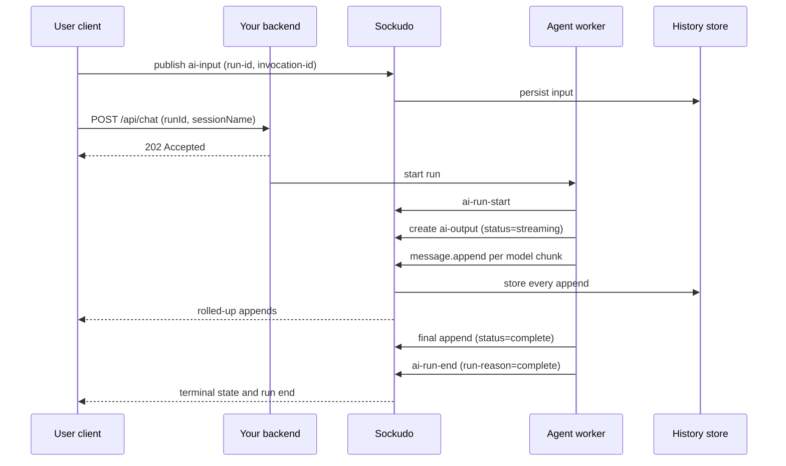

AI Transport turns a streamed LLM answer into durable, ordered channel state. Instead of tying a
response to one HTTP request, the agent writes every token into a Sockudo channel, and any device
can follow along live, reconnect mid-answer, or reload the finished transcript later. Read this page
first if you are building a chat UI, a copilot, or a long-running agent and you want answers that
survive refreshes, flaky networks, and device switches.

AI Transport is a Protocol V2 convention layer, not a separate product. A session is a channel,
every run is normal channel traffic, and the server supplies durable, ordered, recoverable
primitives that SDKs reduce into UI state.

<Callout type="note" title="Credits and support">
Sockudo AI Transport is heavily inspired by [Ably AI Transport](https://ably.com/docs/ai-transport).
Ably's public AI Transport docs and SDK were the main product inspiration; Sockudo adapts that
model to Protocol V2, versioned messages, durable history, presence, push, and the local
`@sockudo/client` SDK. Sockudo AI Transport is community-built and community-maintained. It is not
an Ably product and is not supported by Ably.
</Callout>

## Why durable streaming

A plain streaming endpoint (`fetch` plus server-sent events) works until something interrupts it.
Close the tab, lose Wi-Fi in a lift, or open the same chat on your phone, and the half-finished
answer is gone: the tokens only ever existed inside one HTTP response.

AI Transport moves the answer out of the response and into a channel:

- **Refresh-safe.** The answer lives in durable history, so a reloaded page reads the same
  transcript.
- **Multi-device.** Every subscriber of the session channel sees the same tokens, in the same
  order.
- **Resumable.** A client that drops mid-answer resumes from its last serial and receives only what
  it missed.
- **Observable.** Run starts, ends, cancellations, and orphaned streams surface as webhooks and
  Prometheus metrics.

The HTTP request still exists, but it only starts the work. It returns `202 Accepted` and the answer
flows through the channel.

## Enable AI Transport

<Steps>

1. Build Sockudo with the `ai-transport` Cargo feature (it is not in the default feature set):

   ```bash
   cargo build -p sockudo --features "v2,ai-transport,redis,postgres"
   ```

2. Enable durable history and versioned messages. Startup rejects `ai_transport.enabled = true`
   unless both `[history].enabled` and `[versioned_messages].enabled` are true.

3. Turn on AI Transport and scope it to channel prefixes:

   ```toml title="config.toml"
   [ai_transport]
   enabled = true

   [[ai_transport.channels]]
   prefix = "private-ai-"
   ```

4. Name every AI session channel so it starts with a configured prefix, for example
   `private-ai-user-42-sess-01J`. Prefix matching is a plain string prefix: `private-ai:user-42`
   does **not** match `private-ai-`.

</Steps>

<Callout type="warn" title="AI events on unmatched channels are rejected">
AI validation applies only to channels that match an `[[ai_transport.channels]]` prefix. Publishing
an AI event name (or `extras.ai` metadata) to any other channel fails with `104003`
`ai_event_not_permitted` and the message `AI Transport is not enabled for this channel`.
</Callout>

## Mental model

Four ideas cover almost everything:

| Concept | What it is | In Sockudo terms |
| --- | --- | --- |
| Session | One conversation between a user and an agent. | One private or presence channel. |
| Run | One user turn plus the agent's reply to it, identified by `run-id`. | A sequence of ordinary channel events that share `extras.ai.transport.run-id`. |
| Output message | The assistant's reply, which grows token by token. | One mutable message: a `message.create` followed by `message.append` operations. |
| Transcript | What the user sees after reload. | Durable history with every mutable message substituted by its latest aggregate. |

A run moves through a small lifecycle. The client sends input, the agent announces the run, streams
output, and closes the run with a reason:



Your backend and the agent worker are often the same process: the `/api/chat` route accepts the
request, returns `202`, and keeps streaming in the background. Ownership is split deliberately:

- **Clients** may publish only `ai-input` and `ai-cancel`, and only with a verified identity.
- **Agents** publish `ai-output`, the run lifecycle events, and the step events through trusted
  app-key HTTP. A WebSocket client that publishes an agent event receives `104003` with the message
  `agent AI events require trusted app-key publish`.

### Why resume works

Deliveries on a durable V2 channel carry a `stream_id` and a monotonic `serial`. A reconnecting
client sends its last position, and Sockudo replays from the hot replay buffer or, if that has expired,
from durable history (reported as `hot` or `cold` recovery). When Sockudo cannot prove the range is
contiguous, it fails closed with `stream_reset` or `position_expired` rather than delivering a
transcript with a silent hole. A late joiner can also request history with `until_attach: true`,
which returns everything at or below its subscription attach serial, so history plus live delivery
forms one gap-free sequence.

### Why every original mutation is kept

The version store and durable history record every `message.append` exactly as received. Live
WebSocket delivery may coalesce a burst of appends into one frame
([append rollup](/docs/server/token-streaming-rollup)), but that is the only place coalescing
happens. Persistence, history, recovery, webhooks, push, billing, and rate limits all see the
original operations. Keeping storage unrolled means a client that reduces the full log and a client
that received rolled-up frames always arrive at the same final message.

## The primitives

AI Transport reuses Sockudo subsystems rather than adding AI-only storage:

| Primitive | Plain-language role | Sockudo subsystem |
| --- | --- | --- |
| Session | The conversation container. | One channel, usually private or presence, for a user/agent conversation. |
| Input | What the user said. | `ai-input` channel event from a verified user-capable connection or trusted server. |
| Output | What the agent is saying, as it grows. | `ai-output` mutable message created and appended by the agent/server side. |
| Run lifecycle | When a reply starts, pauses, resumes, or ends. | `ai-run-start`, `ai-run-suspend`, `ai-run-resume`, `ai-run-end`, and `ai-cancel` events with bounded `extras.ai.transport` headers. |
| Mutable state | Editing a message without losing its history. | Existing versioned messages: create, update, delete, append, summary. |
| Replay | Catching up after a disconnect or late join. | Durable history, rewind, `until_attach`, and hot-to-durable recovery. |
| Identity | Who is allowed to say what. | V2 capability tokens, signed channel auth, and server app-key HTTP auth. |
| Agent state | Whether the agent is idle, thinking, or streaming. | Presence channels plus V2 `sockudo:presence_update`. |
| Notifications | Telling a user who left that the answer is ready. | Existing push device/channel-subscription pipeline and optional `[[push_rules]]`. |

### Event names

| Event | Published by | Purpose |
| --- | --- | --- |
| `ai-input` | Client or trusted server | User input for a run. |
| `ai-cancel` | Client or trusted server | Ask the agent to stop one or more runs. |
| `ai-output` | Agent (app key) | The assistant's mutable output message. |
| `ai-run-start` | Agent (app key) | A run began. |
| `ai-run-suspend` | Agent (app key) | A run paused without a terminal outcome; it can continue later. |
| `ai-run-resume` | Agent (app key) | A suspended run continues under a new `invocation-id`. |
| `ai-run-end` | Agent (app key) | A run finished with `run-reason` `complete`, `cancelled`, or `error`. |
| `ai-step-start`, `ai-step-end` | Agent (app key) | Open and close a re-attemptable step inside a run. |

Legacy `ai-turn-start` and `ai-turn-end` are still accepted as inbound aliases for migration; new
code uses the run vocabulary. The full header registry is in
[AI Transport conventions](/docs/server/ai-transport-conventions).

## What already exists

These features are not new AI-only subsystems:

- `MessageAction` and `VersionStore` for mutable messages.
- `HistoryStore`, rewind, and two-tier recovery.
- Presence and presence-history.
- Annotation publish/delete/summary projection.
- Push providers, device registrations, channel subscriptions, publish status, queues, retries,
  feedback, and scheduler.
- Protocol V2 capability tokens and revocation.
- V1 isolation: V1 clients keep Pusher-compatible output.

## What `ai-transport` adds

The feature adds validation and operational conventions:

- well-known AI event names
- bounded `extras.ai.transport` and `extras.ai.codec`
- anti-spoof checks for `*-client-id` headers
- stream lifecycle tracking and active-stream limits
- append rollup as WebSocket egress optimization
- orphan stream cancellation
- conformance, benchmark, load, and chaos suites

The formal wire reference is the
[AI Transport wire protocol](https://github.com/sockudo/sockudo/blob/master/docs/specs/ai-transport-wire-protocol.md)
specification in the repository.

## Build your first session

The JavaScript SDK `@sockudo/ai-transport` handles run IDs, optimistic UI, history decoding, and
the append codec for you. Install it next to the realtime client:

```bash
pnpm add @sockudo/client @sockudo/ai-transport ai @ai-sdk/vue
```

### Agent route

The agent side creates a session for the channel, registers the run the client announced, and pipes
the model stream into it.

```ts title="app/api/chat/route.ts"
import { streamText, toUIMessageStream } from "ai";
import { createAgentSession } from "@sockudo/ai-transport/vercel";
// App code: a ClientLike whose publishes and mutations use app-key HTTP.
import { realtimeClient } from "@/lib/sockudo-agent";
// App code: resolves the signed-in user and checks channel ownership.
import { requireSessionOwner } from "@/lib/auth";

export async function POST(req: Request) {
  const body = await req.json();
  const channelName: string = body.sessionName;
  const userId = await requireSessionOwner(req, channelName);

  const session = createAgentSession({ client: realtimeClient(), channelName });
  const run = session.createRun({
    runId: body.runId,
    invocationId: body.invocationId,
    inputEventId: body.inputEventId,
    clientId: userId,
    onCancel(request) {
      return request.runOwners.get(body.runId) === userId;
    },
  });

  const work = (async () => {
    await run.start();
    const result = streamText({
      model: "openai/gpt-5-mini",
      instructions: "You are a concise incident-room assistant.",
      prompt: latestText(body.messages),
      abortSignal: run.abortSignal,
    });
    await run.streamResponse(toUIMessageStream({ stream: result.stream }));
    await run.end("complete");
  })().finally(() => session.close());

  void work;
  return new Response(null, { status: 202 });
}

function latestText(messages: { parts?: { text?: string }[] }[] = []): string {
  return messages.at(-1)?.parts?.map((part) => part.text ?? "").join("") ?? "";
}
```

The client SDK posts `sessionName` (the channel name), `runId`, `invocationId`, `inputEventId`,
`clientId`, and the UI `messages` to `/api/chat`. Treat every field as untrusted input: derive the
user from your own session cookie or token and confirm that user owns `sessionName` before starting
work.

<Callout type="warn" title="The agent client must publish with app-key authority">
Agent events (`ai-output`, `ai-run-*`, `ai-step-*`) are rejected on WebSocket connections. The
`client` you pass to `createAgentSession` must route `publish`, `appendMessage`, `updateMessage`,
`deleteMessage`, and `history` through signed app-key HTTP. The Nuxt demo's `realtimeClient()` in
`client-sdks/sockudo-ai-transport-js/demo/server/utils/sockudo.ts` is a complete reference adapter
built on `adaptSockudoClient`.
</Callout>

On serverless platforms, keep the background work alive past the response (for example with the
platform's `waitUntil`), or run the agent in a long-lived worker.

### Browser client

The browser connects with Protocol V2, authenticates with a short-lived capability token so its
identity is verified, and hands the session to AI SDK `useChat`.

```ts title="src/chat.ts"
import { createSockudoRealtimeClient } from "@sockudo/ai-transport";
import { useChat } from "@ai-sdk/vue";
import { provideChatTransport } from "@sockudo/ai-transport/vercel/vue";

const realtime = await createSockudoRealtimeClient("app-key", {
  clientOptions: {
    wsHost: "realtime.example.com",
    forceTLS: true,
    channelAuthorization: { endpoint: "/api/sockudo/channel-auth" },
    authCallback: async ({ reason }) => {
      const res = await fetch("/api/sockudo/token", {
        method: "POST",
        headers: { "Content-Type": "application/json" },
        body: JSON.stringify({ reason }),
      });
      return res.json(); // { token, exp }
    },
  },
});

const channelName = "private-ai-user-42-sess-01J";
const provider = provideChatTransport({
  api: "/api/chat",
  channelName,
  client: realtime,
  clientId: "user-42",
});

const { sendMessage } = useChat({
  id: channelName,
  transport: provider.chatTransport.value,
});

await sendMessage({ text: "Investigate the last failed deploy." });
```

`createSockudoRealtimeClient` always connects with `protocolVersion: 2` and rejects any other
explicit version. To wrap a `Sockudo` instance you already created, pass it to
`adaptSockudoClient` instead. React and Svelte bindings live at
`@sockudo/ai-transport/vercel/react` and `@sockudo/ai-transport/vercel/svelte`. See
[Authentication for AI Transport](/docs/server/ai-transport-authentication) for the token endpoint.

## Session channel model

Use channel names that encode tenant/user/session ownership in your backend, and start them with a
configured AI prefix:

```text
private-ai-tenant-7-user-42-sess-01J...
presence-ai-tenant-7-sess-01J...
```

Add a `presence-ai-` prefix to `[[ai_transport.channels]]` if AI events will flow on presence
channels. Colon-delimited names such as `private-ai:tenant-7:...` are only valid when the app
defines a matching [channel namespace](/docs/reference/configuration); without one, Sockudo
rejects the name with `Unknown channel namespace`.

Clients should never assert `client_id` or tenant identity in message bodies. Derive channel access
from signed auth or capability-token claims, then scope `subscribe`, `publish`, `history`,
`message_append_own`, and related capabilities to the exact channel or a narrow wildcard such as
`private-ai-user-42-*`.

## AI SDK agents and durability

Sockudo durability and AI SDK agent durability solve different recovery problems. Use both when you
run long-lived agents.

| Layer | Owns | Recovers from |
| --- | --- | --- |
| Sockudo AI Transport | Published user inputs, assistant output chunks, approval responses, run lifecycle, and cursors. | Browser refresh, mobile handoff, reconnect, late join, transcript replay, and audit workflows. |
| AI SDK `WorkflowAgent` or agent store | Pending agent steps, sleeps, retries, tool execution state, model-local context, and checkpoints. | Worker crash, deployment restart, long-running wait states, and agent workflow resume. |
| Model provider runtime | Provider-native realtime sessions, reasoning controls, uploaded files, and provider tool context. | Provider-specific retries, session resume, or media reconnect semantics. |

Sockudo history is intentionally not a workflow checkpoint store. Persist the AI SDK workflow run id
or agent checkpoint id in run metadata, then correlate it with `channelName`, `runId`, and
`invocationId`. When a workflow resumes, it can reload its own checkpoint and continue appending to
the same Sockudo session channel; clients recover the visible transcript from Sockudo.

## Compatibility

AI Transport is V2-only. V1 connections can still coexist on the same server, but they do not see
V2 extras, mutable-message fields, recovery frames, annotations, or AI validation semantics.

## Next steps

<Cards>
  <Card title="Conventions" href="/docs/server/ai-transport-conventions" description="Event names, extras headers, idempotency, and the deployment matrix." />
  <Card title="Providers" href="/docs/server/ai-transport-providers" description="Stream from Vercel AI SDK, OpenAI, Anthropic, or a custom model gateway." />
  <Card title="Authentication" href="/docs/server/ai-transport-authentication" description="Issue capability tokens and scope who can read, write, and append." />
  <Card title="Token streaming and rollup" href="/docs/server/token-streaming-rollup" description="How high-rate appends are coalesced on egress without losing data." />
</Cards>
