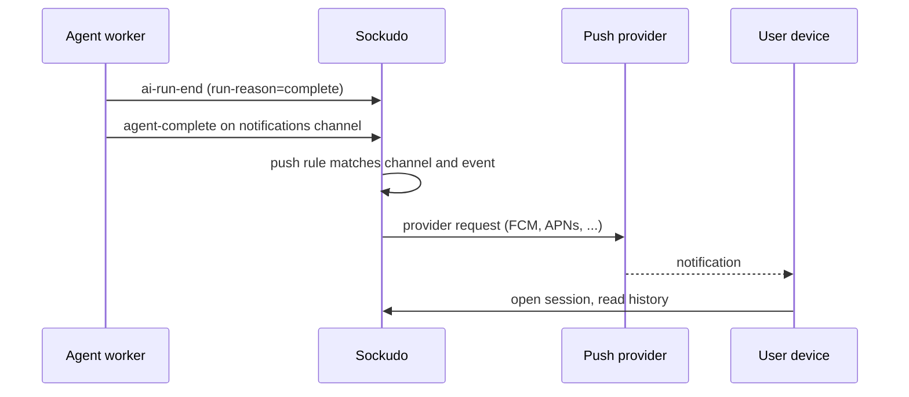

Long agent runs often outlive the user's attention: they ask a question, lock their phone, and come
back later. This page shows two ways to send a push notification when the answer is ready, both
built on Sockudo's existing push pipeline. You need it when runs take longer than a user will keep
the app open.

AI Transport uses normal Sockudo channel events for lifecycle and output. Push rules let those same
channel publishes wake devices through the existing push notification pipeline.

## Choose a recipe

| Recipe | How it triggers | Choose it when |
| --- | --- | --- |
| Channel push rule | The agent publishes an ordinary event (for example `agent-complete`) to a notification channel; a `[[push_rules]]` entry turns it into a push. | You want zero backend code and static notification text. |
| Webhook recipe | The `ai_run_ended` webhook reaches your backend, which calls the push publish API. | You need enrichment, quiet hours, or a database lookup before notifying. |

Both recipes deliver through the same durable push status, fanout, queue, retry, and feedback
transitions as any other push publish.



## Channel rule recipe

<Steps>

1. Build Sockudo with the `push` feature and configure at least one provider. See
   [Push notifications](/docs/server/push-notifications) for provider credentials.

2. Add a rule that watches each user's notification channel:

   ```toml title="config.toml"
   [[push_rules]]
   enabled = true
   channel_pattern = "notifications:*"
   event_filter = ["agent-complete"]
   rate_limit_per_second = 100

   [push_rules.payload_mapping]
   title_field = "title"
   body_field = "body"
   template_data_field = "data"
   include_remaining_fields = true
   ```

3. Register each device and subscribe it to the same channel the app is allowed to read:

   ```http
   POST /apps/{appId}/push/channelSubscriptions
   ```

4. Have the long-running agent publish a normal event when the answer is ready:

   ```json
   {
     "name": "agent-complete",
     "channel": "notifications:user-123",
     "data": {
       "title": "Agent finished",
       "body": "Your answer is ready",
       "sessionId": "sess_123"
     }
   }
   ```

</Steps>

Sockudo maps `title` and `body` into the push notification and copies the remaining fields into
provider data under `data`. The push target is `Channel { channel: "notifications:user-123" }`, so
existing channel subscriptions determine which devices receive FCM, APNs, Web Push, HMS, or WNS
delivery.

Rule details:

- `channel_pattern` accepts exact names, `*`, or a single trailing wildcard such as
  `notifications:*`.
- `event_filter` is a non-empty allowlist of at most 32 event names, each at most 200 bytes.
- `rate_limit_per_second` defaults to `100` per rule.
- Rules are validated at startup, and a publish that matches no rule does no push work.

<Callout type="note" title="Colon channel names need a namespace">
A channel such as `notifications:user-123` belongs to the `notifications` namespace. Sockudo
rejects colon-delimited channel names unless the app defines that namespace; see
[Channel namespaces](/docs/reference/configuration). Alternatively use a hyphenated name such as
`private-notifications-user-123` with a matching `channel_pattern`.
</Callout>

When the user taps the notification, the client should load `sessionId`, attach to the realtime
session channel, and read history/recovery state for the authoritative transcript. The notification
is a pointer, not the answer.

## Webhook recipe

For teams that keep push orchestration in their backend, enable the `ai_run_ended` webhook. Its
payload carries `channel`, `run_id`, `reason`, and an optional `error_code`. On
`reason = "complete"`, the backend can call the existing push publish API
(`POST /apps/{appId}/push/publish`):

```json
{
  "recipients": [
    { "type": "channel", "channel": "notifications:user-123" }
  ],
  "payload": {
    "title": "Agent finished",
    "body": "Your answer is ready",
    "templateData": {
      "data": { "sessionId": "sess_123" }
    }
  },
  "sync": false
}
```

With the Node server SDK, the same handler looks like this:

```ts title="app/api/sockudo/webhooks/route.ts"
import Sockudo from "sockudo";
// App code: maps a session channel to the user who owns it.
import { ownerOfChannel } from "@/lib/sessions";

const sockudo = new Sockudo({
  appId: process.env.SOCKUDO_APP_ID!,
  key: process.env.SOCKUDO_APP_KEY!,
  secret: process.env.SOCKUDO_APP_SECRET!,
  host: "realtime.example.com",
  useTLS: true,
});

export async function POST(req: Request) {
  const rawBody = await req.text();
  const webhook = sockudo.webhook({
    headers: Object.fromEntries(req.headers),
    rawBody,
  });
  if (!webhook.isValid()) return new Response("invalid signature", { status: 401 });

  for (const event of webhook.getEvents()) {
    if (event.name !== "ai_run_ended" || event.reason !== "complete") continue;
    const userId = await ownerOfChannel(event.channel);
    await sockudo.publishPush({
      recipients: [{ type: "channel", channel: `notifications:${userId}` }],
      payload: {
        title: "Agent finished",
        body: "Your answer is ready",
        templateData: { data: { sessionId: event.channel } },
      },
    });
  }
  return new Response(null, { status: 200 });
}
```

This path is useful when the backend enriches notifications, applies product-specific quiet hours,
or joins run metadata with an application database before sending push. Webhooks are delivered at
least once, so make the handler idempotent (for example by keying on `run_id`).

## Authorization

Use capability patterns so clients can subscribe only to their own notification channels, for
example `notifications:user-123`, while trusted backends or agent workers publish `agent-complete`.
Do not accept `client_id` from the message body when choosing a notification channel; derive the
channel from verified auth state or server-side session ownership.

<Callout type="warn" title="Do not let clients publish the trigger event">
Anyone who can publish `agent-complete` to a user's notification channel can send that user a push.
Grant `publish` on notification channels only to the agent's app-key HTTP path, never in a client
capability token.
</Callout>

## Verification surface

The recipe relies on existing push device registration, channel subscriptions, channel publish
targets, scheduled/status handling, delivery feedback, retries, and dead-letter behavior. Push
rules add only the channel-to-push trigger; accepted work still goes through the same durable
status, fanout, queue, retry, and feedback transitions as explicit push publishes.

## Next steps

<Cards>
  <Card title="Push notifications" href="/docs/server/push-notifications" description="Providers, device registration, publish status, and retries." />
  <Card title="Webhooks" href="/docs/server/webhooks" description="Configure endpoints and validate ai_run_ended deliveries." />
  <Card title="Authentication" href="/docs/server/ai-transport-authentication" description="Scope push-subscribe and publish capabilities per user." />
  <Card title="AI Transport overview" href="/docs/server/ai-transport-overview" description="Reopen the session channel after the notification tap." />
</Cards>
