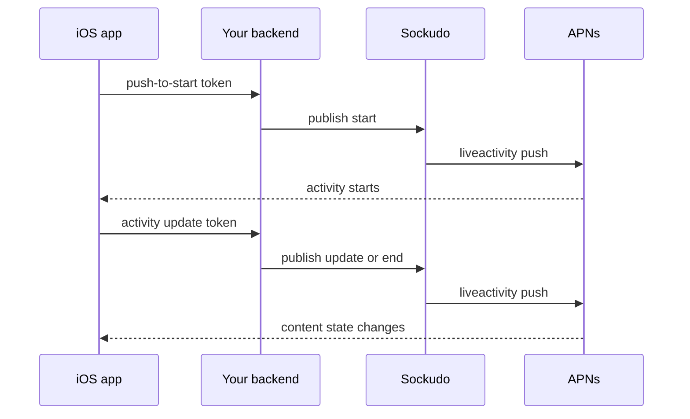

# Apple Live Activities

This page covers driving iOS Live Activities from your server through Sockudo: starting an
activity remotely, updating and ending it, and broadcasting one update to millions of devices
through iOS 18 channels. Use it when your app shows live state on the Lock Screen or Dynamic Island
(rides, deliveries, scores, builds) and that state changes on your backend.

Sockudo supports the complete server-side ActivityKit lifecycle:

- token-based push-to-start, update, and end notifications
- automatic `<bundle-id>.push-type.liveactivity` topics
- direct priority 5 (`conservePower`) and 10 (`immediate`), plus broadcast-only priority 1 (`lowPower`)
- `stale-date`, `dismissal-date`, relevance score, alerts, and iOS 18 input push token/channel fields
- iOS 18 broadcast channel create, inspect, delete, update, and end
- durable admission, scheduling, idempotency, retry, dead letters, status, metrics, and backpressure from the normal push pipeline

Sockudo builds and validates the APNs wire payload. Callers use camel-case typed fields and never
need to construct hyphenated `aps` keys or APNs headers themselves. The implementation follows
Apple's [ActivityKit remote update contract](https://developer.apple.com/documentation/ActivityKit/starting-and-updating-live-activities-with-activitykit-push-notifications),
[APNs request contract](https://developer.apple.com/documentation/usernotifications/sending-notification-requests-to-apns),
[broadcast request contract](https://developer.apple.com/documentation/usernotifications/sending-broadcast-push-notification-requests-to-apns),
and [channel management contract](https://developer.apple.com/documentation/usernotifications/sending-channel-management-requests-to-apns).

## Three ways to reach an activity

Every Live Activity request is a normal [push publish](/docs/server/push-notifications#publish)
with two additions: a Live Activity recipient and a typed `liveActivity` object. Which recipient you
use depends on what you are doing.

| Goal | Recipient `transportType` | Token or ID | Allowed events |
| --- | --- | --- | --- |
| Start a new activity remotely | `apnsLiveActivity` | The app's **push-to-start token** | `start` |
| Update or end one specific activity | `apnsLiveActivity` | That activity's **update token** | `update`, `end` |
| Update or end every activity watching shared content | `apnsLiveActivityBroadcast` | A broadcast **channel ID** plus its `storagePolicy` | `update`, `end` |

Direct tokens cost one APNs request per activity. A broadcast channel costs one APNs request no
matter how many devices subscribe, which is why shared content (a match score, a flight status)
belongs on a channel.



## Apple app setup

Enable Push Notifications and Live Activities for the application and widget extension. Add
`NSSupportsLiveActivities` to the app's Info.plist. If the product needs higher-frequency updates,
also add `NSSupportsLiveActivitiesFrequentUpdates`; users can still disable frequent updates, so
the app should observe ActivityKit authorization changes and tolerate coalescing.

<Callout type="warn" title="Tokens rotate for the life of the activity">
Every activity update token and push-to-start token can rotate. Observe the async token sequences
for the entire activity lifetime, upload every new value to your backend, and stop using the old
value immediately. The Sockudo Swift client includes cancellable observers for both sequences.
</Callout>

## Server configuration

<Steps>

1. Build the server with `push-apns`. Add `monolith` when the same process should run the durable
   planner, dispatcher, APNs delivery, feedback, repair, and cleanup workers:

   ```bash
   cargo build -p sockudo --release --features "push-apns,monolith"
   ```

   Without `monolith`, run the push worker roles separately; the HTTP API and broadcast-channel
   management surface remain available in the server process.

2. Enable APNs, Live Activities, and (optionally) broadcast under `[push]` and `[push.apns]`:

   ```toml title="config.toml"
   [push]
   apns_enabled = true
   dispatch_worker_count = 8
   dispatch_max_outbound_requests = 256

   [push.apns]
   topic = "com.example.rides"
   live_activities_enabled = true
   bundle_id = "com.example.rides"
   live_activity_topic = "" # derives com.example.rides.push-type.liveactivity
   broadcast_enabled = true
   endpoint = "https://api.push.apple.com"
   broadcast_endpoint = "https://api-broadcast.push.apple.com"
   management_endpoint = "https://api-manage-broadcast.push.apple.com:2196"
   default_broadcast_expiration_secs = 3600
   connect_timeout_ms = 5000
   request_timeout_ms = 10000
   pool_idle_timeout_secs = 90
   max_idle_connections_per_host = 128
   tcp_keepalive_secs = 60
   http2_keepalive_interval_secs = 30
   http2_keepalive_timeout_secs = 10
   ca_certificate_path = "" # optional extra PEM roots
   ```

3. Provide APNs credentials, either as a stored credential (`POST /apps/{appId}/push/credentials/apns`
   plus `PUSH_APNS_APP_ID`) or through `PUSH_APNS_TEAM_ID`, `PUSH_APNS_KEY_ID`, and
   `PUSH_APNS_PRIVATE_KEY_PATH`. See
   [Provider credentials](/docs/server/push-notifications#provider-credentials).

4. Start the server. Configuration is validated at boot; an invalid combination fails fast with
   the offending `push.apns.*` key.

</Steps>

Startup validation enforces these rules:

| Rule | Error when violated |
| --- | --- |
| `live_activities_enabled` requires `push.apns_enabled`. | `push.apns.live_activities_enabled requires push.apns_enabled` |
| `broadcast_enabled` requires `live_activities_enabled`. | `push.apns.broadcast_enabled requires push.apns.live_activities_enabled` |
| `topic` must be set when APNs is enabled. `bundle_id` falls back to `topic`. | `push.apns.topic must not be empty when APNs is enabled` |
| `live_activity_topic`, when set, must equal `<bundle_id>.push-type.liveactivity`. | `push.apns.live_activity_topic must equal <bundle_id>.push-type.liveactivity` |
| `default_broadcast_expiration_secs` must be between 1 and 28800 (eight hours). | `push.apns.default_broadcast_expiration_secs must be between 1 and 28800` |
| All three endpoints must be `https` URLs without user information. | `push.apns.<name> must be an HTTPS URL without user information` |

`ca_certificate_path` adds root certificates to the built-in public roots for every APNs, broadcast,
and channel-management connection. Use it for private egress proxies or for staged rollouts against
an APNs-compatible mock; leave it empty to trust only Apple's public certificate chain.

<Callout type="tip" title="Sandbox uses three hosts">
Use all three sandbox hosts for sandbox tokens and channels:

- `https://api.sandbox.push.apple.com`
- `https://api-broadcast.sandbox.push.apple.com`
- `https://api-manage-broadcast.sandbox.push.apple.com:2195`
</Callout>

Broadcast channel management supports the same APNs token or mTLS credential stored for dispatch.
For token authentication, configure `teamId`, `keyId`, and a `.p8` private key, or a short-lived
provider token. APNs provider JWTs are cached for 55 minutes and invalidated once on
`ExpiredProviderToken`; Sockudo does not regenerate them more frequently than Apple's recommended
interval. Secrets remain in the existing encrypted credential store or secret environment
variables.

`lowPower` maps to APNs priority 1 and is valid only for broadcast requests. Direct token delivery
uses `conservePower` (5, the default) or `immediate` (10).

## The liveActivity object

| Field | Type | Meaning |
| --- | --- | --- |
| `event` | `start`, `update`, or `end` | The ActivityKit event. |
| `timestamp` | UNIX seconds | Required and positive. Keep it current and monotonically ordered per activity. |
| `contentState` | object | Required. Must match your `Activity.ContentState`. |
| `attributesType` | string | The `ActivityAttributes` type name. Start only. |
| `attributes` | object | Static activity attributes. Start only. |
| `alert` | object | Alert shown with the push. Required for start. |
| `staleDate` | UNIX seconds | When the content becomes stale. Update only. |
| `dismissalDate` | UNIX seconds | When an ended activity leaves the Lock Screen. End only. |
| `relevanceScore` | number | Finite and non-negative. Orders multiple activities. |
| `inputPushToken` | boolean | iOS 18: ask the started activity for an update token. Start only. |
| `inputPushChannel` | string | iOS 18: subscribe the started activity to a broadcast channel. Start only. |
| `priority` | `lowPower`, `conservePower`, `immediate` | APNs priority 1, 5, or 10. Defaults to `conservePower`. |

Sockudo rejects a publish with `400` when:

- a Live Activity recipient is present but `liveActivity` is missing;
- `liveActivity` is combined with an APNs entry in `providerOverrides`;
- a `start` omits `attributesType`, `attributes`, or `alert`, or sets `staleDate` or `dismissalDate`;
- an `update` sets start fields, `dismissalDate`, `inputPushToken`, or `inputPushChannel`;
- an `end` sets start fields, `staleDate`, `inputPushToken`, or `inputPushChannel`;
- `inputPushToken` and `inputPushChannel` are both set;
- `lowPower` is used for direct (non-broadcast) delivery;
- a broadcast recipient carries a `start` event.

## Start from a push-to-start token

Broadcast notifications cannot start an activity. Send a start request to a push-to-start token:

```http
POST /apps/{appId}/push/publish
Content-Type: application/json
x-sockudo-push-capability: push-admin

{
  "publishId": "ride-184-start-v1",
  "recipients": [{
    "type": "recipient",
    "recipient": {
      "transportType": "apnsLiveActivity",
      "activityToken": "PUSH_TO_START_TOKEN"
    }
  }],
  "payload": {},
  "liveActivity": {
    "event": "start",
    "timestamp": 1725000000,
    "contentState": { "status": "driverAssigned", "etaMinutes": 4 },
    "attributesType": "RideAttributes",
    "attributes": { "rideID": "ride-184" },
    "alert": { "title": "Driver assigned", "body": "Arriving in 4 minutes" },
    "inputPushToken": true,
    "priority": "immediate"
  }
}
```

```json title="202 Accepted"
{
  "publishId": "ride-184-start-v1",
  "status": "accepted",
  "expectedRecipients": 1,
  "fanoutRegime": "fastPath"
}
```

The real response also includes `renderedPayloads`, one preview per provider; it is omitted here.

On iOS 18, use either `inputPushToken: true` or `inputPushChannel: "CHANNEL_ID"`, never both.
The channel form lets the newly started activity subscribe directly to a broadcast channel.

## Update or end one activity

Use the activity's current update token with `transportType: "apnsLiveActivity"`. An update may
set `staleDate`; an end may set `dismissalDate`. Keep `timestamp` current and monotonically ordered
for a given activity.

```json title="Update"
{
  "publishId": "ride-184-update-42",
  "recipients": [{
    "type": "recipient",
    "recipient": {
      "transportType": "apnsLiveActivity",
      "activityToken": "CURRENT_ACTIVITY_UPDATE_TOKEN"
    }
  }],
  "payload": {},
  "liveActivity": {
    "event": "update",
    "timestamp": 1725000042,
    "contentState": { "status": "arriving", "etaMinutes": 1 },
    "staleDate": 1725000162,
    "relevanceScore": 0.9,
    "priority": "conservePower"
  }
}
```

```json title="End"
{
  "publishId": "ride-184-end",
  "recipients": [{
    "type": "recipient",
    "recipient": {
      "transportType": "apnsLiveActivity",
      "activityToken": "CURRENT_ACTIVITY_UPDATE_TOKEN"
    }
  }],
  "payload": {},
  "liveActivity": {
    "event": "end",
    "timestamp": 1725000300,
    "contentState": { "status": "completed", "etaMinutes": 0 },
    "dismissalDate": 1725003900
  }
}
```

<Callout type="tip" title="Use publishId as your idempotency key">
Reusing `publishId` makes application retries deterministic: a retried request returns the
original publish instead of sending a second push. Derive it from the activity and update
sequence, as in `ride-184-update-42`.
</Callout>

## Broadcast at large scale

<Steps>

1. Create a channel through the signed, push-admin API:

   ```http
   POST /apps/{appId}/push/liveActivities/channels
   Content-Type: application/json

   {"storagePolicy":"mostRecent"}
   ```

   ```json title="201 Created"
   { "channelId": "CHANNEL_ID", "storagePolicy": "mostRecent" }
   ```

2. Store the returned `channelId` and `storagePolicy` with the event it represents, and hand the
   channel ID to apps so they can start activities with `inputPushChannel`.

3. Publish updates to the channel with an `apnsLiveActivityBroadcast` recipient (example below).

4. Delete the channel when the event is over.

</Steps>

`storagePolicy` is `noStorage` (the default) or `mostRecent`. `noStorage` maximizes the broadcast
budget and always sends `apns-expiration: 0`. `mostRecent` lets APNs retain only the latest
notification for offline devices, for at most eight hours. The policy is immutable: include the
returned `storagePolicy` in every publish target so Sockudo can apply the matching expiration rules.

Apple permits up to 10,000 channels per app in each environment. Reconcile the APNs inventory with
your event registry using the read endpoints:

| Request | Response |
| --- | --- |
| `GET /apps/{appId}/push/liveActivities/channels` | `200` with `{ "channels": ["CHANNEL_ID", ...] }` |
| `GET /apps/{appId}/push/liveActivities/channels/{channelId}` | `200` with `{ "channelId": "...", "storagePolicy": "..." }` |
| `DELETE /apps/{appId}/push/liveActivities/channels/{channelId}` | `204 No Content` |

Channel endpoints return `422 feature_disabled` unless both `push.apns_enabled` and
`push.apns.broadcast_enabled` are set. APNs `429` and `5xx` responses from channel management
surface as `503`; other APNs rejections surface as `400`.

```json title="Broadcast update"
{
  "publishId": "match-90-score-3-1",
  "recipients": [{
    "type": "recipient",
    "recipient": {
      "transportType": "apnsLiveActivityBroadcast",
      "channelId": "CHANNEL_ID",
      "storagePolicy": "mostRecent"
    }
  }],
  "payload": {},
  "expiresAtMs": 1725003600000,
  "liveActivity": {
    "event": "update",
    "timestamp": 1725000000,
    "contentState": { "home": 3, "away": 1 },
    "priority": "conservePower"
  }
}
```

A broadcast target is one provider request regardless of subscriber count. Consequently,
`expectedRecipients` is `1`; delivery status means APNs accepted the broadcast, not that every
device displayed it. Use Apple's Push Notifications Console and delivery metrics for downstream
visibility.

<Callout type="warn" title="Channel deletion is irreversible">
Delete retired channels promptly, but never reuse or publish to a deleted ID. APNs may still
deliver an already stored message after channel deletion.
</Callout>

## Swift token observation

```swift title="RideActivityController.swift"
let updateTask = SockudoLiveActivityTokens.observePushTokens(for: activity) {
  activityID, token in
  await backend.replaceLiveActivityToken(activityID: activityID, token: token)
}

if #available(iOS 17.2, *) {
  let startTask = SockudoLiveActivityTokens.observePushToStartTokens(
    for: RideAttributes.self
  ) { token in
    await backend.replacePushToStartToken(token)
  }
}
```

Keep the returned task for as long as tokens are needed and cancel it when ownership ends. Tokens
are delivered as hexadecimal strings, ready to send as `activityToken`.

<Callout type="warn" title="Never ship push-admin credentials in the app">
Mobile apps should send tokens only to their authenticated backend. That backend calls Sockudo;
app secrets and push-admin capability headers must never ship in the application.
</Callout>

## Local end-to-end example

`examples/apple-live-activities-backend` runs the whole path without Apple credentials: a mock
APNs in Docker that enforces Apple's wire contract, a ride-tracking backend built on the Node
server SDK, and a scenario that verifies every request the server makes. Its `run.sh` builds
Sockudo with `push-apns,monolith` and trusts the mock's CA through `ca_certificate_path`. The
example also ships an iOS Simulator app with a Live Activity widget that exercises the Swift token
observers against the backend; the Simulator needs real sandbox APNs credentials to display pushed
updates, because `simctl push` cannot deliver `liveactivity` pushes.

## Capacity and failure handling

Sockudo reuses long-lived HTTP/2 connections, enables adaptive flow-control windows, and bounds
each worker's concurrent outbound requests. Direct-token fanout remains O(number of activities);
use broadcast channels for audiences that share content. Increase worker count and outbound
concurrency gradually while watching APNs 429 responses, queue lag, retry age, circuit state, and
provider latency. More sockets do not guarantee more APNs throughput.

| Condition | Behavior |
| --- | --- |
| Payload too large | The APNs device payload limit is 4096 bytes and the broadcast limit is 5120 bytes. Sockudo checks the final serialized body for the actual destination. |
| APNs `429` or `5xx` | Retried with jitter and `Retry-After`. |
| APNs `5xx` | Holds only that payload for Apple's required 15-minute delay; other Live Activity deliveries keep flowing, and repeated 5xx failures trip the normal provider circuit breaker. |
| Invalid token or channel, configuration failure, caller payload error | Terminal and observable, without leaking tokens. |
| Retried request | Reuses the same `apns-id` (direct) or `apns-request-id` (broadcast). Sockudo supplies both deterministically. |

The dedicated `sockudo_push_apns_live_activity_requests_total{mode,event,status,app}` counter
separates direct and broadcast outcomes while the common push queue, retry, provider-failure, and
latency metrics retain the full operational picture.

## Next steps

<Cards>
  <Card title="Push notifications" href="/docs/server/push-notifications" description="Devices, subscriptions, publish, status, and provider credentials." />
  <Card title="Push operations" href="/docs/server/push-operations" description="Metrics, alerts, dead-letter replay, and APNs outage runbooks." />
  <Card title="Swift client" href="/docs/clients/swift" description="The Sockudo Swift client and its Live Activity token observers." />
  <Card title="Configuration reference" href="/docs/reference/configuration" description="Every push.apns key with defaults." />
</Cards>
