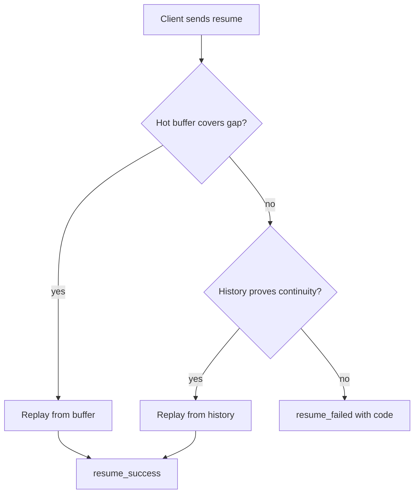
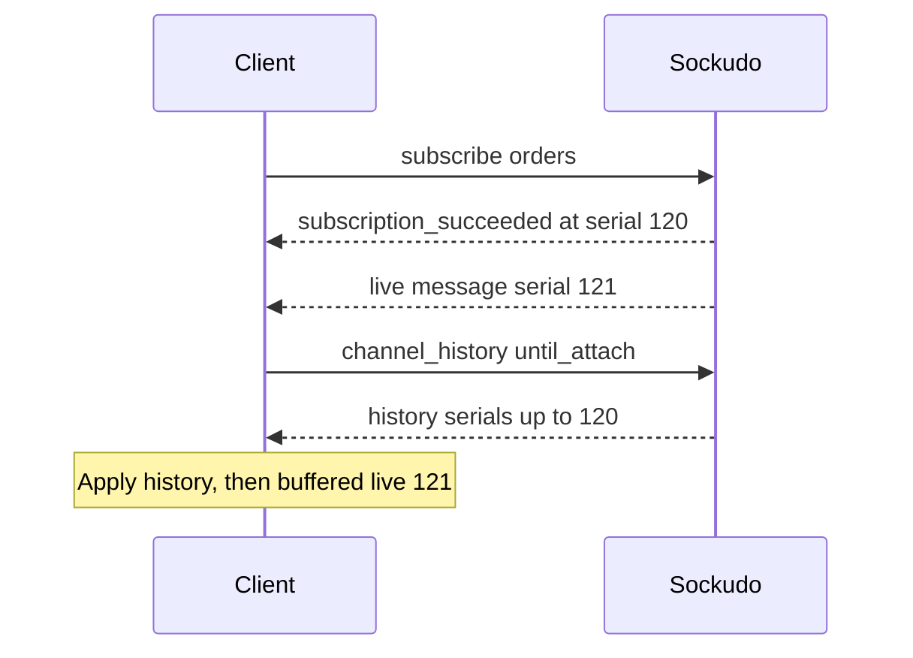

This page explains how Sockudo gives clients a gapless view of a channel: recovering messages missed
during a disconnect, sending recent history to late joiners, and serving durable history to your
backend. Read it when you enable Protocol V2 recovery or history, or when you need to know exactly
what a client can trust after a reconnect.

Sockudo separates connection recovery from durable history. Recovery keeps a connection continuous after a short interruption. History is an application feature for reading and reconstructing past state.

<FanoutDiagram start={3} caption="A client drops mid-stream; on reconnect Sockudo replays the gap from the hot buffer or durable history, or fails closed when continuity cannot be proven." />

## Mental model

Every V2 broadcast on a channel gets a position: a `stream_id` naming the stream's generation and a
`serial` that increases with each message. A client that remembers its last position can ask
"send me everything after serial 42 on stream `orders:main`", and Sockudo can check whether it still
holds every message in that range.

Two stores can answer that question:

| | Hot replay buffer | Durable history |
| --- | --- | --- |
| Where | In each node's memory | Shared backend (`postgres`, `mysql`, `dynamodb`, `surrealdb`, `scylladb`, or `memory`) |
| Holds | The last `connection_recovery.max_buffer_size` messages per channel, for `buffer_ttl_seconds` | Messages within `history.retention_window_seconds` and the per-channel caps |
| Used for | Fast resume after a short disconnect | Cold resume, rewind, history reads, versioned messages |
| Survives | Nothing: a restart or a reconnect to another node misses it | Node restarts and cross-node reconnects |

**Fail closed** is the governing rule. If Sockudo cannot prove that a replay contains every message
in the gap, in order, it refuses the resume and says why, instead of sending a partial replay that
the client would mistake for complete. The client then resubscribes and backfills explicitly.



## Recovery

Protocol V2 broadcasts carry stream metadata:

```json
{
  "event": "order.updated",
  "channel": "orders",
  "data": { "id": "ord_123" },
  "message_id": "msg_01HX",
  "stream_id": "orders:main",
  "serial": 42
}
```

Clients store recovery positions and provide them during reconnect. Sockudo replays missed messages if continuity can be proven.

For V2 clients, the subscription acknowledgement carries the first recovery position when recovery is enabled. Keep that position even before the channel receives any application event. A reconnect can then resume from the subscribed-but-idle checkpoint and replay messages published while the client was disconnected.

```ts
const client = new Sockudo("app-key", {
  wsHost: "127.0.0.1",
  wsPort: 6001,
  forceTLS: false,
  protocolVersion: 2,
  connectionRecovery: true,
});

client.bind("sockudo:resume_success", (payload) => {
  console.log(payload.recovered, payload.failed);
});
```

Each entry in `recovered` names the `channel`, the `source` (`hot` or `cold`), and the terminal
`position` the client should store. Each entry in `failed` names the `channel`, a `code`, and a
`reason`.

### Resume failure codes

| `code` | Meaning | What the client should do |
| --- | --- | --- |
| `position_expired` | The gap is older than retention, or larger than `max_buffer_size` (`reason: "recovery_window_exceeded"`). | Resubscribe, then backfill with `until_attach: true`. |
| `continuity_unverifiable` | The position is ahead, non-contiguous, duplicate, or non-progressing, or the stream head is unknown. | Resubscribe and backfill. Do not advance the stored cursor. |
| `stream_reset` | The stream ID changed, for example after an operator reset. | Discard local state for the channel, resubscribe, and reload. |
| `persistence_unavailable` | The durable tier could not be read. | Resubscribe and backfill once history is reachable again. |

If a channel emits `sockudo:resume_failed` with `code: "position_expired"`, the hot replay buffer and durable recovery window could not prove continuity. Resubscribe, then backfill with V2 channel history using `until_attach: true` so the history page is bounded at the subscription's attach serial.

`code: "continuity_unverifiable"` means Sockudo rejected an ahead, non-contiguous, duplicate, or non-progressing recovery position. Treat it the same way: resubscribe and backfill instead of advancing the client cursor.

<Callout type="warn" title="Never treat a failed resume as recovered">
After `resume_failed`, live messages continue but the gap is not filled. UI that shows the channel as
up to date without a backfill will silently miss messages.
</Callout>

### How the two tiers work

Recovery is two-tier:

1. Hot replay uses the bounded per-channel replay buffer.
2. Durable recovery uses `HistoryStore` when `stream_id`, serial bounds, and retention prove
   continuity.

Both tiers enforce `connection_recovery.max_buffer_size` for each recovered
channel. A larger gap fails with `position_expired` and
`reason: "recovery_window_exceeded"` before Sockudo builds or partially sends an
unbounded replay. When the SDK has already reattached a subscription, a bounded
continuity gate holds concurrent live messages until replay has been enqueued;
the aggregate `resume_success` is enqueued before those live messages are
released. Gate overflow closes that connection instead of delivering frames out
of order.

Both tiers replay the Protocol V2 wire message, not Sockudo's durable storage
wrapper. Durable rows are decoded through the shared history projection first,
so recovery and ordinary history reads preserve the same IDs, publisher fields,
version projection, stream ID, and serial.

Versioned mutations keep the delivery position reserved by the native version
service. The hot replay buffer adopts that position instead of allocating a
second serial. Recovery validates every serial in the returned range; a missing
position or mixed stream generation falls through to durable recovery and then
fails closed if the durable tier cannot prove the same continuity.

The native V2 attach and resume gates register the subscriber before capturing
the durable high-water mark. Concurrent publishes are held in a count-and-byte-
bounded gate, shared across subscribers with immutable message references, then
drained in ordered batches without a lock held across delivery. Overflow closes
the affected connection because the live-plus-replay sequence can no longer be
proven.

If the durable stream is degraded or reset-required, Sockudo fails closed instead of pretending the
stream is continuous.

A stream is **degraded** when durable writes or reads failed and continuity is in doubt, and
**reset-required** when an operator must explicitly reset it before history and recovery resume.
Both states are exported as `sockudo_history_degraded_channels` and
`sockudo_history_reset_required_channels`; see [Observability](/docs/server/observability).

## Configuration

Both tiers are off in the built-in defaults; the shipped `config/config.toml` enables them.

```toml title="config.toml"
[connection_recovery]
enabled = true
buffer_ttl_seconds = 120
# Bounds both the per-channel hot buffer and one durable fallback replay.
max_buffer_size = 100

[history]
enabled = true
rewind_enabled = true
backend = "postgres"
retention_window_seconds = 86400
max_page_size = 100
max_messages_per_channel = 1000

[presence_history]
enabled = true
retention_window_seconds = 86400
max_page_size = 100
max_events_per_channel = 1000
```

Use a shared history backend whenever more than one node serves the same channels: `memory` history
is local to one process, so a client that reconnects to another node cannot be cold-recovered.
Raising `max_buffer_size` lets clients survive longer gaps, at the cost of memory per active channel
and larger replays on reconnect. Every key is in the
[configuration reference](/docs/reference/configuration#protocol-features).

## Rewind

Subscribe-time rewind asks Sockudo to send recent history when a client joins:

```ts
const channel = client.subscribe("orders", {
  rewind: { seconds: 30 },
});

channel.bind("sockudo:rewind_complete", (payload) => {
  console.log(payload.historical_count, payload.complete);
});
```

Rewind accepts a message `count` or a time window in `seconds`. `sockudo:rewind_complete` reports
`historical_count`, `live_count`, `complete`, and whether the page was truncated by retention or by
the limit.

When a V2 subscription has a compound predicate, rewind scans durable history in bounded pages until it fills the requested matching count or reaches the scan/retention boundary. Suppressed rows still advance the channel's canonical continuity position. Hot and durable recovery apply the same predicate after the client has reattached that subscription; a legacy resume sent before reattachment retains the unfiltered recovery contract. Each recovered-channel entry in `sockudo:resume_success` includes the terminal `position` so clients advance continuity even when the predicate suppresses the tail.

## Durable channel history

Server SDKs expose app-key channel history helpers. Use signed app-key HTTP history for backend jobs, administrative reads, and server SDKs.

```python
page = sockudo.get_channel_history(
    "orders",
    HistoryParams(limit=50, direction="newest_first"),
)
```

Opaque cursors make storage implementation details private. Store the cursor as a token and pass it back unchanged.

The HTTP endpoint, its query parameters, and the full response shape are documented in
[HTTP API: History](/docs/server/http-api#history).

Protocol V2 clients use WebSocket `channel_history` frames instead of direct HTTP history. Token-authenticated clients need the `history` capability for the requested channel. The existing app-key HTTP endpoint remains server-only; there is no client-token HTTP history surface in v1.

```json
{
  "event": "sockudo:channel_history",
  "data": {
    "channel": "orders",
    "limit": 100,
    "direction": "backwards",
    "cursor": null,
    "start_serial": 1,
    "end_serial": 100,
    "until_attach": true
  }
}
```

The response uses the same history payload shape as app-key HTTP history: `items`, `direction`, `limit`, `has_more`, `next_cursor`, `bounds`, `continuity`, and `stream_state`. Limits are capped at `1000` and may be lowered by channel policy. `direction` defaults to backwards/newest-first. `until_attach: true` bounds results to `history_serial <= attach_serial`, while live delivery after subscribe continues above that attach serial. Mutable messages are returned as the latest aggregated V2 message, not raw operation log rows.

### Late joins with until_attach

`until_attach` is the late-join gaplessness rule: the history page stops at the serial captured when
the subscription succeeded, and live fanout continues above that serial. Clients should reduce
history first, then live messages. In a cluster, route this request to the node that owns the live
attachment. If Sockudo cannot find that authoritative attachment position, it rejects the read
instead of silently removing the upper bound and returning a page that could overlap live delivery.



<Steps>

1. Subscribe and keep the attach position from the subscription acknowledgement.
2. Buffer live messages that arrive while history loads.
3. Request `channel_history` with `until_attach: true`, paging with `next_cursor` as needed.
4. Apply history oldest to newest, then the buffered live messages, skipping any serial already seen.

</Steps>

## Presence history

Presence history records joins, leaves, causes, and continuity metadata. It is different from the current presence member list.

Protocol projections must write transitions through the native presence
service. Current membership remains available if the durable tier fails, but
the tracking store marks that channel degraded. Continuity-sensitive history
reads then fail closed until the durable stream is healthy or explicitly reset;
they must not return a partial page as complete.

```ts
const channel = client.subscribe("presence-lobby");
const page = await channel.history({
  limit: 50,
  direction: "newest_first",
});

const snapshot = await channel.snapshot({ atSerial: 4 });
```

Client helpers call your backend proxy. They do not sign Sockudo REST requests directly.

## Mutable messages

Protocol V2 mutable messages use action events:

- `sockudo:message.update`
- `sockudo:message.delete`
- `sockudo:message.append`

Clients reduce those events into local state. Server SDKs can fetch the latest visible state or list preserved versions.
When a V2 subscription uses rewind, historical rows that point at mutable messages are delivered as the latest visible version, so late joiners see accumulated appended content rather than only the original create payload.

```ts
const latest = await channel.getMessage("42");
const versions = await channel.getMessageVersions("42", {
  limit: 20,
  direction: "oldest_first",
});
```

## Push and history

Push notifications should include stable identifiers that let the app fetch authoritative state after the user opens the notification.

```json
{
  "title": "Order updated",
  "body": "Order ord_123 is now packed",
  "data": {
    "channel": "orders",
    "message_serial": "42",
    "order_id": "ord_123"
  }
}
```

Do not encode the entire durable state into the push payload. Use push to wake the app, then read the latest message or application API state.

<Callout type="tip" title="Push is a wake-up, history is the truth">
Push delivery is best effort and can arrive late or out of order. Treat the notification as a hint
and read the channel history or message version on open.
</Callout>

## Next steps

<Cards>
  <Card title="Protocol V2" href="/docs/clients/protocol-v2" description="Client-side recovery, rewind, and position handling." />
  <Card title="Presence history" href="/docs/clients/presence-history" description="Read join and leave history from clients." />
  <Card title="Mutable messages" href="/docs/server/mutable-messages" description="Versions, serials, and mutation authorization." />
  <Card title="HTTP API" href="/docs/server/http-api" description="Signed history, state, reset, and purge endpoints." />
</Cards>
