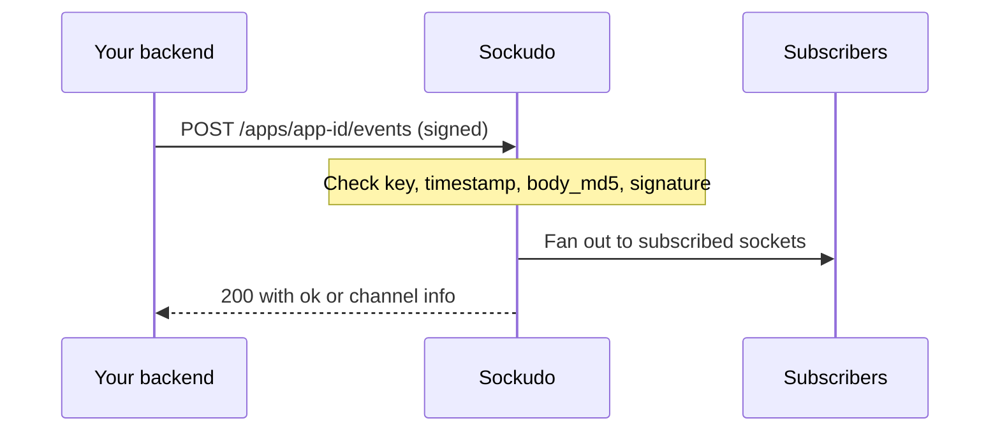

Sockudo's HTTP API is the trusted server interface: your backend uses it to publish events, inspect
channels, read durable history, edit messages, and drive push notifications. Every request is
signed with an app's key and secret, so it must only be called from code you control. Use a
[server SDK](/docs/server-sdks) unless you are writing a custom integration; this page documents the
wire contract the SDKs implement.

## Request lifecycle



Requests are authenticated before the handler runs. A request that fails signing never reaches the
publish pipeline, consumes no idempotency key, and produces no fanout.

## Signing model

Signed requests include these query parameters:

| Parameter | Purpose |
| --- | --- |
| `auth_key` | App key. Must belong to the app in the `/apps/{app_id}` path. |
| `auth_timestamp` | Unix timestamp in seconds. Requests more than 600 seconds from server time are rejected. |
| `auth_version` | Signing protocol version (`1.0`). |
| `body_md5` | Hex MD5 of the raw JSON body. Required for a `POST` with a non-empty body; must be absent on `GET`, `DELETE`, and empty bodies. |
| `auth_signature` | Hex HMAC SHA-256 of the string to sign, keyed with the app secret. |

The string to sign is the uppercase method, the request path, and every query parameter except
`auth_signature`, sorted by key and joined as `key=value` pairs with `&`:

```text
POST
/apps/app-id/events
auth_key=app-key&auth_timestamp=1749377222&auth_version=1.0&body_md5=fc820aa38714282f8300c2ca039cd034
```

This is the Pusher signing scheme, so Pusher-compatible server libraries can sign Sockudo requests.

<Callout type="warn" title="Sign the exact bytes you send">
`body_md5` is computed over the raw body. Re-serializing JSON after signing (key reordering,
whitespace changes) produces a `401` with `body_md5 mismatch`. Clock skew beyond 600 seconds fails
with a `401` as well, so keep backend hosts on NTP.
</Callout>

## Error format

Every handler error returns JSON with a stable machine-readable `code`:

```json
{
  "error": "Request must contain 'channels' (list) or 'channel' (string)",
  "code": "missing_channel_info",
  "status": 400
}
```

| Status | `code` values | Meaning |
| --- | --- | --- |
| `400` | `invalid_input`, `missing_channel_info`, `limit_exceeded` | Invalid request shape, bad query parameter, or a per-app limit such as event name length, channels per publish, or batch size. |
| `401` | `auth_failed` | Signature, timestamp, or `body_md5` failure, or the key does not match the path's app. |
| `403` | `forbidden` | The caller lacks a required capability, for example push admin. |
| `404` | `app_not_found`, `not_found` | Unknown app key, or the message, device, or resource does not exist. |
| `413` | `payload_too_large` | Event data exceeds `max_event_payload_in_kb`, or the body exceeds `http_api.request_limit_in_mb`. |
| `422` | `feature_disabled` | The feature (history, versioned messages, annotations) is disabled for this app or channel. |
| `429` | `rate_limited` | A rate limit was hit. Includes `Retry-After`. |
| `503` | `service_unavailable`, `backpressure`, `draining` | A shared backend is unavailable, an idempotent request is still in flight, or the node is shutting down. `backpressure` and `draining` include `Retry-After`. |
| `5xx` | `internal_error` and others | Server or backend dependency failure. |

AI Transport validation errors also include a numeric `ai_code`. The rate limiter middleware adds
`X-RateLimit-Limit`, `X-RateLimit-Remaining`, and `X-RateLimit-Reset` headers.

<Callout type="tip" title="Retry 503 and 429, not 4xx">
`503` and `429` responses are safe to retry with the same idempotency key; a load balancer may route
the retry to a healthy node. Other `4xx` responses will fail again until the request changes.
</Callout>

## Publish an event

`POST /apps/{app_id}/events` publishes one event to one or more channels. Auth: signed app request.

```http
POST /apps/{app_id}/events
Content-Type: application/json
```

```json
{
  "name": "order.created",
  "channel": "orders",
  "data": {
    "id": "ord_123"
  },
  "idempotency_key": "order-created-ord_123"
}
```

| Field | Description |
| --- | --- |
| `name` | Event name. Required. |
| `channel` or `channels` | One channel, or a list of channels (capped by `max_event_channels_at_once`). One of the two is required. |
| `data` | Event payload, as a string or JSON value. |
| `socket_id` | Exclude this connection from delivery. |
| `info` | Comma-separated attributes to return per channel: `subscription_count`, `user_count`. |
| `idempotency_key` | Deduplicate retries. The `X-Idempotency-Key` header is used when the body field is absent. |
| `message_id` | Idempotent create identity for V2 and AI Transport publishes. |
| `extras` | Protocol V2 extras envelope (headers, ephemeral, echo, push, AI Transport). Stripped for V1 clients. |
| `tags`, `delta` | Tag-filtering metadata and per-publish delta compression override. |

Use `socket_id` to suppress echo back to the originating connection.

A successful publish returns `200` with `{"ok": true}`. When `info` is set, it returns per-channel
attributes instead:

```json
{
  "channels": {
    "orders": { "subscription_count": 12 }
  }
}
```

In the `api` server role, `subscription_count` and `user_count` are unavailable and return `400`.

### Idempotency

Idempotency keys are claimed atomically in the shared cache for `idempotency.ttl_seconds` (default
`120`) and must be non-empty and at most `idempotency.max_key_length` (default `128`) characters. A
retry with the same key returns the cached response without publishing again.

When `ai_transport` and versioned messages are enabled for the target channel,
AI events and publishes with `message_id` return serial acknowledgements under
the channel entry. Retries with the same `message_id` or `X-Idempotency-Key`
return the original serials without publishing a duplicate event.
If the publishing node exits after durable persistence but before recording the
idempotency acknowledgement, a retry reconstructs and atomically repairs the
receipt from native history/version storage. Raw idempotency keys are not stored
in message envelopes; recovery uses an app/channel-scoped hash plus the canonical
payload fingerprint.

```json
{
  "channels": {
    "ai:session-1": {
      "message_serial": "00000000000000000001:test:00000000000000000001",
      "history_serial": 1,
      "delivery_serial": 1,
      "version_serial": "00000000000000000001:test:00000000000000000001"
    }
  }
}
```

Idempotent publishes fail closed when their shared coordination backend is
unavailable: Sockudo returns `503 service_unavailable` instead of publishing
without a proven claim. Concurrent retries whose first request is still active also
return `503 backpressure` with `Retry-After: 1`. Retry either response with the same
idempotency key; a load balancer may route the retry to a healthy node.

**Errors:** `400` for a missing name or channel, a name or channel list over the app limit, or an
invalid idempotency key; `413` when `data` exceeds `max_event_payload_in_kb`; `503 draining` with
`Retry-After` on a shutting-down node without a horizontal adapter.

## Batch publish

`POST /apps/{app_id}/batch_events` publishes several events in one request. Auth: signed app request.

```http
POST /apps/{app_id}/batch_events
Content-Type: application/json
```

```json
{
  "batch": [
    {
      "channel": "orders",
      "name": "order.created",
      "data": { "id": "ord_123" }
    },
    {
      "channel": "orders",
      "name": "order.paid",
      "data": { "id": "ord_123" }
    }
  ]
}
```

Each item accepts the same fields as a single publish. The response is `{}`, or
`{"batch": [ ... ]}` with one entry per item, in order, when any item sets `info`.

Batching reduces HTTP overhead, but do not use it to hide unbounded payloads. Keep per-event data compact.
`X-Idempotency-Key` identifies the whole batch request, while an
`idempotency_key` inside an item identifies only that logical event. The two key
domains do not collide. Every per-event key is validated with the same non-empty
and maximum-length rules as a single-event publish before any item is accepted,
then atomically claimed so concurrent batches cannot publish that event twice.

**Errors:** `400 limit_exceeded` when the batch is larger than `max_event_batch_size` (default `10`);
otherwise the same per-item validation as a single publish.

## Channel state

Read current occupancy. Auth: signed app request. These routes need local socket state, so they are
not registered in the `api` server role.

```http
GET /apps/{app_id}/channels?filter_by_prefix=presence-&info=user_count
GET /apps/{app_id}/channels/{channel_name}?info=subscription_count,user_count
GET /apps/{app_id}/channels/{channel_name}/users
```

| Endpoint | Response |
| --- | --- |
| List channels | `{"channels": {"presence-room": {"user_count": 3}}}`. `user_count` requires `filter_by_prefix=presence-`. |
| One channel | `{"occupied": true, "subscription_count": 12, "user_count": 3}`. Counts appear only when requested. |
| Presence users | `{"users": [{"id": "user-1"}]}`. Presence channels only; others return `400`. |

Use state APIs for dashboards and admin tooling. Do not poll them as a substitute for realtime subscription events.

If a cluster-wide count could not be collected from every node, the single-channel response adds
`"subscription_count_complete": false`.

For channels matched by `[ai_transport]`, `GET /apps/{app_id}/channels/{channel_name}`
also includes:

```json
{
  "ai": {
    "active_streams": 1,
    "last_history_serial": 42,
    "message_count": 7
  }
}
```

## User connections

Disconnect or recycle every connection of an authenticated user (from user authentication).
Auth: signed app request. Not available in the `api` server role.

```http
POST /apps/{app_id}/users/{user_id}/terminate_connections
POST /apps/{app_id}/users/{user_id}/force_reconnect
```

Both return `{"ok": true}`. Use `terminate_connections` when a user is banned or signs out
everywhere; use `force_reconnect` when the user should come back immediately, for example after a
permission change.

## Capability token revocation

`POST /apps/{app_id}/revocations` revokes Protocol V2 capability tokens by `jti`, by `client_id`, or
both. Auth: signed app request.

```json
{
  "jti": "tok_01J",
  "client_id": "user-42",
  "ttl_seconds": 3600,
  "reason": "session revoked"
}
```

```json
{
  "revoked_jti": true,
  "revoked_client_id": true,
  "closed_connections": 1
}
```

At least one of `jti` or `client_id` is required. The revocation lives for `ttl_seconds`, or until
`expires_at` (Unix seconds), or 24 hours when neither is set. The receiving node closes matching local
sockets at once; other nodes reject the token on next validation once the shared cache entry is
visible. See [Security](/docs/server/security#three-layer-auth-model).

## History

`GET /apps/{app_id}/channels/{channel_name}/history` reads durable channel history. Auth: signed app
request. Requires `[history]` enabled for the channel.

```http
GET /apps/{app_id}/channels/{channel_name}/history?limit=50&direction=newest_first
```

| Parameter | Description |
| --- | --- |
| `limit` | Page size. Defaults to and is capped at the channel's `max_page_size`. Must be greater than 0. |
| `direction` | `newest_first` (default, alias `backwards`) or `oldest_first` (alias `forwards`). |
| `cursor` | Opaque `next_cursor` from a previous page. |
| `start_serial`, `end_serial` | Serial bounds. |
| `start_time_ms`, `end_time_ms` | Time bounds in milliseconds. `start` and `end` are accepted aliases. |

```json
{
  "items": [
    {
      "stream_id": "orders:main",
      "serial": 42,
      "published_at_ms": 1749377222000,
      "message_id": "msg_01HX",
      "event_name": "order.updated",
      "payload_size_bytes": 128,
      "message": { "event": "order.updated", "channel": "orders", "data": "..." }
    }
  ],
  "direction": "newest_first",
  "limit": 50,
  "has_more": true,
  "next_cursor": "opaque-cursor",
  "bounds": { "start_serial": null, "end_serial": null, "start_time_ms": null, "end_time_ms": null },
  "continuity": {
    "stream_id": "orders:main",
    "oldest_available_serial": 1,
    "newest_available_serial": 42,
    "complete": true,
    "truncated_by_retention": false
  },
  "stream_state": { "durable_state": "healthy", "recovery_allowed": true, "reset_required": false }
}
```

Items also carry `operation_kind`, and the `continuity` and `stream_state` objects carry more fields
than shown, including retained counts and bytes, transition timestamps, and the reporting node.

History responses use opaque cursors. Store and replay cursors as strings; do not parse them.
Use `direction=oldest_first`/`forwards` or `direction=newest_first`/`backwards`
with `start`, `end`, and the policy-capped `limit` to bound a stable page. A
cursor is opaque and must be replayed with the same query shape that produced
it. The Ably-compatible `/channels/{channel}/messages` projection additionally
returns credential-free `first` and optional `next` Link relations that preserve
that query shape.

When versioned messages are enabled, rows that point at a mutable message return its latest visible
version. Check `stream_state.durable_state` (`healthy`, `degraded`, or `reset_required`) and
`continuity.complete` before treating a page as authoritative.

**Errors:** `422 feature_disabled` when history is off for the channel; `400` for an invalid
`direction`, a zero `limit`, or a malformed cursor.

Operators can inspect and repair a stream with `GET .../history/state`,
`POST .../history/reset`, and `POST .../history/purge`. Reset and purge are destructive and require
`confirm_channel` (exactly the path channel), `confirm_operation` (`reset` or `purge`), and a
non-empty `reason`. Presence history has matching routes under `.../presence/history`. See the
[HTTP endpoint reference](/docs/reference/http-endpoints).

## Versioned messages

Protocol V2 mutable messages expose latest visible state and preserved versions. Auth: signed app
request. Requires `[versioned_messages]` enabled. Without `socket_id`, a mutation acts as the
privileged server and may change any message. With `socket_id`, it acts as that connected V2 socket:
the socket's verified user must match any `client_id` sent, and token-authenticated sockets need
`publish` on the channel plus the own/any mutation policy.

```http
GET /apps/{app_id}/channels/{channel_name}/messages/{message_serial}
GET /apps/{app_id}/channels/{channel_name}/messages/{message_serial}/versions
POST /apps/{app_id}/channels/{channel_name}/messages/{message_serial}/update
POST /apps/{app_id}/channels/{channel_name}/messages/{message_serial}/delete
POST /apps/{app_id}/channels/{channel_name}/messages/{message_serial}/append
```

`GET .../messages/{message_serial}` returns `{"channel": "...", "item": { ... }}` with the latest
version. `GET .../versions` accepts `limit`, `direction` (`newest_first` by default), and `cursor`,
and returns `channel`, `direction`, `limit`, `has_more`, `next_cursor`, and `items`.

The optional Ably compatibility route is
`PATCH /channels/{channel_name}/messages/{message_serial}`. Its encoded message
body selects `message.update`, `message.delete`, or `message.append` through the
`action` field and carries operation metadata in `version`. It is a projection
over the same native mutation service and `VersionStore`; it does not maintain
a compatibility-only message chain. Request and response formats are negotiated
independently as JSON or MsgPack.

An update body:

```json
{
  "data": {
    "body": "edited message"
  },
  "description": "user edit",
  "op_id": "edit-msg-1-v2"
}
```

| Field | Applies to | Description |
| --- | --- | --- |
| `data` | all | New data (update, delete) or the string fragment to append (append; required, non-empty except for a terminal AI append). |
| `name` | update | New event name. |
| `extras` | all | Replaces the message's V2 extras when present. An append without `extras` keeps the existing ones. |
| `clear_fields` | update, delete | Fields to clear. Must not contain duplicates. |
| `client_id`, `socket_id` | all | Act as a connected V2 socket and its verified client instead of the privileged server. Not used for echo suppression: the mutation is delivered to every subscriber. |
| `description`, `metadata` | all | Operation metadata stored on the version. |
| `op_id` | all | Operation ID that makes retries idempotent. |

Mutation responses preserve the existing fields and include serials for SDK
ordering and retries:

```json
{
  "channel": "ai:session-1",
  "message_serial": "msg_123",
  "action": "append",
  "accepted": true,
  "version_serial": "ver_456",
  "history_serial": 12,
  "delivery_serial": 34,
  "status": "applied"
}
```

`status` is `applied` for a new version and `duplicate` when an `op_id` retry matched an existing one.

**Errors:** `404` for an unknown message serial; `422` when versioned messages or durable history are
disabled for the channel; `400`
for an invalid body or `op_id`; `401` when the `socket_id` actor is not connected, not V2, or does
not match `client_id`; `413` or `403` for AI Transport limits and mutable-not-permitted channels,
with an `ai_code`.

## Annotations

Annotations attach secondary state to a message without rewriting the message itself. Auth: signed
app request. Requires annotations enabled for the channel.

```http
POST /apps/{app_id}/channels/{channel_name}/messages/{message_serial}/annotations
GET /apps/{app_id}/channels/{channel_name}/messages/{message_serial}/annotations
DELETE /apps/{app_id}/channels/{channel_name}/messages/{message_serial}/annotations/{annotation_serial}
```

Annotation bodies and responses use camelCase field names:

```json
{
  "type": "reactions:distinct.v1",
  "name": "like",
  "clientId": "user-1",
  "count": 1
}
```

| Field | Description |
| --- | --- |
| `type` | Annotation type, such as `reactions:distinct.v1`. Required. |
| `name` | Annotation name within the type. |
| `clientId`, `socketId` | Acting client. With `socketId`, the actor is resolved from that connected socket. Not used for echo suppression. |
| `count` | Count for counting types. Must be greater than 0. |
| `data`, `encoding` | Optional payload. |

`POST` returns `{"annotationSerial": "..."}`. `DELETE` returns `annotationSerial` and
`deletedAnnotationSerial`. `GET` accepts `type`, `limit`, `from_serial`, and `socket_id`, and returns
`channel`, `messageSerial`, `limit`, `hasMore`, `nextCursor`, and `items`.

Use annotations for reactions, read receipts, moderation signals, and summary projections.

**Errors:** `404` when the target message does not exist; `422` when annotations are disabled;
`400` for `count: 0`.

## Push notifications

Push APIs are first-class HTTP APIs, not separate infrastructure. They cover device registration, channel subscriptions, credential management, publish admission, status inspection, scheduling, cancellation, and provider callbacks.

Auth: signed app request plus an optional `X-Sockudo-Push-Capability` header. Without the header the
request acts as `push-admin`. With `push-subscribe`, device-scoped routes also require
`X-Sockudo-Device-Identity-Token` matching the stored device. Push request and response bodies use
camelCase.

### Register a device

`POST /apps/{app_id}/push/deviceRegistrations` creates or updates a device. Admin or subscribe.

```http
POST /apps/{app_id}/push/deviceRegistrations
Content-Type: application/json
```

```json
{
  "appId": "app-id",
  "id": "ios-device-1",
  "clientId": "user-42",
  "formFactor": "phone",
  "platform": "ios",
  "deviceSecret": "",
  "timezone": "Europe/Madrid",
  "locale": "en-US",
  "metadata": { "app_version": "4.5.0" },
  "push": {
    "recipient": { "transportType": "apns", "deviceToken": "provider-token" },
    "state": "ACTIVE"
  }
}
```

`appId` and `deviceSecret` are required by the decoder but replaced by the server: `appId` with the
path app, `deviceSecret` with a hash of a server-generated device identity token. `transportType` is
`apns`, `gcm` (FCM), or another provider recipient type.

The response is `201` with `change`, `tokenHash`, `device`, and, on first registration by an admin
(or with `X-Sockudo-Rotate-Device-Identity-Token: true`), `deviceIdentityToken`. Return that token
to the device; it is shown once.

### Subscribe a device to a channel

`POST /apps/{app_id}/push/channelSubscriptions` upserts a channel push subscription. Admin or
subscribe.

```http
POST /apps/{app_id}/push/channelSubscriptions
Content-Type: application/json
```

```json
{
  "appId": "app-id",
  "channel": "orders",
  "deviceId": "ios-device-1",
  "clientId": "user-42",
  "provider": "apns",
  "tokenHash": "token-hash-from-registration"
}
```

Returns `201` with the stored subscription. With `push-subscribe`, the device must exist and the
identity token must match, otherwise `404` or `403`.

### Publish push

`POST /apps/{app_id}/push/publish` admits a push publish. Admin only.

```http
POST /apps/{app_id}/push/publish
Content-Type: application/json
```

```json
{
  "publishId": "push-order-ord_123-packing",
  "recipients": [
    { "type": "channel", "channel": "orders" }
  ],
  "payload": {
    "title": "Order updated",
    "body": "Order ord_123 moved to packing",
    "templateData": { "order_id": "ord_123" }
  }
}
```

Push returns `202 Accepted`:

```json
{
  "publishId": "push-order-ord_123-packing",
  "status": "accepted",
  "expectedRecipients": 1,
  "fanoutRegime": "fastPath",
  "renderedPayloads": []
}
```

Send a stable `publishId` to make retries idempotent: a retry with the same `publishId` returns the
original publish and its current status instead of sending again. Without one, the server generates
a fresh ID per request. Admission is asynchronous: `sync` or `?mode=sync` still returns `202`, with
`X-Sockudo-Forced-Async: publish-api-is-async`. Use `notBeforeMs` to schedule and `expiresAtMs` to
bound delivery.

**Errors:** `403` without push admin; `400` for invalid recipients or payload; `503 backpressure`
when the admission rate or queue backpressure rejects the publish. A quota rejection is still
admitted with status `quota_exceeded`.

### Inspect publish status

```http
GET /apps/{app_id}/push/publish/{publish_id}/status
```

Admin only. Use this endpoint for operator tools, not user-facing busy loops.

## Ably compatibility routes

When Cargo feature and runtime option `ably-compat` are enabled, the root REST
router also exposes Ably-compatible batch operations:

```http
POST /messages
GET /presence?channels=channel-a,channel-b
POST /keys/{keyName}/revokeTokens
```

`POST /messages` accepts the raw object used by `Rest.request()` and the array of
batch specs used by `batchPublish()`. Results preserve spec and channel order.
The raw form returns `201` plus a flat channel result array on full success, or
`400`/`40020` plus `{ error, batchResponse }` when one or more channels fail.
The array form, batch presence, and token revocation return BatchResult envelopes
with exact `successCount`, `failureCount`, and ordered item results. Publish
success is reported only after the normal native publish pipeline commits; item
failures do not roll back unrelated successful items.

The compatibility batch edge runs no more than eight channel/target operations
at once and rejects requests exceeding 100 specs, 1,000 results, 10,000 publish
operations, or 10 MiB. Native event channel/message limits can lower those
ceilings. Bodies and responses negotiate JSON or MsgPack through the same REST
codec, and error responses include `X-Ably-ErrorCode` and
`X-Ably-ErrorMessage`.

With Cargo feature `ably-compat`, the compatibility router also exposes
`GET|POST /channels/{channel}/messages/{messageSerial}/annotations`. The POST
body is an Ably annotation array and supports both create and delete actions;
both operations call the same native annotation service shown above. Responses
negotiate JSON or MsgPack. List pages return credential-free relative Link
headers with an opaque app/channel/message-scoped cursor. Realtime action `21`
is delivered only to an attachment that negotiated `annotation_subscribe`,
while `message.summary` uses the original message serial for ordinary
subscribers. `annotation-publish`, `annotation-subscribe`,
`annotation-delete-own`, and `annotation-delete-any` are evaluated independently
from message mutation permissions.

When the server is built with `ably-compat`, the root Ably REST projection also
provides `/stats`, `/push/publish`, `/push/deviceRegistrations`,
`/push/channelSubscriptions`, and `/push/channels`. These routes authenticate
with Ably-compatible credentials but call a bounded typed compatibility stats
store plus the native push domain services; they do not call Sockudo HTTP
handlers internally. Stats pages use opaque cursors and stable Link query
propagation. Direct push and `extras.push` enter the native durable publish log,
queue, planner, provider-dispatch, feedback, retry, status, scheduler, and
retention pipeline. The realtime provider delivers `__ably_push__` through the
ordinary `MessageService` fanout path and records the actual outcome. External
providers continue through their configured native workers and fail truthfully
when the required feature or credentials are unavailable. Restricted Ably keys
must carry `push-admin` or channel-scoped `push-subscribe`; device-owned requests
also verify the stored hashed device identity token.

The same projection exposes `GET /channels/{channel}/presence` and
`GET /channels/{channel}/presence/history`. Current presence supports
`clientId`, `connectionId`, `limit`, and opaque cursor pagination. Presence
history additionally supports forward/backward direction and millisecond
`start`/`end` bounds. Both routes use the native presence service and return
credential-free `first`/`next` Link relations. History reads fail with Ably code
`50003` when durable continuity is degraded or reset-required.

## Complete endpoint reference

This page explains the common server workflows. The complete route matrix, including health probes, stats, metrics, all push credential/template/device/subscription endpoints, presence history state, durable history repair, and annotation filters, is in the [HTTP endpoint reference](/docs/reference/http-endpoints).

## Next steps

<Cards>
  <Card title="HTTP endpoint reference" href="/docs/reference/http-endpoints" description="Every route, method, and auth requirement." />
  <Card title="Server SDKs" href="/docs/server-sdks" description="Signed clients for Node, Python, Go, PHP, Ruby, and more." />
  <Card title="History and recovery" href="/docs/server/history-recovery" description="How durable history, cursors, and continuity work." />
  <Card title="Push notifications" href="/docs/server/push-notifications" description="Providers, templates, scheduling, and delivery status." />
</Cards>
