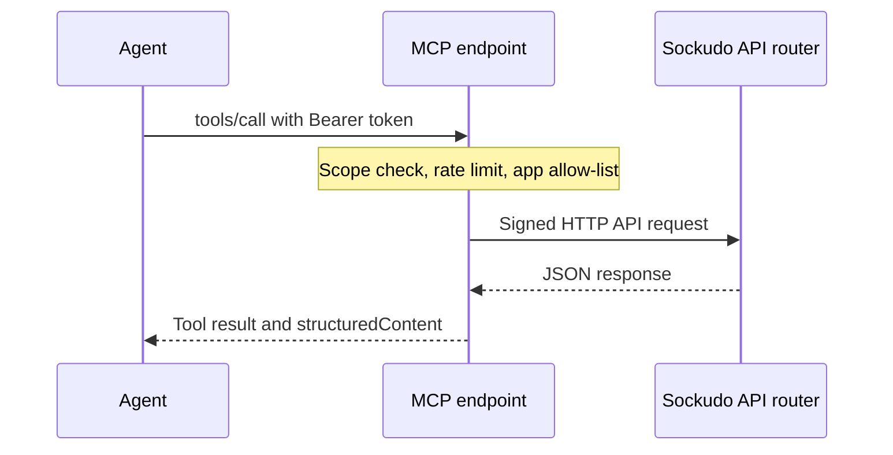

Sockudo ships a Model Context Protocol (MCP) server so agents such as Claude can inspect and
operate a deployment through a typed, permissioned tool surface instead of hand-built HTTP calls.
Use it when you want an agent to debug channels, triage incidents, read history, or publish
events while you keep control over exactly what it may touch.

The protocol layer is the official [`rmcp`](https://crates.io/crates/rmcp) SDK; Sockudo adds
signed API access, scopes, tools, resources, and prompts.

## How it works

The MCP tools are a thin layer over the public [HTTP API](/docs/server/http-api). Every tool call
is turned into a signed HTTP API request and runs through the same validation, idempotency, rate
limits, metrics, feature gates, and role restrictions as any external caller. Tool results are the
documented HTTP API response shapes, so anything you know about the HTTP API applies.



Two deployment shapes share the same code:

| Shape | Transport to Sockudo | MCP transport | Use when |
| --- | --- | --- | --- |
| Embedded (`sockudo` binary, `mcp` feature) | In-process: the server drives its own API router with self-signed requests | Streamable HTTP on `/mcp` (shared or dedicated port) | Hosted agents, shared team access, production |
| Standalone (`sockudo-mcp` binary) | Signed HTTP to a remote deployment | stdio or Streamable HTTP | Claude Desktop, Claude Code, local IDEs |

<Callout type="note" title="Agents never see app secrets">
In both shapes the MCP server holds the app credentials and signs requests itself. Agents
authenticate with an MCP bearer token, and tools such as `sockudo_list_apps` return keys and
sanitized policy only.
</Callout>

## Enable the embedded server

<Steps>

1. Build with the `mcp` feature (it is also part of the `full` feature set):

   ```bash
   cargo build -p sockudo --release --features "v2,mcp,redis,postgres"
   ```

2. Add an `[mcp]` section with at least one token:

   ```toml title="config.toml"
   [mcp]
   enabled = true
   path = "/mcp"
   # port = 6100                 # optional dedicated listener (host defaults to the server host)
   allowed_hosts = []            # empty = accept any Host (fine behind a trusted proxy)
   allowed_origins = []          # browser origins; empty disables Origin checks
   rate_limit_per_minute = 600   # per token; 0 disables
   request_timeout_ms = 30000
   session_ttl_seconds = 1800

   [[mcp.tokens]]
   name = "ops-agent"
   token = "${SOCKUDO_MCP_OPS_TOKEN}"   # >= 16 chars; use env interpolation
   scopes = ["read", "write"]
   apps = ["*"]

   [[mcp.tokens]]
   name = "readonly-dashboard"
   token = "${SOCKUDO_MCP_RO_TOKEN}"
   scopes = ["read"]
   apps = ["app-1"]
   ```

3. Start Sockudo and send an `initialize` request to confirm the endpoint answers:

   ```bash
   curl -sS http://127.0.0.1:6001/mcp \
     -H "Authorization: Bearer $SOCKUDO_MCP_OPS_TOKEN" \
     -H "Content-Type: application/json" -H "Accept: application/json, text/event-stream" \
     -d '{"jsonrpc":"2.0","id":1,"method":"initialize","params":{"protocolVersion":"2025-06-18","capabilities":{},"clientInfo":{"name":"curl","version":"1"}}}'
   ```

4. Register the endpoint with your agent (see [Connect a client](#connect-a-client)).

</Steps>

### Configuration reference

| Key | Default | Meaning |
| --- | --- | --- |
| `enabled` | `false` | Serve MCP. Requires the `mcp` Cargo feature. |
| `path` | `"/mcp"` | URL path of the Streamable HTTP endpoint. |
| `host` | unset | Bind host for a dedicated listener; defaults to the server host. |
| `port` | unset | Dedicated MCP port. When unset, MCP shares the main HTTP listener. |
| `allowed_hosts` | `[]` | Allowed `Host` authorities (DNS-rebinding protection). Empty accepts any host. |
| `allowed_origins` | `[]` | Allowed browser origins. Empty disables `Origin` validation. |
| `allow_anonymous` | `false` | Accept unauthenticated requests with `anonymous_scopes`. Development only. |
| `anonymous_scopes` | `["read"]` | Scopes granted to anonymous callers. |
| `tokens` | `[]` | Bearer token principals (`name`, `token`, `scopes`, `apps`). |
| `request_timeout_ms` | `30000` | Per-tool upstream timeout. |
| `max_body_bytes` | `1048576` | Maximum MCP POST body size (minimum `1024`). |
| `session_ttl_seconds` | `1800` | Idle session lifetime for session-based protocol versions. |
| `rate_limit_per_minute` | `600` | Per-token tool and resource call budget. `0` disables. |
| `disabled_tools` | `[]` | Tool names to hide entirely. |
| `instructions` | unset | Extra text appended to the MCP server instructions. |

Each `[[mcp.tokens]]` entry takes a unique `name` (used in audit logs), a `token` of at least 16
characters, `scopes` (default `["read"]`), and `apps` (default `["*"]`).

Startup validation fails when:

- `enabled = true` and there are no tokens, unless `allow_anonymous = true`.
- `path` is not an absolute path, or shadows a Sockudo API route (`/apps`, `/app`, `/up`, `/live`,
  `/usage`, `/stats`, `/operator`, `/accept-traffic`, `/metrics`) while sharing the main listener.
- `port` equals the main HTTP port or the metrics port.
- A token name is empty or duplicated, a token is shorter than 16 characters, or a scope is not
  one of `read`, `write`, `admin`.

<Callout type="warn" title="allow_anonymous is ignored once tokens exist">
If any `[[mcp.tokens]]` entry is configured, `allow_anonymous` has no effect and Sockudo logs a
warning. When it does apply, every caller gets the anonymous principal, so never enable it on a
reachable listener.
</Callout>

### Tokens from the environment

`MCP_TOKEN`, `MCP_TOKEN_NAME`, `MCP_TOKEN_SCOPES`, and `MCP_TOKEN_APPS` add a token without
touching the file. The name defaults to `env`, scopes to `read,write`, and apps to `*`; an existing
file token with the same name is replaced. Every other `[mcp]` key has an `MCP_*` override; see
[Environment variables](/docs/reference/environment-variables#mcp).

```bash
MCP_ENABLED=true \
MCP_TOKEN="$(openssl rand -hex 24)" \
MCP_TOKEN_NAME=ops-agent \
MCP_TOKEN_SCOPES=read,write \
MCP_TOKEN_APPS=app-1 \
sockudo --config config.toml
```

## Connect a client

Clients authenticate with `Authorization: Bearer <token>`. A missing or invalid token is rejected
before MCP processing with HTTP `401` and a JSON body:

```json
{ "error": "unauthorized", "message": "invalid bearer token" }
```

Claude Code:

```bash
claude mcp add --transport http sockudo https://rt.example.com/mcp \
  --header "Authorization: Bearer $SOCKUDO_MCP_OPS_TOKEN"
```

Claude API (MCP connector):

```json
{
  "mcp_servers": [{ "type": "url", "url": "https://rt.example.com/mcp", "name": "sockudo",
                    "authorization_token": "<token>" }],
  "tools": [{ "type": "mcp_toolset", "mcp_server_name": "sockudo" }]
}
```

For interactive exploration, point `npx @modelcontextprotocol/inspector` at `/mcp` with the same
`Authorization` header.

## Standalone binary

`sockudo-mcp` runs outside the server and talks to a remote deployment over signed HTTP. Use it for
desktop agents and IDEs, where stdio is the natural transport.

```bash
cargo install --path crates/sockudo-mcp --features cli
# stdio for Claude Desktop / Claude Code
sockudo-mcp --url https://rt.example.com --app app-1:key:secret --scopes read,write
claude mcp add sockudo -- sockudo-mcp --url https://rt.example.com --app app-1:key:secret
# Streamable HTTP with tokens
sockudo-mcp --transport http --listen 127.0.0.1:6100 \
  --token 'ops/read+write=<16+ char token>' --url https://rt.example.com --app app-1:key:secret \
  --metrics-url http://rt.example.com:9601/metrics
```

| Flag | Env | Default | Meaning |
| --- | --- | --- | --- |
| `--url` | `SOCKUDO_URL` | `http://127.0.0.1:6001` | Base URL of the Sockudo HTTP API (may include a path prefix). |
| `--app` | `SOCKUDO_MCP_APPS` | none | `app_id:app_key:app_secret`; repeatable or comma-separated. |
| `--app-id`, `--app-key`, `--app-secret` | `SOCKUDO_APP_ID`, `SOCKUDO_APP_KEY`, `SOCKUDO_APP_SECRET` | none | Single-app convenience form. |
| `--transport` | `SOCKUDO_MCP_TRANSPORT` | `stdio` | `stdio` or `http`. |
| `--listen` | `SOCKUDO_MCP_LISTEN` | `127.0.0.1:6100` | Listen address for `--transport http`. |
| `--path` | `SOCKUDO_MCP_PATH` | `/mcp` | URL path for `--transport http`. |
| `--token` | `SOCKUDO_MCP_TOKENS` | none | `token`, `name=token`, or `name/scope+scope=token`; repeatable or comma-separated. |
| `--scopes` | `SOCKUDO_MCP_SCOPES` | `read,write` | Scopes for stdio and for tokens without explicit scopes. |
| `--allow-anonymous` | `SOCKUDO_MCP_ALLOW_ANONYMOUS` | off | Serve HTTP without authentication (development only). |
| `--metrics-url` | `SOCKUDO_METRICS_URL` | none | Prometheus URL; enables `sockudo_server_metrics`. |
| `--timeout-ms` | `SOCKUDO_MCP_TIMEOUT_MS` | `30000` | Per-request timeout. |
| `--allowed-hosts` | `SOCKUDO_MCP_ALLOWED_HOSTS` | empty | Allowed `Host` authorities for HTTP. |
| `--allowed-origins` | `SOCKUDO_MCP_ALLOWED_ORIGINS` | empty | Allowed browser origins for HTTP. |
| `--disable-tool` | `SOCKUDO_MCP_DISABLED_TOOLS` | none | Tools to hide; repeatable or comma-separated. |
| `--instructions` | `SOCKUDO_MCP_INSTRUCTIONS` | none | Extra text appended to the server instructions. |

<Callout type="tip" title="Keep stdout clean">
Over stdio, stdout is the protocol channel. `sockudo-mcp` writes logs to stderr, so wrap it in
scripts that do not print to stdout.
</Callout>

## Scopes and safety

Scopes are cumulative: `admin` implies `write`, and `write` implies `read`.

| Scope | Grants | Examples |
| --- | --- | --- |
| `read` | Inspection | `sockudo_list_channels`, `sockudo_get_history`, `sockudo_server_stats`, `sockudo_server_metrics` |
| `write` | Publishing and mutation (implies `read`) | `sockudo_trigger_event`, `sockudo_update_message`, `sockudo_publish_annotation`, `sockudo_push_publish`, `sockudo_sign_channel_auth` |
| `admin` | Destructive and connection-affecting operations (implies `write`) | `sockudo_terminate_user_connections`, `sockudo_reset_history`, `sockudo_purge_history`, `sockudo_revoke_capability_tokens`, `sockudo_replay_push_dead_letter` |

- `tools/list` only returns tools the token may call. Calling a tool above the token's scope
  returns JSON-RPC error `-32003` with `reason: "missing_scope"` and `required_scope`.
- Tokens carry an app allow-list; requests for other apps fail with `-32003` and
  `reason: "app_not_allowed"`.
- When a token exceeds `rate_limit_per_minute`, calls fail with `-32004` and
  `retry_after_seconds`. The embedded limiter is in-memory, so each node enforces its own budget.
- App secrets never leave the server. `sockudo_list_apps` and `sockudo_get_app` return keys and
  sanitized policy only; webhook headers are redacted.
- Every tool call emits an audit log line on target `sockudo_mcp::audit` with principal, tool, app,
  channel, outcome, and latency.

Every `admin` tool requires `confirm: true`; calls without it fail argument validation before any
request is made. `sockudo_reset_history`, `sockudo_purge_history`, and
`sockudo_reset_presence_history` also require a `reason`, which is forwarded to the server.
`sockudo_revoke_capability_tokens` accepts an optional `reason` recorded with the revocation.

```json title="tools/call: reset a history stream"
{
  "jsonrpc": "2.0",
  "id": 7,
  "method": "tools/call",
  "params": {
    "name": "sockudo_reset_history",
    "arguments": {
      "app_id": "app-1",
      "channel": "chat:room-1",
      "reason": "stream marked reset_required after storage incident",
      "confirm": true
    }
  }
}
```

<Callout type="warn" title="Grant admin sparingly">
`admin` tools disconnect users, rotate history streams, and delete retained data. Give agents
`read` or `read` plus `write` by default, and hide individual tools you never want exposed with
`disabled_tools`.
</Callout>

### Errors an agent can act on

Protocol-level problems (bad arguments, missing scope, rate limits) are JSON-RPC errors. Failures
from Sockudo itself come back as tool results with `isError: true` and a machine-readable envelope,
so the agent can read the server's `code` and `error` and recover:

```json title="isError result for an upstream 4xx"
{
  "error": "upstream_error",
  "message": "<server error message>",
  "details": {
    "http_status": 404,
    "upstream": { "...": "the server's JSON error body, unchanged" }
  }
}
```

Other envelope `error` values are `unknown_app`, `missing_app_id`, `transport_error`, `timeout`,
`invalid_request`, and `internal_error`.

## Tools

| Area | Tools |
| --- | --- |
| Discovery and server | `sockudo_list_apps`, `sockudo_get_app`, `sockudo_server_info`, `sockudo_server_health`, `sockudo_server_accept_traffic`, `sockudo_server_stats`, `sockudo_server_usage`, `sockudo_server_metrics` |
| Channels | `sockudo_list_channels`, `sockudo_get_channel`, `sockudo_get_presence_users` |
| Publish | `sockudo_trigger_event`, `sockudo_trigger_batch_events` |
| Durable history | `sockudo_get_history`, `sockudo_get_history_state`, `sockudo_reset_history`, `sockudo_purge_history` |
| Versioned messages | `sockudo_get_message`, `sockudo_list_message_versions`, `sockudo_update_message`, `sockudo_delete_message`, `sockudo_append_message` |
| Annotations | `sockudo_list_annotations`, `sockudo_publish_annotation`, `sockudo_delete_annotation` |
| Presence history | `sockudo_get_presence_history`, `sockudo_get_presence_history_state`, `sockudo_get_presence_snapshot`, `sockudo_reset_presence_history` |
| Connections and tokens | `sockudo_terminate_user_connections`, `sockudo_force_reconnect_user`, `sockudo_revoke_capability_tokens` |
| Push | `sockudo_push_publish`, `sockudo_push_batch_publish`, `sockudo_push_publish_status`, `sockudo_list_push_devices`, `sockudo_get_push_device`, `sockudo_list_push_channel_subscriptions`, `sockudo_list_push_subscription_channels`, `sockudo_list_push_dead_letters`, `sockudo_replay_push_dead_letter`, `sockudo_delete_push_scheduled_job`, `sockudo_list_push_credentials`, `sockudo_list_push_templates`, `sockudo_get_push_template` |
| Auth helpers | `sockudo_sign_channel_auth`, `sockudo_sign_user_auth`, `sockudo_verify_webhook_signature` |

Start an agent session with `sockudo_list_apps` to discover valid `app_id` values, then
`sockudo_server_info`, which reports the server version, transport, tool count, and the caller's
own scopes and apps:

```json title="sockudo_server_info result (abridged)"
{
  "mcp_server": {
    "name": "sockudo",
    "version": "5.2.0",
    "transport": "in-process",
    "tools": 48,
    "request_timeout_ms": 30000,
    "rate_limited": true
  },
  "principal": { "name": "ops-agent", "scopes": ["read", "write"], "apps": "*" }
}
```

Hide tools with `disabled_tools = ["sockudo_purge_history"]`. Tools that hit a feature the server
does not enable (for example push without the `push` feature) return the server's
`feature_disabled` or `404` error rather than failing at startup. `sockudo_server_stats` and
`sockudo_server_usage` require `http_api.usage_enabled` on the server.

## Resources and prompts

Resources use the `sockudo://` scheme:

| Resource | Contents |
| --- | --- |
| `sockudo://server/info`, `server/health`, `server/stats` | Server description, health check, operator stats |
| `sockudo://apps`, `apps/{app_id}` | Apps visible to the token and one app's sanitized policy |
| `sockudo://apps/{app_id}/channels` | Occupied channels for an app |
| `sockudo://apps/{app_id}/channels/{channel}` | One channel, with `/history`, `/presence`, and `/messages/{message_serial}` sub-resources |
| `sockudo://docs/http-api`, `docs/channels`, `docs/operations` | Embedded reference docs for the agent |

Prompts `sockudo_debug_channel`, `sockudo_incident_triage`, `sockudo_design_realtime_feature`, and
`sockudo_audit_app_security` walk an agent through common workflows. Argument completion is
available for `app_id` and `channel`.

## Observability

Prometheus families (with the configured prefix):

| Metric | Labels | Meaning |
| --- | --- | --- |
| `mcp_requests_total` | `port`, `outcome` | Protocol requests by outcome (`tools_call`, `resources_read`, `rate_limited`, `unauthorized`, ...). |
| `mcp_tool_calls_total` | `port`, `tool`, `outcome` | Tool calls by tool and outcome (`ok`, `upstream_4xx`, `forbidden_scope`, `timeout`, ...). |
| `mcp_tool_latency_ms` | `port`, `tool` | Tool execution latency. |

Tool outcomes are `ok`, `invalid_arguments`, `forbidden_scope`, `forbidden_app`, `unauthorized`,
`upstream_4xx`, `upstream_5xx`, `timeout`, `unknown_app`, `transport_error`, `internal_error`, and
`unknown_tool`. A rising `forbidden_scope` count usually means an agent is trying tools above its
grant; a rising `upstream_4xx` count usually means bad arguments the agent is not correcting.

## Testing

- `cargo test -p sockudo-mcp --all-features` runs protocol, signing, catalog, and Streamable HTTP
  transport tests; `cargo test -p sockudo --features mcp mcp::` drives the in-process transport
  through the real API middleware.
- `make mcp-smoke` builds both binaries, starts a scratch server from `tests/mcp/config.toml`, and
  runs `tests/mcp/smoke_http.py` (embedded endpoint, admin and read-only tokens) and
  `tests/mcp/smoke_stdio.py` (standalone binary over stdio).
- For interactive checks use `npx @modelcontextprotocol/inspector` against `/mcp` with the
  `Authorization: Bearer` header, or register the endpoint in Claude Code and call
  `sockudo_server_info`.

## Performance notes

- The embedded transport never touches a socket: requests are signed and dispatched to the router
  with `tower::Service::oneshot`. Cost per call is one HMAC-SHA256, one MD5 for POST bodies, and the
  normal handler work.
- `tools/list` responses are prebuilt once per scope combination and served as an `Arc` clone.
- Responses are passed through as the server's JSON bytes; only object bodies are parsed once more
  to populate `structuredContent`.
- Sessions are managed by `rmcp` with idle expiry (`session_ttl_seconds`); the `2026-07-28`
  protocol revision is served statelessly.

## Next steps

<Cards>
  <Card title="HTTP API" href="/docs/server/http-api" description="The request and response shapes every MCP tool returns." />
  <Card title="Security" href="/docs/server/security" description="Harden listeners, tokens, and app credentials before exposing MCP." />
  <Card title="Observability" href="/docs/server/observability" description="Scrape mcp_* metrics and route the audit log." />
  <Card title="Environment variables" href="/docs/reference/environment-variables#mcp" description="Every MCP_* override for containerized deployments." />
</Cards>
