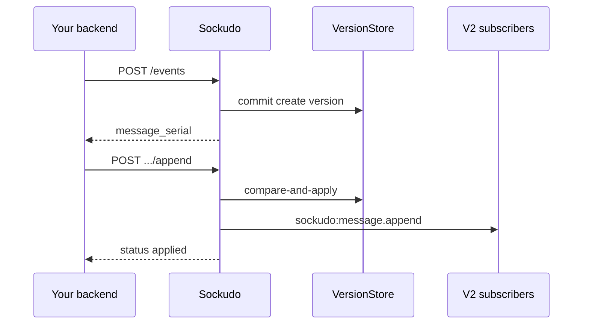

Mutable messages let one logical message change after it is published. You can edit it, delete
it, or stream text into it fragment by fragment, and Sockudo keeps every change as an ordered
version. Use them for edited chat messages, moderation, and token-by-token AI responses: history,
rewind, and recovery always return the current state of a message, and you can still audit how it
got there.

This is a Protocol V2 feature. V1 (Pusher-compatible) clients keep receiving plain events and never
see mutations.

## Mental model

A mutable message is a **version chain**. Publishing creates the first version (`create`); every
later `update`, `delete`, or `append` adds a version on top of it. Nothing is overwritten in place:

- **Latest reads** (`GET .../messages/{messageSerial}`, history, rewind) return the *aggregate*,
  which is the visible state after every version has been applied.
- **Version reads** (`GET .../versions`) return the individual operations in order.
- **Realtime** subscribers receive each new version as its own `sockudo:message.*` event and reduce
  those events into local state.



### The four serials

Each version carries four identities. They answer different questions, so do not mix them up:

| Serial | Type | Identifies | Changes per version? |
| --- | --- | --- | --- |
| `message_serial` | string | The logical message. Use it in every mutation and read URL. | No |
| `version_serial` | string | One specific version of that message. Strictly increases along the chain. | Yes |
| `history_serial` | integer | The message's original position in channel history (assigned at create). | No |
| `delivery_serial` | integer | This version's position in the channel's delivery stream. It is the `serial` field on the wire and drives replay and recovery. | Yes |

Server-generated `message_serial` and `version_serial` values have the shape
`<20-digit ms timestamp>:<node>:<20-digit counter>`, for example
`00000001730000000000:node-a:00000000000000000007`. The create version's `version_serial` equals the
message's `message_serial`. Serials are opaque: `1..=128` bytes with no whitespace. Treat them as
identifiers, not as something to parse.

<Callout type="note" title="Why history and delivery serials differ">
An edited message keeps its place in history (`history_serial`), but each edit is a new delivery
(`delivery_serial`) so that reconnecting clients can replay exactly the versions they missed.
Replay requires contiguous delivery serials. If continuity cannot be proven, recovery fails closed
instead of skipping versions.
</Callout>

## Actions

| Action | Realtime event | Meaning |
| --- | --- | --- |
| `create` | `sockudo:message.create` | Create the logical message and reserve its original history identity. |
| `update` | `sockudo:message.update` | Shallow patch `name`, `data`, `extras`, or clear fields. |
| `delete` | `sockudo:message.delete` | Mark/delete visible fields while preserving the version chain. |
| `append` | `sockudo:message.append` | Append a string fragment to existing string data. |
| `summary` | internal `message` event with `data.action: "message.summary"` | Annotation summary projection for a message. Emitted by the annotations subsystem, not by a mutation endpoint; the JavaScript client surfaces it as `message.summary`. |

Wire constants live in `sockudo-protocol/src/versioned_messages.rs`; store semantics live in
`sockudo-core/src/versioned_messages.rs` and `sockudo-core/src/version_store.rs`.

### How each action changes the aggregate

`update` and `delete` use tri-state field semantics. For each of `name`, `data`, and `extras` the
operation either **keeps** the current value (field omitted), **replaces** it (field present), or
**clears** it (field listed in `clear_fields`):

| Operation | `name` | `data` | `extras` | Notes |
| --- | --- | --- | --- | --- |
| `update` | keep / replace / clear | keep / replace / clear | keep / replace / clear | Must include at least one patch field or operation metadata. `extras` is replaced whole, not merged. |
| `delete` | keep / clear | keep / replace / clear | keep / replace / clear | `name` cannot be replaced. An empty body records a delete version and keeps the content. |
| `append` | unchanged | current string + fragment | replaced if sent, otherwise kept | `data` must be a non-empty string. The current data must be a string or absent. |

A field cannot be both replaced and cleared in the same request, and `clear_fields` must not
contain duplicates.

<Callout type="warn" title="Delete does not erase content by itself">
A delete only changes the fields you name. To remove the visible payload, send
`"clear_fields": ["data"]` (and `"extras"` if needed), or replace `data` with a tombstone value.
Earlier versions stay in the version chain until retention removes them.
</Callout>

At commit time Sockudo also records a protocol-neutral message envelope in the
version record and new history payloads. It preserves the client message ID,
publisher identity and timestamp, typed stream/history/delivery positions,
complete encoding chain, user-visible extras, and operation metadata. Older
stored payloads remain readable through the envelope migration fallback.

## Enable mutable messages

<Steps>

1. Enable durable history. Versioned messages build on it: a channel whose resolved history policy
   is disabled cannot create or mutate versioned messages.

   ```toml title="config.toml"
   [history]
   enabled = true
   backend = "postgres"
   ```

2. Enable versioned messages and choose a version store. `driver` accepts `memory` (the default),
   `postgres`, `mysql`, `dynamodb`, `scylladb`, or `surrealdb`.

   ```toml title="config.toml"
   [versioned_messages]
   enabled = true
   driver = "postgres"
   max_page_size = 100
   retention_window_seconds = 0
   ```

   The same keys are available as environment variables: `VERSIONED_MESSAGES_ENABLED`,
   `VERSIONED_MESSAGES_DRIVER`, `VERSIONED_MESSAGES_MAX_PAGE_SIZE`,
   `VERSIONED_MESSAGES_RETENTION_WINDOW_SECONDS`, `VERSIONED_MESSAGES_PURGE_INTERVAL_SECONDS`,
   `VERSIONED_MESSAGES_PURGE_BATCH_SIZE`, and `VERSIONED_MESSAGES_MAX_PURGE_PER_TICK`.

3. Connect subscribers with Protocol V2. Only V2 connections receive `update`, `delete`, and `append`
   events. Choose how appends arrive with the `append_mode` connection parameter (see
   [Realtime delivery](#realtime-delivery)).

4. Publish as usual. While versioned messages are enabled, every non-ephemeral publish to a channel
   with durable history becomes a `create` version.

</Steps>

<Callout type="tip" title="Memory is for development">
The `memory` driver keeps versions in process memory, so they are lost on restart and are not
shared between nodes. Use a durable driver for anything you deploy.
</Callout>

## Walkthrough

The examples use the signed app HTTP API. Signed requests without `socket_id` act as a privileged
server and may mutate any message (see [Authorization](#authorization)). Server SDKs sign requests
for you; the Node SDK exposes `getMessage`, `getMessageVersions`, `updateMessage`, `deleteMessage`,
and `appendMessage`.

<Steps>

1. **Create the message and capture its serial.** Publish through `/events`. To get the serials
   back, include `message_id` (or `info`) in the body; otherwise the response is `{"ok": true}`.

   ```http
   POST /apps/{appId}/events
   ```

   ```json
   {
     "name": "chat-message",
     "channel": "private-chat-room-1",
     "data": "Sockudo keeps",
     "message_id": "reply-7f3a"
   }
   ```

   ```json
   {
     "channels": {
       "private-chat-room-1": {
         "acknowledgement_id": "00000001730000000000:node-a:00000000000000000007",
         "message_serial": "00000001730000000000:node-a:00000000000000000007",
         "history_serial": 41,
         "delivery_serial": 57,
         "version_serial": "00000001730000000000:node-a:00000000000000000007"
       }
     }
   }
   ```

2. **Append a fragment.** The fragment is concatenated to the current string data.

   ```http
   POST /apps/{appId}/channels/private-chat-room-1/messages/{messageSerial}/append
   ```

   ```json
   { "data": " every version.", "op_id": "reply-7f3a-append-1" }
   ```

   ```json
   {
     "channel": "private-chat-room-1",
     "message_serial": "00000001730000000000:node-a:00000000000000000007",
     "action": "append",
     "accepted": true,
     "version_serial": "00000001730000000150:node-a:00000000000000000008",
     "history_serial": 41,
     "delivery_serial": 58,
     "status": "applied"
   }
   ```

3. **Update it.** Replace `data` and attach operation metadata to the new version.

   ```json
   {
     "data": "Sockudo keeps every version of a message.",
     "description": "rewrite",
     "metadata": { "editor": "support" },
     "op_id": "reply-7f3a-edit-1"
   }
   ```

   The response has the same shape with `"action": "update"`, a new `version_serial`, and the next
   `delivery_serial`. `history_serial` stays `41`.

4. **Delete it.** Clear the payload so the aggregate no longer shows it.

   ```json
   { "clear_fields": ["data"], "description": "removed by moderator" }
   ```

5. **Read the result.** Fetch the latest aggregate, or page through the individual versions.

   ```http
   GET /apps/{appId}/channels/private-chat-room-1/messages/{messageSerial}
   GET /apps/{appId}/channels/private-chat-room-1/messages/{messageSerial}/versions?direction=oldest_first&limit=2
   ```

</Steps>

The same flow with the Node server SDK:

```ts title="mutate.ts"
import Sockudo from "sockudo";

const sockudo = new Sockudo({ appId, key, secret, host: "127.0.0.1", port: 6001 });
const channel = "private-chat-room-1";

await sockudo.appendMessage(channel, messageSerial, { data: " every version." });
await sockudo.updateMessage(channel, messageSerial, {
  data: "Sockudo keeps every version of a message.",
  description: "rewrite",
  op_id: "reply-7f3a-edit-1",
});
await sockudo.deleteMessage(channel, messageSerial, { clear_fields: ["data"] });

const latest = await sockudo.getMessage(channel, messageSerial);
const versions = await sockudo.getMessageVersions(channel, messageSerial, {
  direction: "oldest_first",
  limit: 20,
});
```

## Realtime delivery

Every applied mutation is fanned out to the channel's V2 subscribers as a `sockudo:message.*` event.
The version identities travel in `extras.headers`, and `serial` is the version's `delivery_serial`.
An abridged update frame:

```json
{
  "event": "sockudo:message.update",
  "channel": "private-chat-room-1",
  "data": "Sockudo keeps every version of a message.",
  "name": "chat-message",
  "serial": 59,
  "extras": {
    "headers": {
      "sockudo_action": "message.update",
      "sockudo_message_serial": "00000001730000000000:node-a:00000000000000000007",
      "sockudo_version_serial": "00000001730000000300:node-a:00000000000000000009",
      "sockudo_version_timestamp_ms": 1730000000300,
      "sockudo_history_serial": 41
    }
  }
}
```

- **Appends** follow the subscriber's `append_mode` connection parameter. `delta` (the V2 default)
  delivers only the new fragment in `data`; `full` delivers the accumulated string on every append.
  An unknown value rejects the WebSocket upgrade with `400`.
- **V1 connections** receive the original `create` as a plain event with `extras`, `serial`, and
  other V2 fields stripped. They never receive `update`, `delete`, or `append` events.
- **Late joiners** that rewind or read history get the latest visible version of each message
  (`latest_by_history` returns one latest version per logical message, sorted by original history
  serial), so they see accumulated appended content rather than only the create payload.
- **Webhooks:** each committed version emits a `message_version_created` webhook carrying
  `message_serial`, `version_serial`, and `action`. See [Webhooks](/docs/server/webhooks).

## HTTP reference

Signed app HTTP auth can create mutable messages through `/events`. Mutation and read surfaces are:

| Method | Path | Returns |
| --- | --- | --- |
| `POST` | `/apps/{appId}/channels/{channel}/messages/{messageSerial}/update` | Mutation acknowledgement |
| `POST` | `/apps/{appId}/channels/{channel}/messages/{messageSerial}/delete` | Mutation acknowledgement |
| `POST` | `/apps/{appId}/channels/{channel}/messages/{messageSerial}/append` | Mutation acknowledgement |
| `GET` | `/apps/{appId}/channels/{channel}/messages/{messageSerial}` | Latest aggregate |
| `GET` | `/apps/{appId}/channels/{channel}/messages/{messageSerial}/versions` | Page of versions |

### Mutation request body

| Field | Applies to | Description |
| --- | --- | --- |
| `data` | all | Replacement data (update, delete). For append: the string fragment, required and non-empty unless the append carries a terminal AI status (`complete` or `cancelled`). |
| `name` | update | Replacement event name. |
| `extras` | all | Replacement V2 extras. |
| `clear_fields` | update, delete | Any of `"name"` (update only), `"data"`, `"extras"`. No duplicates. |
| `socket_id` | all | Binds the operation to a connected V2 actor. See [Authorization](#authorization). |
| `client_id` | all | Must match the signed-in user of `socket_id` when both are sent. Without `socket_id` it is recorded as attribution only. |
| `description`, `metadata` | all | Operation metadata stored on the new version. |
| `op_id` | all | `1..=64` bytes. Makes retries idempotent. |

### Mutation response

```json
{
  "channel": "private-chat-room-1",
  "message_serial": "00000001730000000000:node-a:00000000000000000007",
  "action": "update",
  "accepted": true,
  "version_serial": "00000001730000000300:node-a:00000000000000000009",
  "history_serial": 41,
  "delivery_serial": 59,
  "status": "applied"
}
```

`status` is `applied` for a new version and `duplicate` when an `op_id` retry matched an existing
one.

### Read the latest aggregate

```json
{
  "channel": "private-chat-room-1",
  "item": {
    "event": "sockudo:message.update",
    "channel": "private-chat-room-1",
    "data": "Sockudo keeps every version of a message.",
    "name": "chat-message",
    "serial": 59,
    "action": "update",
    "message_serial": "00000001730000000000:node-a:00000000000000000007",
    "history_serial": 41,
    "delivery_serial": 59,
    "version": {
      "serial": "00000001730000000300:node-a:00000000000000000009",
      "timestamp_ms": 1730000000300,
      "description": "rewrite",
      "metadata": { "editor": "support" }
    }
  }
}
```

`item.action` is the action of the newest version; `data` is the accumulated, visible state. The
example is abridged: `extras` is included when the message has extras.

### List versions

Query parameters: `limit` (greater than `0`, capped at `versioned_messages.max_page_size`),
`direction` (`newest_first` by default, or `oldest_first`), and `cursor` (the previous page's
`next_cursor`).

```json
{
  "channel": "private-chat-room-1",
  "direction": "oldest_first",
  "limit": 2,
  "has_more": true,
  "next_cursor": "00000001730000000150:node-a:00000000000000000008",
  "items": [
    { "event": "sockudo:message.create", "action": "create", "data": "Sockudo keeps", "...": "..." },
    { "event": "sockudo:message.append", "action": "append", "data": " every version.", "...": "..." }
  ]
}
```

<Callout type="note" title="Append versions show the fragment">
In a version page, an `append` item's `data` is the fragment that operation added, so the page can
be replayed operation by operation. The latest-aggregate read returns the concatenated string.
</Callout>

### Ably compatibility facade

The optional Ably compatibility facade projects the pinned SDK shape over the
same service:

```http
PATCH /channels/{channel}/messages/{messageSerial}
Content-Type: application/json
```

```json
{
  "serial": "message-serial",
  "action": "message.append",
  "data": " fragment",
  "version": {
    "serial": "optional-version-serial",
    "clientId": "verified-or-server-attributed-client",
    "timestamp": 1710000000000,
    "description": "stream fragment",
    "metadata": { "source": "agent" }
  }
}
```

`message.update` and `message.delete` use the same envelope. JSON and MsgPack
requests, successes, and errors all use the negotiated compatibility encoder.
The path and body serial must identify the same logical message. The facade is a projection over
the same mutation service and `VersionStore`; it does not keep a separate message chain.

## Authorization

Every mutation is evaluated against an **actor**. Which actor you get depends on whether the
request carries `socket_id`:

| Request | Actor | May mutate |
| --- | --- | --- |
| Signed app HTTP, no `socket_id` | Privileged server | Any message on the app. |
| Signed app HTTP with `socket_id` | The V2 connection with that socket ID, on the node that receives the request | Only what that connection's capabilities allow. |

When `socket_id` is sent, Sockudo checks that the socket is connected to the receiving node and
uses Protocol V2. If `client_id` is also sent, it must equal the connection's signed-in user.
Connections authenticated with a capability token also need `publish` on the channel.

In `server_role = "api"` mode, `socket_id` cannot be verified (no local WebSocket connections)
and the request is rejected with HTTP 400. Omit `socket_id` or send the request to a WebSocket node.
See [Server role](/docs/reference/configuration#server-role).

### Capabilities

There are six mutation capabilities: `message_update_own`, `message_update_any`,
`message_delete_own`, `message_delete_any`, `message_append_own`, and `message_append_any`.

- `*_any` grants are checked first and allow mutating any message on matching channels.
- `*_own` grants require an identified actor, an identified original creator, and a constant-time
  match between the actor's `client_id` and the original creator's `client_id`.

User sign-in data maps each capability to channel patterns:

```json title="user_data.capabilities"
{
  "message_append_own": ["private-ai:user-42:*"],
  "message_update_own": ["private-ai:user-42:*"],
  "message_delete_own": ["private-ai:user-42:*"],
  "history": ["private-ai:user-42:*"]
}
```

Capability tokens use the inverse shape (channel pattern to operations) and accept both the
underscore and hyphenated spellings, for example `message-update-own`. See
[AI Transport authentication](/docs/server/ai-transport-authentication).

For token-authenticated compatibility clients, an operation-supplied `clientId`
is metadata only after the authenticated actor and capability check succeeds;
it is never identity proof.

<Callout type="warn" title="Own-scoped grants need an identified creator">
The original creator is the signed-in user of the connection that published the message: a client
publish, or an HTTP publish that passed that connection's `socket_id`. A message published by your
backend without `socket_id` has no identified creator, so `*_own` grants can never match it. Only
`*_any` grants or privileged server requests can mutate such messages.
</Callout>

## Idempotency and concurrency

`op_id` is scoped by app, channel, message, and action. Replaying the same ID
with the same canonical operation returns the original acknowledgement with `status: "duplicate"`
and does not fan out again. Reusing it with a different operation is an idempotency conflict
(`400`). Memory, PostgreSQL, MySQL, DynamoDB, ScyllaDB, and SurrealDB implement the same
compare-and-apply contract.

Every create or mutation commits through one `VersionStore` transaction. The
transaction validates the exact predecessor, reserves the next delivery
position, writes the version, and stores any idempotency receipt together. A
failed transaction exposes neither a version nor a delivery gap. Concurrent
appends retry from the newest aggregate, so each accepted fragment appears once
and in commit order. Accumulated-byte, append-count, open-stream, and terminal
state checks are part of that transaction.

<Callout type="tip" title="Always send op_id from retrying workers">
Streaming workers retry on timeouts. With a stable `op_id` per fragment, a retried append that
already committed returns `duplicate` instead of appending the text twice.
</Callout>

## Limits

| Limit | Default | Applies to |
| --- | --- | --- |
| `versioned_messages.max_page_size` | `100` | Version-history pages |
| `versioned_messages.retention_window_seconds` | `0`, no expiry | Version entries |
| `versioned_messages.purge_interval_seconds` | `300` (minimum 10) | Purge worker, backends without native TTL |
| `versioned_messages.purge_batch_size` | `1000` | Rows per purge query |
| `versioned_messages.max_purge_per_tick` | `100000` | Rows per purge run |
| `ai_transport.max_accumulated_message_bytes` | `1048576` | AI Transport channels |
| `ai_transport.max_appends_per_message` | `4096` | AI Transport channels |
| `ai_transport.max_open_streaming_messages_per_channel` | `1024` | AI Transport channels |
| `op_id` length | `1..=64` bytes | All mutations |
| serial length | `1..=128` bytes, no whitespace | All serials |

ScyllaDB and DynamoDB apply `retention_window_seconds` as native row TTL. PostgreSQL, MySQL,
SurrealDB, and memory use the background purge worker.

The `ai_transport.*` limits apply only to channels that match an `[[ai_transport.channels]]` entry
while `[ai_transport]` is enabled. On those channels an append to a message that already reached a
terminal state is rejected.

## Errors

Mutation errors use the same HTTP envelope as other app APIs. AI Transport-coded errors add
`ai_code`:

```json
{
  "error": "mutations not permitted on this channel",
  "code": "mutable_not_permitted",
  "ai_code": 93002,
  "status": 403
}
```

| Status | `code` | When |
| --- | --- | --- |
| `400` | `invalid_input` | Malformed body, empty append, conflicting or duplicate `clear_fields`, invalid `op_id` or serial, `op_id` reused with a different operation, append to non-string data or to a terminal message, `socket_id` in the `api` server role. |
| `401` | `auth_failed` | `socket_id` is not connected to the receiving node or is not V2, or `client_id` does not match the connection's signed-in user. |
| `403` | `mutable_not_permitted` (`ai_code` `93002`) | The actor lacks the required capability, a capability token lacks `publish`, or versioned messages are disabled on an AI Transport channel. |
| `404` | `not_found` | Unknown message serial in that channel. |
| `413` | `payload_too_large` (`ai_code` `40009`) | An AI Transport accumulated-bytes, append-count, or open-stream limit was exceeded. |
| `422` | `feature_disabled` | Versioned messages are disabled, or durable history is disabled for the channel. |

Feature-disabled, not-found, malformed-input, payload-too-large, and authorization failures are
kept distinct so SDKs can preserve behavior across languages.

## Storage internals

This section is for operators running a durable version store.

The memory version store maintains
latest-version, version-identity, idempotency-receipt and retained append-count
indexes under the same lock as the version chain and replay log. Latest selection
uses the greatest version serial, including for out-of-order imported records.
Retention removes corresponding index entries; it does not reset the stream ID
or its delivery allocator. Full-chain validation remains available for import
and repair tooling.

### Append-count table (PostgreSQL and MySQL)

PostgreSQL and MySQL maintain the same retained append count in a small companion
table (`<version_entries_table>_ac`). Insert/delete triggers update it within the
entry write transaction, including imports, duplicate insert handling, rollback,
and retention deletes. Updates and deletes do not query the count; capped appends
read one indexed counter. Delivery allocation and mutation transaction boundaries
are unchanged.

The first startup after upgrading installs the counter table and triggers and
backfills existing entries while temporarily locking version-entry writes. Plan
this initialization for a maintenance window on large stores. The database role
needs permission to create tables and triggers, PostgreSQL trigger functions, and
MySQL table locks. Concurrent installers serialize; a completion marker
(`<version_entries_table>_c1`) is written only after backfill succeeds. Interrupted
installation retries on startup. Subsequent startups skip the backfill.

Include the companion table, marker and triggers in consistent database backups.
Older server versions can continue inserting and deleting entries because the
database triggers maintain the count. For manual repair that changes entry actions
or truncates entries, stop writers, validate the repaired version chains, remove
the completion marker row, and restart to rebuild counts before serving mutations.

<Callout type="warn" title="Do not edit the counter table by hand">
Do not independently edit the counter table during normal operation. Rebuild it with the
marker-removal procedure above.
</Callout>

### Append storage

Each original append remains its own version entry, including its fragment,
metadata, extras, envelope facts, all four serial identities and any `op_id`
receipt. Public reads (latest, version pages in either direction, replay, recovery, rewind,
history projection and duplicate receipts) return the same results whichever storage format is
active. The storage representation does not change the wire API.

Durable stores read self-contained legacy rows, format-1 run snapshots and
format-2 chunked runs. Format 2 stores the aggregate in bounded byte chunks:
1 KiB on PostgreSQL/MySQL and 4 KiB on DynamoDB/ScyllaDB/SurrealDB. Each append
rewrites only its tail chunk and adds chunks for the new fragment, together
with the original operation and fixed run metadata. Latest-state payloads on
DynamoDB, ScyllaDB and SurrealDB are compact too. Memory retains its in-place
append-run string.

Chunks can split a multibyte character. Readers join the required prefix and
check its length, UTF-8 boundary and terminating operation fragment before
returning a record. Missing or malformed storage fails closed. Every chunked
run has a unique generation. The bounded 8 MiB per-store cache on DynamoDB,
ScyllaDB and SurrealDB uses that generation plus tenant/channel/message identity;
a cached prefix never supplies a longer version written by another node.
PostgreSQL/MySQL fetch page rows and their required chunks in one statement.

DynamoDB follows service pagination for version history, replay and latest-state
enumeration, including pages containing only expired records. Large append
fragments that exceed one transaction's chunk capacity use fenced staging:
bounded batches write an unpublished suffix, then a final transaction publishes
the operation, receipt and new head together. Concurrent writers, marker changes
and abandoned staging cannot expose a partial append. The original operation
and receipt must still fit DynamoDB's individual item size limit.

ScyllaDB reuses prepared statements through a bounded 64-entry cache. SurrealDB
initialization defines immutable, versioned mutation functions alongside its
tables; database credentials must permit defining those functions. Mutations
still run inside one explicit transaction, including the format fence, serial
checks, original entry, chunks and receipt. Older releases ignore the functions,
and rollback materialization still restores the legacy full-row representation.
SurrealDB also enforces a unique delivery position per app/channel. Initialization
rejects existing duplicate positions instead of silently accepting a forked
history. Inspect and repair such data before restarting writers. Concurrent
mutation conflicts retry the complete operation with fresh state, while retaining
the original precondition and operation receipt identity.

<Callout type="warn" title="SurrealDB 3.3.0 or later is required">
The SurrealDB version store requires a stable server release **3.3.0 or later**.
Earlier in-memory engines can lose concurrent updates even inside guarded
transactions, and older servers also have a FlatBuffers limit affecting large
legacy byte-array records. Startup rejects older versions because the remote
connection cannot reliably identify which storage engine the server uses.
Upgrade the database before starting writers with this release. See the
[upstream concurrency defect](https://github.com/surrealdb/surrealdb/issues/7473)
and [3.3 release notes](https://surrealdb.com/releases/3.3).
</Callout>

#### Rolling upgrade and activation

The persisted store marker starts **off**. New nodes continue writing full rows
while old nodes remain in service. There is no format setting in the server
configuration. If a store already contains C2 format-1 rows, releases older than
C2 cannot read those rows; materialize them before introducing such readers.

<Steps>

1. Roll out a release that supports format 2 to every writer and reader. Remove older C2 writers;
   they ignore the marker.

2. Stop writers.

3. Activate compact append storage:

   ```bash
   sockudo --config <file> --enable-append-storage
   ```

4. Restart writers.

</Steps>

Activation seeds chunks for existing latest messages before enabling compact
writes. This moves conversion of large existing aggregates into maintenance,
so their first append can extend a seed. New creates, updates and imports keep
full records and prepare a seed while chunked storage is enabled. Include the
run/chunk tables and marker in consistent backups. Startup needs permission to
create the companion tables and add nullable pointer columns.

Marker changes use transactional fences on PostgreSQL, MySQL, DynamoDB and
SurrealDB. ScyllaDB's channel-partition conditional batches cannot fence a
separate store-wide row; the stopped-writer maintenance requirement is essential
there.

#### Rollback and retention

<Steps>

1. Stop every writer.

2. Check the backend's legacy representation constraints:

   ```bash
   sockudo --config <file> --check-append-storage-rollback
   ```

3. Disable compact writes and materialize in one command:

   ```bash
   sockudo --config <file> --rollback-append-storage
   ```

4. Start the older release only after the command completes.

</Steps>

The check does not change the format marker or rewrite version records. On
DynamoDB it scans compact entries, receipts and latest states and checks their
materialized item sizes, including attribute names. A successful check is valid
only while writers remain stopped; it is not a cluster-wide admission fence.
Numeric attributes use a conservative size bound, so an item extremely close
to the service limit may be rejected even if DynamoDB could encode it smaller.

The rollback command performs the size preflight before changing the marker. If a later
database operation fails, keep writers stopped and rerun the command; earlier
rewrites are safe to repeat. The separate `--disable-append-storage` and
`--materialize-append-storage` commands remain available. DynamoDB materialization also performs a
preflight before its first rewrite.

Materialization supports both compact formats, including latest states and
receipts, and is idempotent. It restores full per-version storage and its write
cost. Disabling the marker alone does not make existing compact rows readable by
older releases; those releases reject unknown formats rather than return
partial data.

<Callout type="warn" title="DynamoDB items above 400 KiB block rollback">
DynamoDB's 400 KiB item limit cannot be raised by this command.
If any required legacy row exceeds it, the preflight rejects rollback before
changing the marker or rewriting entries. Continue using a release that supports
chunked storage; do not truncate messages or delete receipts to force rollback.
The limit applies to the encoded full item, which may contain multiple copies
of message data, not just to the aggregate string length.
</Callout>

Chunks are removed only when no retained entry or receipt needs them.
PostgreSQL/MySQL remove chunks with unreferenced runs; SurrealDB also protects
latest-state references and receipt-pinned runs. DynamoDB chunks do not receive
an independent TTL that could expire before later entries: reference-checked
cleanup reclaims inactive runs, and receipt references pin them. ScyllaDB keeps
chunks with its non-expiring commit rows. Unpublished staged DynamoDB seeds
become eligible for bounded cleanup after five minutes. A persisted deletion
fence prevents late staging or publication from racing cleanup. Never delete snapshots or
chunks independently of their entries.

## Next steps

<Cards>
  <Card title="History and recovery" href="/docs/server/history-recovery" description="How rewind, replay, and durable history serve the latest version of each message." />
  <Card title="Webhooks" href="/docs/server/webhooks" description="React to every committed version with message_version_created." />
  <Card title="HTTP API" href="/docs/server/http-api" description="Signing, publish acknowledgements, and the full endpoint reference." />
  <Card title="Token streaming rollup" href="/docs/server/token-streaming-rollup" description="Coalesce high-rate appends for AI token streams." />
  <Card title="AI Transport overview" href="/docs/server/ai-transport-overview" description="Streamed AI responses built on mutable messages." />
</Cards>
