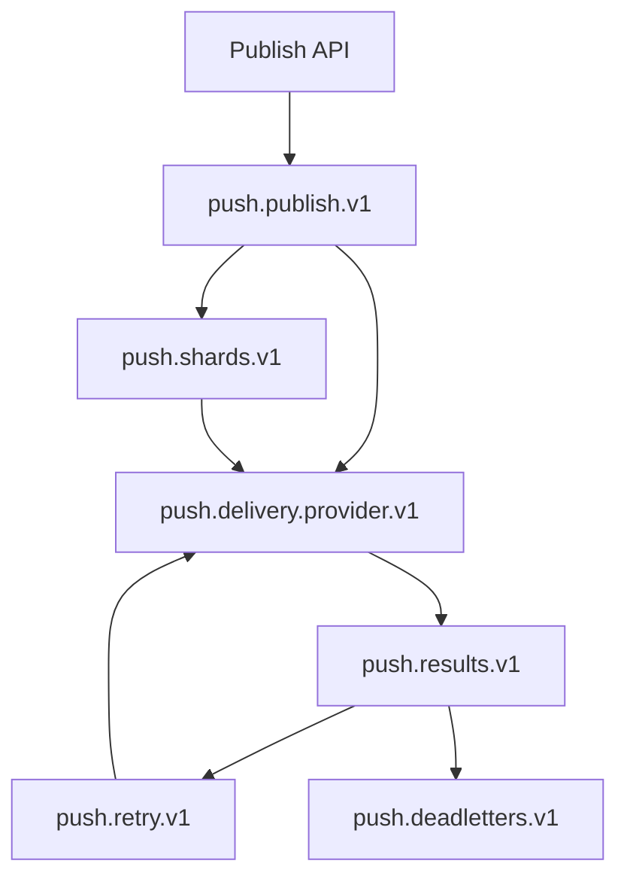

This page is the operator's guide to a running push pipeline: what to measure, what to alert on,
how to inspect and replay dead letters, and what to do when a provider or a node fails. Read it
before your first production campaign, and keep it open during an incident. For the API and
delivery model itself, see [Push notifications](/docs/server/push-notifications).

Push operations revolve around five questions:

1. Is work being admitted?
2. Is it moving through each queue stage?
3. Are providers accepting it?
4. Can stale queued work be repaired?
5. Is old operational state being cleaned up?

## Queue stages

Accepted publishes move through a fixed set of queue stages. Metrics label each stage with a stable
`stage` value, which is what you alert on.



| Queue topic | Metric `stage` label | Consumer | Lag usually means |
| --- | --- | --- | --- |
| `push.publish.v1` | `publish_log` | Planner workers | Planner capacity or queue health. |
| `push.shards.v1` | `shard_jobs` | Shard workers | Large channel fanout. |
| `push.delivery.<provider>.v1` | `delivery_jobs_<provider>` | Provider workers | Provider throughput or credentials. |
| `push.results.v1` | `delivery_results` | Feedback workers | Feedback or status-store write capacity. |
| `push.retry.v1` | `retry_schedule` | Retry scheduler workers | Provider outage or retry policy. |
| `push.deadletters.v1` | `dead_letters` | Operators | Work that needs inspection and replay. |

Small publishes go straight from the planner to provider delivery (`fastPath`); publishes at or
above `push.fanout_fast_threshold` expected recipients are split into shards first (`shardPath`).

## Backpressure

Publish admission rejects new work before a backlog becomes unbounded. When a threshold is crossed,
`POST /apps/{appId}/push/publish` returns `429` with `Retry-After`.

| Control | Default | Effect |
| --- | --- | --- |
| `PUSH_PUBLISH_LOG_MAX_LAG` | `100000` | Maximum `publish_log` depth before admission returns `429`. |
| `PUSH_CRITICAL_QUEUE_MAX_LAG` | `100000` | Maximum depth for the other critical stages. |
| `push.backpressure_lag_threshold_secs` / `PUSH_BACKPRESSURE_LAG_THRESHOLD_SECS` | `60` | Oldest ready or inflight item age tolerated. `0` relies only on depth. |
| `PUSH_BACKPRESSURE_RETRY_AFTER_SECONDS` | `5` | `Retry-After` value sent with queue backpressure. |
| `PUSH_BACKPRESSURE=true` | unset | Forces admission to return `429` (manual brake during an incident). |

<Callout type="tip" title="Use the manual brake during provider outages">
Setting `PUSH_BACKPRESSURE=true` stops new admission while existing work drains and retries. It is
a faster, safer lever than scaling workers into a provider that is already throttling you.
</Callout>

## Retention and cleanup

The monolith push cleanup worker runs when `push.cleanup_interval_secs > 0`.

| State | Retention |
| --- | --- |
| Terminal publish statuses | `push.publish_status_ttl_days` |
| Delivery events | `push.analytics_retention_days` |
| Operator invalidation events | `push.analytics_retention_days` |
| Expired idempotency records | The record `expires_at_ms`; legacy non-epoch expiries are retained |
| Expired scheduler locks | Removed after `expires_at_ms` |
| Completed scheduled jobs | Deleted synchronously when emitted or cancelled |
| Active scheduled jobs and active retries | Retained until they run, expire, or are cancelled |
| Credentials, templates, and active device registrations | Never removed by cleanup |

Cleanup is bounded by `push.cleanup_batch_size` per category and
`push.cleanup_max_deleted_per_tick` overall. SQL stores use bounded deletes. Document stores clean
new writes through internal app and time indexes where available; families without a time index are
cleaned by bounded app-partition scans. Memory cleanup is for tests and local development only.

```toml title="config.toml (defaults)"
[push]
publish_status_ttl_days = 30
analytics_retention_days = 30
cleanup_interval_secs = 300
cleanup_batch_size = 1000
cleanup_max_deleted_per_tick = 100000
```

## Dead letters

Dead-letter queue messages remain owned by the configured queue backend. Operators can inspect
queue-native dead-letter metadata through `GET /apps/{appId}/push/deadLetters`, filter by
`provider` (`fcm`, `apns`, `webpush`, `hms`, or `wns`), `sinceMs`, and `untilMs`, and page with
`limit` (1 to 1000) plus `cursor`. Both endpoints require the `push-admin` capability.

```http
GET /apps/{appId}/push/deadLetters?provider=apns&sinceMs=1725000000000&limit=50
x-sockudo-push-capability: push-admin
```

```json title="200 OK"
{
  "items": [
    {
      "deadLetterId": "dl_01J...",
      "appId": "my-app",
      "publishId": "order-ord_123-packed",
      "provider": "apns",
      "stage": "delivery_result",
      "key": "BATCH_ID",
      "reason": "PROVIDER_ERROR_CLASS",
      "occurredAtMs": 1725000123456,
      "replayable": true
    }
  ],
  "next_cursor": null,
  "has_more": false
}
```

Responses include safe metadata only: dead-letter id, app/publish ids, provider when known, stage,
key, reason, timestamp, and `replayable`. They do not expose original push payloads, recipient
tokens, endpoints, or credential material.

Use `POST /apps/{appId}/push/deadLetters/{deadLetterId}/replay` to re-enqueue a replayable
dead-letter's original queue item after fixing the underlying incident:

```json title="202 Accepted"
{
  "deadLetterId": "dl_01J...",
  "replayed": true,
  "messageId": "..."
}
```

Marker-only dead letters that were emitted without retained original queue payload stay
inspectable but are returned as `replayable: false`. Replaying one returns `400` with the reason;
an unknown id returns `404`.

<Callout type="warn" title="Fix the cause before replaying">
Replay re-enqueues the original work unchanged. If the credential, topic, or provider incident is
still active, the replayed work will fail and dead-letter again.
</Callout>

## Metrics

Watch these metrics by app, provider, stage, or bounded category labels:

| Signal | Metrics |
| --- | --- |
| Admission | `sockudo_push_publish_accepted_total`, `sockudo_push_quota_acceptance_rejections_total` |
| Queue lag | `sockudo_push_publish_log_lag_seconds`, `sockudo_push_delivery_jobs_lag_seconds`, `sockudo_push_queue_oldest_age_seconds`, queue backend lag |
| Provider outcomes | `sockudo_push_dispatched_total`, `sockudo_push_dispatch_duration_seconds`, `sockudo_push_provider_failures_total` |
| Retries | `sockudo_push_retry_scheduled_total`, `sockudo_push_retry_attempted_total`, `sockudo_push_retry_deferred_total`, `sockudo_push_retry_expired_total`, `sockudo_push_retry_malformed_total` |
| Dead letters | `sockudo_push_retry_dead_lettered_total`, dead-letter queue depth, `GET /apps/{appId}/push/deadLetters` |
| Repair | `sockudo_push_repair_scanned_total`, `sockudo_push_repair_requeued_total`, `sockudo_push_repair_skipped_total` |
| Credentials | `sockudo_push_provider_failures_total{failure_class="credential_auth"}` |
| Device invalidation | `sockudo_push_token_invalidations_total`, `sockudo_push_token_invalidation_guard_total` |
| Status integrity | `sockudo_push_invariant_violations_total`, `sockudo_push_status_cas_conflicts_total`, `sockudo_push_status_cas_exhausted_total` |
| Live Activities | `sockudo_push_apns_live_activity_requests_total` |
| Cleanup | `sockudo_push_cleanup_scanned_total`, `sockudo_push_cleanup_deleted_total`, `sockudo_push_cleanup_errors_total`, `sockudo_push_cleanup_tick_duration_seconds` |
| Worker health | `sockudo_push_worker_exits_total` |

`sockudo_push_queue_oldest_age_seconds` carries a `stage` label (see [Queue stages](#queue-stages))
and a `state` label of `ready` or `inflight`. `failure_class` values are `device_terminal`,
`device_transient`, `provider_transient`, `provider_quota`, `credential_auth`, `caller_payload`,
`network_transport`, and `unknown`.

<Callout type="warn" title="Keep label cardinality bounded">
Do not add labels for `publish_id`, `device_id`, tokens, endpoint URLs, or raw provider reasons.
</Callout>

## Alerts

Start with these alert shapes and tune them against normal traffic:

| Alert | Suggested condition |
| --- | --- |
| Retry backlog age | `sockudo_push_queue_oldest_age_seconds` for `retry_schedule` ready or inflight work exceeds the retry SLO |
| Dead-letter rate | `sockudo_push_retry_dead_lettered_total` increases above baseline |
| Provider auth failures | `sockudo_push_provider_failures_total{failure_class="credential_auth"}` is nonzero |
| Invalidation spike | `sockudo_push_token_invalidation_guard_total` is nonzero or invalidation ratio jumps |
| Dispatching age | publish statuses remain `dispatching` beyond retry max elapsed plus provider timeout |
| Queue lag | critical stage depth crosses `PUSH_CRITICAL_QUEUE_MAX_LAG` or oldest actionable age crosses `PUSH_BACKPRESSURE_LAG_THRESHOLD_SECS` |
| Repair requeues | `sockudo_push_repair_requeued_total` increases outside a queue-loss or worker-crash incident |
| Status write exhaustion | `sockudo_push_status_cas_exhausted_total` increases |
| Worker exits | `sockudo_push_worker_exits_total` increases |
| Cleanup failures | `sockudo_push_cleanup_errors_total` increases |

## Runbooks

### APNs outage

<Steps>

1. Confirm `sockudo_push_provider_failures_total{provider="apns"}` and the APNs HTTP status family.

2. If failures are `credential_auth`, rotate or roll back the APNs key/topic/environment
   configuration and restart provider workers so credentials reload.

3. If failures are provider transient or quota, keep devices intact, watch retry and dead-letter
   rate, and reduce campaign admission until `push.delivery.apns.v1` lag drains.

</Steps>

### FCM outage

<Steps>

1. Separate project/auth failures from provider `5xx` or quota responses using
   `sockudo_push_provider_failures_total{provider="fcm",failure_class=...}`.

2. For auth failures, fix the service account or stored credential and restart workers.

3. For a provider outage, leave device registrations in place, verify retries are scheduled, and
   throttle new fanout if retry lag or publish-log lag crosses the configured backpressure
   thresholds.

</Steps>

### Credential rotation failure

<Steps>

1. Stop new publishes for the affected provider if admission is still accepting work.

2. Restore the last known-good credential or upload a corrected credential, then restart provider
   workers.

3. Watch `credential_auth` failures, provider worker exits, and `dispatching` publish age.

4. Replay dead letters marked `replayable` that failed during the incident, or republish from the
   original source.

</Steps>

<Callout type="warn" title="Credential failures are not device failures">
Do not delete devices for credential failures. Sockudo never increments device failure counts for
`credential_auth`, and purging the registry would turn a recoverable incident into permanent
audience loss.
</Callout>

### Dead node with pending queue work

Use the queue backend's visibility timeout and redelivery tools first. Sockudo queue adapters keep a
bounded local ready/pending handoff; if a node dies, broker redelivery depends on the selected
backend. After the replacement worker starts, verify `push.publish.v1`, `push.shards.v1`,
`push.results.v1`, `push.retry.v1`, and provider delivery stages are draining.

### Backlog or backpressure

Check which stage crossed lag first. Publish-log lag points to planner capacity or queue health.
Shard lag points to channel fanout. Provider delivery lag points to provider throughput or
credentials. Retry lag points to provider outage or retry policy. Use
`sockudo_push_queue_oldest_age_seconds` to separate a shallow but stale stage from ordinary depth
growth. Dead-letter lag means operators need to inspect `GET /apps/{appId}/push/deadLetters`, fix
the underlying provider/credential/queue incident, then replay only entries marked `replayable` or
republish from the original source.

### Publish-log repair

When `push.repair_interval_secs > 0`, the monolith repair worker scans durable publish-log entries
that are still in `queued` state after `push.repair_min_age_secs` and re-enqueues the missing
`push.publish.v1` queue item. It is meant for accepted publish work whose queue message was lost or
acknowledged by a crashing worker before planning began. It does not recreate active retry,
provider-delivery, or terminal publish work.

```toml title="config.toml (defaults)"
[push]
repair_interval_secs = 30
repair_min_age_secs = 30
repair_batch_size = 100
```

## Next steps

<Cards>
  <Card title="Push notifications" href="/docs/server/push-notifications" description="Delivery model, publish API, provider credentials, and device invalidation." />
  <Card title="Apple Live Activities" href="/docs/server/apple-live-activities" description="ActivityKit delivery, broadcast channels, and APNs failure handling." />
  <Card title="Observability" href="/docs/server/observability" description="Prometheus metrics, logging, and tracing across the server." />
  <Card title="Scaling" href="/docs/server/scaling" description="Horizontal deployment and queue backends for multi-node clusters." />
</Cards>
