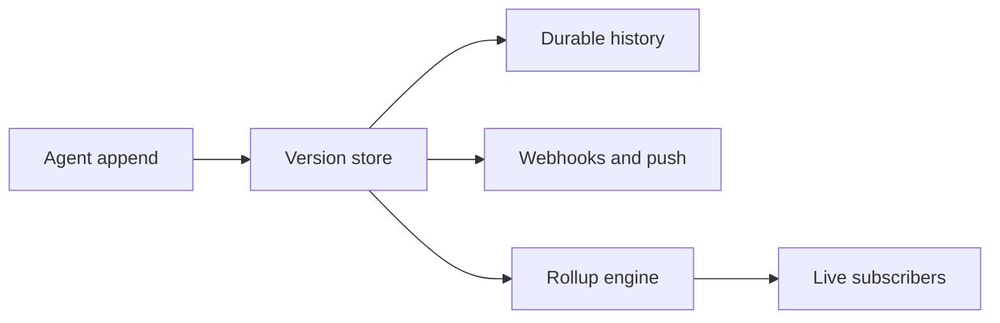

Append rollup coalesces bursts of `message.append` operations into fewer WebSocket frames, so a
model streaming hundreds of tokens per second does not send hundreds of frames per second to every
subscriber. This page explains what rollup changes, what it deliberately does not change, and how
to tune it. You need it when you stream fast models to many devices, or when you are diagnosing
added latency or low fanout savings.

## Why rollup exists

An agent typically appends one small fragment per model chunk. At 200 tokens per second with five
subscribed devices, that is 1,000 tiny frames per second for a single answer, most of which a UI
renders faster than a person can read. Rollup holds appends for a short window and delivers them as
one frame. At the default 40 ms window, a steady stream is capped near 25 deliveries per second per
stream, and no text is lost.

## What rollup never changes

Sockudo persists every versioned `message.append` operation exactly as received. Append rollup only
changes WebSocket egress: the version store, durable history, recovery, and latest-message reads
still observe the unrolled mutation log.



Rollup sits at the very end of the pipeline, after everything durable has already happened. That
placement is what makes it safe:

- **Correctness is the reduced state.** A client that folds every original append and a client that
  received coalesced frames end with the identical message, because rollup only merges adjacent
  fragments of one stream.
- **Recovery never depends on a buffer.** A reconnecting or late-joining subscriber rebuilds state
  from history and the version store, never from in-memory rollup state. A node can drop its rollup
  buffers (restart, crash) without losing data.
- **Accounting stays honest.** Billing, rate limits, durable history, version storage, webhooks,
  and push accounting count original create/update/delete/append requests, so coalescing cannot hide
  ingress load.

## Configure rollup

Enable the `ai-transport` Cargo feature and runtime AI Transport config before using rollup:

```toml title="config.toml"
[ai_transport]
enabled = true

[[ai_transport.channels]]
prefix = "private-ai-"

[ai_transport.rollup]
enabled = true
default_window_ms = 40
min_window_ms = 0
max_window_ms = 500
orphan_ttl_ms = 60000
wheel_tick_ms = 5
shards = 64
```

| Key | Default | Meaning |
| --- | --- | --- |
| `enabled` | `true` | Turns egress coalescing on for AI channels. |
| `default_window_ms` | `40` | Coalescing window applied to channel fanout. |
| `min_window_ms` | `0` | Smallest window a client may request. |
| `max_window_ms` | `500` | Largest window a client may request. |
| `orphan_ttl_ms` | `60000` | How long a `streaming` message may go without a terminal update before the orphan janitor cancels it. |
| `wheel_tick_ms` | `5` | Scheduler tick interval. |
| `shards` | `64` | Number of scheduler shards. |

## Choose a window

The WebSocket query parameter `append_rollup_window` is accepted only for Protocol V2 and must be
one of the locked values below, and within `[min_window_ms, max_window_ms]`. Any other value fails
the WebSocket upgrade with HTTP `400`.

| `append_rollup_window` | Behavior |
| --- | --- |
| `0` | Disable coalescing; every append fan-out counts individually. |
| `20` | Short coalescing window for lower added latency. |
| `40` | Default; caps a steady stream near 25 deliveries per second. |
| `100` | Heavier coalescing for overloaded subscribers. |
| `500` | Maximum supported coalescing window. |

<Callout type="note" title="The server currently applies one window per node">
Current server v1 semantics use server-wide per `(app_id, channel, message_serial)` coalescing at
`[ai_transport.rollup].default_window_ms`. The query parameter is validated for SDK compatibility
but does not allocate per-subscriber rollup state. Tune latency and savings with
`default_window_ms`.
</Callout>

With the JavaScript SDK, pass the window and append delivery mode when you create the client:

```ts title="src/realtime.ts"
import { createSockudoRealtimeClient } from "@sockudo/ai-transport";

export const realtime = await createSockudoRealtimeClient("app-key", {
  clientOptions: { wsHost: "realtime.example.com", forceTLS: true },
  appendRollupWindow: 40,
  appendMode: "delta",
});
```

`append_mode=delta` (the V2 default) delivers live `sockudo:message.append` frames whose `data` is
only the new fragment. `append_mode=full` delivers the accumulated message on every live append.
Both modes reduce to the same final message.

## How coalescing works

<Steps>

1. **The first append is immediate.** A new stream's first append is delivered without waiting, so
   the user sees output as soon as the model produces it.

2. **Later appends inside the window are held.** Subsequent appends to the same
   `(app_id, channel, message_serial)` are merged: the delivered frame carries the latest append's
   envelope and the concatenation of every held fragment, so delta subscribers receive all text.

3. **The window closes and one frame goes out.** When the deadline passes, the merged append is
   fanned out to subscribers.

4. **Terminal operations flush first.** An append whose `extras.ai.transport.status` is `complete`
   or `cancelled`, and any `message.update` or `message.delete`, flushes pending append state before
   delivering the terminal operation. A terminal operation can never overtake text that preceded it.

</Steps>

## Scheduler internals

The scheduler keeps sharded flush and orphan deadline heaps. A tick peeks one heap per shard and
only pops due entries; it does not scan active streams. Generation tokens make rescheduled and
terminally removed deadlines harmless. The first append retains timing metadata only after its
immediate fanout. Pending payload state is allocated when a later append actually needs
coalescing.

Deadline discovery and delivery are two phases. The worker enters the existing per-channel publish
ordering gate before claiming a generation token, so a concurrent terminal mutation either flushes
the pending append itself or waits behind the claimed delivery. Deferred context retains the app,
channel, excluded socket/echo decision, full-message versus delta choice, original envelope, and
continuity position.

The worker processes at most 4,096 due or retry entries per tick and at most 16 channels
concurrently. Messages within one channel remain sequential. App lookup and ordering-gate
backpressure use a bounded 4,096-entry retry queue. Once a due delivery is claimed, its three
fanout attempts stay inside the same channel ordering permit so a terminal mutation cannot
overtake a retry. Exhaustion is logged with `outcome="reset_required"`; it is never treated as a
successful delivery. Scheduler deadlines use a monotonic runtime clock and are unaffected by
wall-clock corrections. Graceful shutdown stops deadline intake, drains pending content in bounded
chunks, finishes bounded retries, and only then allows connection teardown.

## Metrics

Prometheus exposes low-cardinality rollup metrics per app:

| Metric | What it tells you |
| --- | --- |
| `sockudo_appends_received_total` | Original appends received by rollup (ingress). |
| `sockudo_appends_delivered_total` | Append deliveries emitted after coalescing (egress). |
| `sockudo_rollup_ratio` | Input appends represented by one rollup output. Higher means more savings. |
| `sockudo_active_streams` | Streams currently tracked by the rollup engine. |
| `sockudo_flush_latency` | Rollup flush latency in milliseconds. Compare it to the configured window. |

`sockudo_active_streams` counts rollup streams; `sockudo_ai_active_streams` counts AI lifecycle
streams from the observability tracker. Both should return to baseline once runs finish.

Rollup metrics count both original append receipt and coalesced egress delivery, so operators can
see the reduction ratio without hiding ingress load. Active-stream gauges are changed by exact
insertion/removal deltas. Publishing a gauge does not lock or scan scheduler shards.

<Callout type="tip" title="Tuning in one sentence">
If `sockudo_flush_latency` is close to your latency budget, lower `default_window_ms`; if
`sockudo_rollup_ratio` stays near `1` under heavy streams, raise it.
</Callout>

## Edge cases

- A terminal append flushes pending state before delivering the terminal operation.
- `message.update` and `message.delete` flush pending append state first.
- A late subscriber reconstructs state from history/version storage, not from rollup buffers.
- A node that sees a stale stream after `orphan_ttl_ms` claims it through shared cache and appends a
  normal cancellation update; the latest version is re-read before mutation to avoid cancelling a
  stream that advanced on another node.
- `append_rollup_window=0` disables egress coalescing but does not change persistence or rate-limit
  behavior.

## Benchmarks and load tests

The scheduler exposes `RollupEngine::tracking_overhead_bytes_per_stream()` for the inline tracking
footprint, excluding key and payload allocations. The permanent Criterion matrix measures 2,000
and 50,000 independent streams for empty tick, one-percent due, all due, and terminal-storm
workloads:

```bash
cargo bench -p sockudo-ai-transport --bench rollup_engine -- --noplot
```

`rollup_scheduler::at_least_999_per_mille_due_by_window_plus_five_ms_under_documented_load`
locks the deadline boundary at a 40 ms window, 5 ms tick allowance, and 2,000 independent streams.

Run `scripts/ai-rollup-load-test.mjs` against a local server to exercise a synthetic `200 tok/s`
stream and inspect delivery rate, final content, and append mutation latency.

## Next steps

<Cards>
  <Card title="AI Transport overview" href="/docs/server/ai-transport-overview" description="The run lifecycle and the session channel model." />
  <Card title="Production operations" href="/docs/server/ai-transport-production-ops" description="Alert thresholds for flush latency and rollup ratio." />
  <Card title="Limits and quotas" href="/docs/server/ai-transport-limits-quotas" description="Append counts, accumulated bytes, and open-stream caps." />
  <Card title="Mutable messages" href="/docs/server/mutable-messages" description="How appends are aggregated and stored." />
</Cards>
