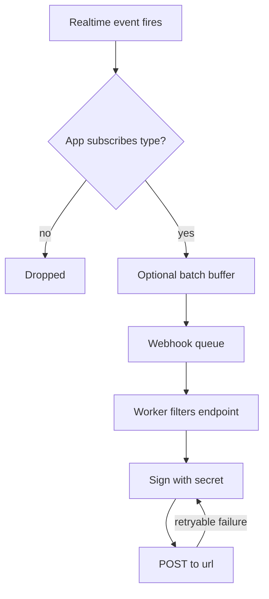

Webhooks let Sockudo tell your backend when something happens on the realtime side: a channel
gains its first subscriber, a presence member leaves, a client sends an event, a message gets a new
version, or an AI run ends. Use them to keep your own database, analytics, or workflows in sync
with realtime state without polling the HTTP API. Delivery is asynchronous and can repeat, so every
handler must be idempotent.

## How delivery works

Webhooks are configured per app and delivered by a background worker that consumes the server's
`[queue]`. When an event fires, Sockudo checks whether any of the app's webhooks subscribes to that
event type. If none does, nothing is enqueued. Otherwise the event becomes a queue job, and a worker
filters it per endpoint, signs the body with the app secret, and POSTs it.



Three things follow from this design:

- **Webhooks need a queue.** With `[queue] driver = "none"` (or a queue that fails to initialize)
  webhooks are disabled. The `memory` driver works for single-node development but loses pending
  jobs when the process exits; use a broker-backed driver such as Redis in production.
- **Delivery is at least once, not exactly once.** A timeout, retry, or worker restart can deliver
  the same event again.
- **Order is not guaranteed.** Each node sends up to 20 deliveries concurrently and retries run in
  the background. Use `time_ms` and the identifiers inside each event, not arrival order.

## Configure an endpoint

Webhook endpoints belong to an app. In the TOML array app manager, add one
`[[app_manager.array.apps.policy.webhooks]]` table per endpoint:

```toml title="config.toml"
[[app_manager.array.apps]]
id = "app-id"
key = "app-key"
secret = "app-secret"
enabled = true

[[app_manager.array.apps.policy.webhooks]]
url = "https://api.example.com/sockudo/webhooks"
event_types = ["channel_occupied", "channel_vacated", "member_added", "member_removed"]
request_timeout_ms = 5000

[app_manager.array.apps.policy.webhooks.filter]
channel_prefix = "presence-"

[app_manager.array.apps.policy.webhooks.headers]
X-Webhook-Source = "sockudo"
```

Database and JSON app managers use the same fields in a top-level `webhooks` array on the app
record:

```json
{
  "id": "app-id",
  "key": "app-key",
  "secret": "app-secret",
  "webhooks": [
    {
      "url": "https://api.example.com/sockudo/webhooks",
      "event_types": ["channel_vacated"],
      "headers": { "X-Webhook-Source": "sockudo" },
      "filter": { "channel_prefix": "private-" }
    }
  ]
}
```

| Field | Description |
| --- | --- |
| `url` | HTTPS endpoint that receives a signed `POST`. |
| `lambda` | `{ function_name, region }` to invoke an AWS Lambda function instead of HTTP. Requires the `lambda` Cargo feature (included in `full`). |
| `lambda_function` | Legacy Lambda function name. Uses region `us-east-1`; prefer `lambda`. |
| `event_types` | Event names this endpoint receives. Required; an event not listed here is never sent to this endpoint. |
| `filter` | Optional channel filter. See [Filter by channel](#filter-by-channel). |
| `headers` | Extra HTTP headers added to every request to this endpoint. |
| `retry` | Per-endpoint override of any `[webhooks.retry]` field. Unset fields fall back to the server value. |
| `request_timeout_ms` | Per-endpoint override of `[webhooks] request_timeout_ms`. |

<Callout type="note" title="Lambda deliveries are fire-and-forget">
Lambda endpoints are invoked asynchronously (`Event` invocation type) with the same JSON body as
HTTP deliveries. They do not carry `X-Pusher-Signature`, and Sockudo does not apply
`[webhooks.retry]` to them; AWS handles asynchronous invocation retries.
</Callout>

### Filter by channel

A filter narrows an endpoint to a subset of channels. Every field you set must match; fields you
omit always pass.

| Filter field | Matches when |
| --- | --- |
| `channel_prefix` | The channel name starts with this string. |
| `channel_suffix` | The channel name ends with this string. |
| `channel_pattern` | The channel name matches this regular expression. |
| `channel_namespace` | The channel's namespace equals this value. |
| `channel_namespaces` | The channel's namespace is one of these values. |

The namespace is the part before the first `:` after Sockudo strips the channel type prefix
(`private-`, `presence-`, `private-encrypted-`, and the `cache-` variants). For example,
`presence-chat:room-1` has the namespace `chat`.

<Callout type="warn" title="An invalid regex silences the endpoint">
If `channel_pattern` is not a valid regular expression, the endpoint matches no channels and
receives nothing. Sockudo logs `invalid webhook channel_pattern regex` at warn level.
</Callout>

## Delivery settings

Server-wide delivery behavior lives under `[webhooks]`. These settings apply to every app; the
`retry` and `request_timeout_ms` values can be overridden per endpoint.

```toml title="config.toml"
[webhooks]
request_timeout_ms = 10000

[webhooks.batching]
enabled = false
duration = 50
size = 100

[webhooks.retry]
enabled = true
max_attempts = 5
max_elapsed_time_ms = 300000
initial_backoff_ms = 1000
max_backoff_ms = 60000
```

| Key | Built-in default | Description |
| --- | --- | --- |
| `request_timeout_ms` | `10000` | Timeout for a single HTTP attempt. |
| `batching.enabled` | `true` | Buffer events in memory and enqueue them as multi-event jobs. The shipped `config/config.toml` sets `false`. |
| `batching.duration` | `50` | Flush interval for the batch buffer, in milliseconds. |
| `batching.size` | `100` | Maximum events per delivered request when batching. |
| `retry.enabled` | `true` | Retry retryable failures. |
| `retry.max_attempts` | unset | Total attempts, including the first. Unset means only `max_elapsed_time_ms` bounds retries. The shipped config sets `5`. |
| `retry.max_elapsed_time_ms` | `300000` | Retry budget measured from the first attempt. |
| `retry.initial_backoff_ms` | `1000` | Delay before the first retry. |
| `retry.max_backoff_ms` | `60000` | Upper bound for the doubling backoff. |

Batching can also be set with `WEBHOOK_BATCHING_ENABLED`, `WEBHOOK_BATCHING_DURATION`, and
`WEBHOOK_BATCHING_SIZE`. See [environment variables](/docs/reference/environment-variables#webhooks).

### Batching

With batching off, every event becomes its own queue job and its own HTTP request. With batching
on, events accumulate in an in-process buffer that flushes every `batching.duration` milliseconds.
Consecutive events for the same app are merged into jobs of at most `batching.size` events, so one
request can carry many events. The envelope's `time_ms` is then the earliest event time in the batch.

AI Transport lifecycle events (`ai_run_started`, `ai_run_ended`, `ai_cancel_requested`,
`ai_stream_orphaned`, and the legacy `ai_turn_*` events) always bypass the batch buffer and go
straight to the queue, so queue backpressure applies to them directly.

<Callout type="tip" title="Always iterate over events">
Write handlers that loop over `events`, even with batching off. The envelope shape is the same in
both modes, so turning batching on later needs no receiver change.
</Callout>

## The request

Each HTTP delivery is a `POST` with a JSON body:

```http
POST /sockudo/webhooks HTTP/1.1
Content-Type: application/json
X-Pusher-Key: app-key
X-Pusher-Signature: 3b1f6c0a5e...e9d2

{"time_ms":1767225600000,"events":[{"name":"channel_occupied","channel":"presence-chat:room-1"}]}
```

| Part | Meaning |
| --- | --- |
| `X-Pusher-Key` | The app key. Use it to pick the secret when one receiver serves several apps. |
| `X-Pusher-Signature` | Lowercase hex HMAC-SHA256 of the raw request body, keyed with the app secret. |
| `time_ms` | Unix time in milliseconds when the event (or earliest batched event) was created. |
| `events` | Array of event objects. Each has a `name` and, for every current event type, a `channel`. |

Custom `headers` from the endpoint config are added to every request. Builds with OpenTelemetry
also add trace-context propagation headers.

The signature covers the exact body sent to that endpoint. Because endpoints receive only the
events they subscribe to, two endpoints can receive different bodies and different signatures for
the same underlying events.

## Verify signatures

<Steps>

1. Capture the raw request body before any JSON parsing. Re-serializing parsed JSON changes the
   bytes and breaks the signature.
2. Look up the secret for the `X-Pusher-Key` header.
3. Compute HMAC-SHA256 of the raw body with that secret and compare it to `X-Pusher-Signature`
   in constant time.
4. Reject the request with `401` if it does not match. Only then parse and process `events`.

</Steps>

With the Node server SDK:

```ts title="webhooks.ts" {4-7}
import express from "express";

app.post("/sockudo/webhooks", express.raw({ type: "application/json" }), (req, res) => {
  const webhook = sockudo.webhook({
    rawBody: req.body.toString("utf8"),
    headers: req.headers,
  });

  if (!webhook.isValid()) {
    return res.status(401).send("invalid signature");
  }

  for (const event of webhook.getEvents()) {
    enqueueWebhookEvent(event);
  }

  res.sendStatus(200);
});
```

The SDK also checks that `Content-Type` is exactly `application/json`. During a secret rotation,
pass the previous credentials so both are accepted:

```ts
webhook.isValid([{ key: "app-key", secret: process.env.SOCKUDO_PREVIOUS_SECRET! }]);
```

Without an SDK, verification is a few lines:

```ts title="verify.ts"
import { createHmac, timingSafeEqual } from "node:crypto";

export function verifySockudoWebhook(rawBody: string, signature: string, secret: string): boolean {
  const expected = createHmac("sha256", secret).update(rawBody).digest("hex");
  const a = Buffer.from(expected);
  const b = Buffer.from(signature ?? "");
  return a.length === b.length && timingSafeEqual(a, b);
}
```

## Event reference

Subscribe to an event by adding its name to `event_types`. Every example below shows one element
of the `events` array.

| Event | Fires when |
| --- | --- |
| `channel_occupied` | A subscribe brings a channel's subscriber count to 1. |
| `channel_vacated` | A channel's subscriber count reaches 0 and is still 0 three seconds later. |
| `subscription_count` | The subscriber count of a non-presence channel changes. |
| `member_added` | A user's first connection joins a presence channel. |
| `member_removed` | A user's last connection leaves a presence channel. |
| `member_updated` | A Protocol V2 client updates its presence data. |
| `client_event` | A client sends a client event (or an AI event frame). |
| `cache_miss` | A client subscribes to a cache channel that has no cached event. |
| `message_version_created` | A version of a versioned message is committed. |
| `annotation_created` | An annotation is published. |
| `annotation_deleted` | An annotation is deleted. |
| `ai_run_started` | An AI Transport run starts. |
| `ai_run_ended` | An AI Transport run ends. |
| `ai_cancel_requested` | A cancel signal is published for an AI run. |
| `ai_stream_orphaned` | The orphan janitor closes a stale streaming message. |
| `ai_turn_started`, `ai_turn_ended` | Legacy aliases of `ai_run_started` and `ai_run_ended`. |

### Channel lifecycle

`channel_occupied` and `channel_vacated` describe whether a channel has any subscribers across the
cluster. `channel_vacated` is delayed by three seconds and re-checked, so a quick reconnect does not
produce a vacated/occupied pair.

```json
{ "name": "channel_occupied", "channel": "private-orders" }
```

```json
{ "name": "channel_vacated", "channel": "private-orders" }
```

`subscription_count` fires on every subscribe and unsubscribe for non-presence channels. Presence
channels use the member events instead.

```json
{ "name": "subscription_count", "channel": "private-orders", "subscription_count": 42 }
```

### Presence

Presence lifecycle events are:

- `member_added`
- `member_updated`
- `member_removed`

Presence lifecycle events use the `user_id` authorized for that channel in
`channel_data`. One socket can have different member IDs in different presence
channels, independently of its sign-in identity. On unsubscribe or disconnect,
`member_removed` identifies the member that joined that channel, and is emitted
only after that member's last connection leaves. The client presence event uses
the same channel-specific identity.

```json
{ "name": "member_added", "channel": "presence-chat:room-1", "user_id": "user-123" }
```

```json
{ "name": "member_removed", "channel": "presence-chat:room-1", "user_id": "user-123" }
```

`member_removed` is sent three seconds after the last connection leaves, and only if the user has
not reconnected to that channel in the meantime.

`member_updated` is emitted for Protocol V2 `sockudo:presence_update` frames. Its payload includes
`channel`, `user_id`, and `user_info` with the latest member data.

```json
{
  "name": "member_updated",
  "channel": "presence-chat:room-1",
  "user_id": "user-123",
  "user_info": { "name": "Ada", "status": "typing" }
}
```

### Client events

`client_event` carries the event name, the data the client sent, and the sender's socket ID.
`data` is passed through as sent: a string for Pusher-style clients, or a JSON value when the client
sent structured data.

```json
{
  "name": "client_event",
  "channel": "private-chat:room-1",
  "event": "client-typing",
  "data": "{\"typing\":true}",
  "socket_id": "123.456"
}
```

AI event frames published by clients also produce a `client_event` with `event` set to `ai-event`
and `data` set to `null`.

<Callout type="note" title="No user_id on presence client events">
Pusher includes `user_id` on `client_event` webhooks from presence channels. Sockudo currently
omits it. If you need the sender's identity, resolve it from `socket_id` in your own records.
</Callout>

Messages marked with `extras.ephemeral` never produce `client_event` webhooks.

### Cache channels

`cache_miss` fires when a client subscribes to a `cache-`, `private-cache-`,
`private-encrypted-cache-`, or `presence-cache-` channel that has no cached event. Use it to
publish an initial value.

```json
{ "name": "cache_miss", "channel": "cache-prices", "data": "{}" }
```

### Versioned messages

`message_version_created` fires once for every committed version: the original create and each
update, delete, or append. `action` is `message.create`, `message.update`, `message.delete`, or
`message.append`. See [mutable messages](/docs/server/mutable-messages) for how the serials relate.

```json
{
  "name": "message_version_created",
  "channel": "chat:room-1",
  "message_serial": "00000000000000000001:node:00000000000000000001",
  "version_serial": "00000000000000000001:node:00000000000000000002",
  "action": "message.update"
}
```

The pair `message_serial` + `version_serial` identifies one version and makes a natural
deduplication key.

### Annotations

Annotation webhooks include `channel`, `message_serial`, `annotation_serial`, and
`annotation_type`; delete events also include `deleted_annotation_serial`.

```json
{
  "name": "annotation_created",
  "channel": "chat:room-1",
  "message_serial": "00000000000000000001:node:00000000000000000001",
  "annotation_serial": "00000000000000000001:node:00000000000000000007",
  "annotation_type": "reaction:distinct.v1"
}
```

```json
{
  "name": "annotation_deleted",
  "channel": "chat:room-1",
  "message_serial": "00000000000000000001:node:00000000000000000001",
  "annotation_serial": "00000000000000000001:node:00000000000000000009",
  "deleted_annotation_serial": "00000000000000000001:node:00000000000000000007",
  "annotation_type": "reaction:distinct.v1"
}
```

### AI Transport

AI Transport event types are:

- `ai_run_started`
- `ai_run_ended`
- `ai_cancel_requested`
- `ai_stream_orphaned`

Legacy `ai_turn_started` and `ai_turn_ended` event types are still accepted for existing webhook
consumers, but new integrations should subscribe to `ai_run_started` and `ai_run_ended`. The legacy
events carry `turn_id` instead of `run_id`.

```json
{
  "name": "ai_run_started",
  "channel": "private-ai-chat",
  "run_id": "run-42",
  "client_id": "user-123"
}
```

`ai_run_ended` includes `reason` and optional `error_code`. `reason` is one of `complete`,
`cancelled`, `error`, or `unknown`. A suspended run does not emit `ai_run_ended`.

```json
{
  "name": "ai_run_ended",
  "channel": "private-ai-chat",
  "run_id": "run-42",
  "reason": "error",
  "error_code": "provider_timeout"
}
```

`ai_cancel_requested` includes both `run_id` and the legacy `turn_id` alias:

```json
{
  "name": "ai_cancel_requested",
  "channel": "private-ai-chat",
  "run_id": "run-42",
  "turn_id": "run-42",
  "client_id": "user-123"
}
```

`ai_stream_orphaned` is emitted when the distributed orphan janitor closes a stale streaming
message after `ai_transport.rollup.orphan_ttl_ms`:

```json
{
  "name": "ai_stream_orphaned",
  "channel": "private-ai-chat",
  "message_serial": "00000000000000000001:node:00000000000000000001",
  "reason": "orphan_timeout"
}
```

`run_id`, `client_id`, and `error_code` are `null` when the run did not carry them. To persist
completed runs from these events, see [persist completed AI runs](/docs/server/observability#persist-completed-ai-runs).

## Retries and response codes

Your response status tells Sockudo whether to try again:

| Your response | Sockudo does |
| --- | --- |
| Any `2xx` | Marks the delivery done. |
| `408`, `409`, `425`, `429`, or any `5xx` | Retries with backoff. |
| Timeout, connection error, or other transport failure | Retries with backoff. |
| Any other status (for example `400`, `401`, `404`) | Gives up immediately. No retry. |

Retries start after `initial_backoff_ms` and double each time, capped at `max_backoff_ms`. They stop
when `max_attempts` is reached, or when waiting for the next retry would exceed
`max_elapsed_time_ms` measured from the first attempt.

If in-process retries are exhausted, the queue job itself is retried by the queue backend and
dead-lettered after its attempt limit. On SQS that limit is the queue's `maxReceiveCount`, or
`queue.reliability.max_attempts` when no redrive policy exists. Delivery is at-least-once: when one
endpoint fails, a retried job re-POSTs the same batch to endpoints that already succeeded, so make
receivers idempotent.

<Callout type="warn" title="Only signal failure when a retry can help">
Return `2xx` for events that are valid but not useful to you, and record them as ignored. Return
`503` or `429` when you are temporarily unable to process. A `400` or `401` stops delivery of that
request permanently.
</Callout>

## Handle events idempotently

Events carry no delivery ID, so derive a deduplication key from the event itself:

| Event | Suggested key |
| --- | --- |
| `message_version_created` | `message_serial` + `version_serial` |
| `annotation_created`, `annotation_deleted` | `annotation_serial` |
| `ai_run_started`, `ai_run_ended`, `ai_cancel_requested` | `name` + `run_id` |
| `ai_stream_orphaned` | `message_serial` |
| Channel and presence events | Treat as state, not as a log: apply them so that replaying is harmless. |

For channel and presence events, store the latest known state (occupied, member present) and
compare `time_ms` before overwriting, instead of counting events.

```ts title="handler.ts"
async function enqueueWebhookEvent(event: SockudoWebhookEvent) {
  switch (event.name) {
    case "message_version_created":
      await jobs.enqueueOnce(`${event.message_serial}:${event.version_serial}`, event);
      break;
    case "member_added":
      await presence.markPresent(event.channel, event.user_id);
      break;
    case "member_removed":
      await presence.markAbsent(event.channel, event.user_id);
      break;
    default:
      await audit.record(event);
  }
}
```

Handlers should:

- verify the signature before any business logic
- return quickly and enqueue expensive work
- tolerate duplicates and out-of-order arrival
- preserve raw payloads for audit when compliance requires it

## Shutdown delivery

Graceful shutdown closes client connections promptly, but keeps webhook dependencies available
while their cleanup finishes. After the listener grace period, Sockudo waits for cleanup workers,
pending presence leases, and delayed `member_removed` and `channel_vacated` producers. It then
joins any in-flight batch enqueue and flushes the final buffer, even if the configured batch
interval has not elapsed. A V2 presence lease remains 15 seconds by default; the subsequent
reconnect check still delays the webhook by 3 seconds.

This drain has a budget of `queue.reliability.shutdown_timeout_ms`
(`QUEUE_SHUTDOWN_TIMEOUT_MS`, default 30000), separate from `shutdown_grace_period`. The memory
queue must finish its queued work before shutdown because it cannot retain jobs after exit.
If the final batch is only partly accepted, shutdown still drains accepted memory-queue jobs
within that budget before returning the enqueue error.
Broker-backed queues only need the final jobs enqueued before their normal worker shutdown;
pending durable jobs can be processed later. With the memory driver, a webhook endpoint that
fails delivery leaves the job in the delayed state for its retry backoff, so graceful
shutdown waits for those retries within the drain budget.

Keep the webhook receiver and queue/cache dependencies available during a rollout. Enqueue
failures are logged, and an exhausted drain budget warns that pending lifecycle events may be
lost. A hard kill or unavailable receiver can still prevent delivery. Allow your supervisor
enough time for both this drain and the queue worker shutdown budget, in addition to listener
grace and teardown. See [rolling deploys](/docs/server/scaling#rolling-deploys).

## Push notifications

Push delivery does not emit webhook events. Track push outcomes through the push publish status
API, metrics, and provider feedback described in [push operations](/docs/server/push-operations).

Sockudo retries a failed delivery in-process for `webhooks.retry.max_elapsed_time_ms`
(default 5 minutes). If it still fails, the queue job is retried by the queue
backend and dead-lettered after its attempt limit. On SQS that limit is the
queue's `maxReceiveCount`, or `queue.reliability.max_attempts` when no redrive
policy exists. Delivery is at-least-once: when one endpoint fails, a retried job
re-POSTs the same batch to endpoints that already succeeded. Make receivers
idempotent.

## Security

- Accept webhooks only over HTTPS.
- Validate the signature against the raw body before parsing business logic.
- Rotate app secrets with an overlap window, accepting old and new credentials during the switch.
- Use endpoint `headers` for an additional shared token if your gateway requires one; never put
  secrets in the URL.
- Avoid logging provider tokens, secrets, or encrypted payloads.
- Rate limit webhook endpoints separately from public API endpoints.

## Next steps

<Cards>
  <Card title="Mutable messages" href="/docs/server/mutable-messages" description="Understand message and version serials behind message_version_created." />
  <Card title="Observability" href="/docs/server/observability" description="Metrics, logs, and persisting completed AI runs from webhooks." />
  <Card title="Scaling" href="/docs/server/scaling" description="Queues, rolling deploys, and multi-node webhook delivery." />
  <Card title="Configuration reference" href="/docs/reference/configuration" description="Every [webhooks] and [queue] key in one place." />
</Cards>
